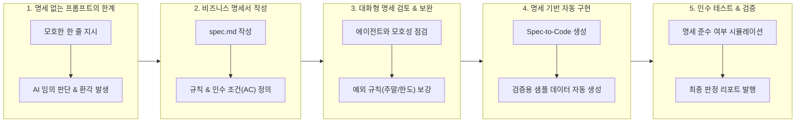

# Antigravity 명세 주도 개발(SDD) 비즈니스 핸즈온 가이드 (agy_sdd)

본 문서는 **GCP Cloud Shell** 및 로컬 환경에서 **Antigravity CLI(`agy`)** 를 활용하여, 코딩 지식이 없는 비즈니스 사용자(기획자, PM, 운영 담당자)도 명확한 기획 명세서(Specification)를 기반으로 고품질의 자동화 도구를 완성하는 **명세 주도 개발(Spec-Driven Development, SDD)** 실습 가이드입니다.

> [!NOTE]
> **SDD(Spec-Driven Development)란?**  
> AI에게 "이런 프로그램 대충 만들어줘"라고 말하는 대신, **비즈니스 규칙과 요구사항을 담은 명세서(`spec.md`)를 '단일 진실 공급원(Single Source of Truth, SSOT)'으로 먼저 작성**하고, AI 에이전트가 오직 이 명세만을 기준으로 프로그램을 구현하고 검증하도록 유도하는 체계적인 개발 방식입니다.

---

## 1. 개요 및 학습 목표



- **대상**: 비즈니스 기획자, PM, 데이터/운영 담당자, AI 에이전트를 실무 자동화에 도입하려는 모든 실무자
- **실습 시나리오**: **사내 경비 규정 검증 및 정산 도구 (`expense_validator`)**  
  직장인이라면 누구나 공감하는 '식대 1인 한도', '심야 교통비 인정 시간', '영수증 증빙 필수' 규정을 다룹니다.
- **학습 목표**:
  1. 명세서 없이 AI에게 지시했을 때 발생하는 '임의적 가정'과 '규정 불일치' 문제를 직접 체험합니다.
  2. 기획자의 언어로 입력 조건, 판정 기준, 예외 상황이 담긴 구조화된 `spec.md`를 작성합니다.
  3. 에이전트와 상호 대화하며 기획서의 빈틈(Edge Case)을 사전에 발굴하고 명세를 점진적으로 보강합니다.
  4. 작성된 `spec.md`를 바탕으로 한 번에 완벽한 비즈니스 로직과 테스트 데이터를 자동 생성합니다.
  5. 명세에 정의된 인수 조건(Acceptance Criteria)에 맞춰 실행 결과를 검증하고 판정 보고서를 확인합니다.

---

## 2. 사전 준비 사항 (Prerequisites)

| 구분 | 요구사항 | 비고 |
| :--- | :--- | :--- |
| **운영체제** | GCP Cloud Shell (Debian Linux) 또는 macOS / Linux | 브라우저 기반 Cloud Shell 권장 |
| **선수 지식** | 프로그래밍 지식 불필요 (마크다운 읽기/쓰기 수준) | 기획 문서 작성 경험만 있으면 충분합니다 |
| **Antigravity CLI** | 설치 및 계정 인증 완료 상태 | [agy_basic.md](../agy_basic/agy_basic.md) 완료 상태 |
| **실습 경로** | `~/antigravity-lab/agy_sdd` | 워크스페이스 하위 디렉터리 사용 |

### 실행 환경 표기 안내

본 가이드는 두 가지 작업 공간을 명확히 구분하여 안내합니다:

- `> 📍 **실행 위치: 🖥️ Cloud Shell 터미널 (일반 bash 셸)**`: 리눅스 기본 명령어(`mkdir`, `cat`, `python3`) 실행
- `> 📍 **실행 위치: 🤖 Antigravity 대화창 (agy 프롬프트)**`: Antigravity 대화 세션 프롬프트(`> `)에서 입력하는 지시문

---

## 3. 단계별 실습 가이드 (Hands-on Steps)

### Step 0: 실습 작업 공간 생성

실습을 진행할 전용 디렉터리를 만들고 워크스페이스를 준비합니다.

> 📍 **실행 위치: 🖥️ Cloud Shell 터미널 (일반 bash 셸)**

```bash
# 1. 워크스페이스 확인 및 실습 폴더 생성
mkdir -p ~/antigravity-lab/agy_sdd
cd ~/antigravity-lab/agy_sdd
pwd
```

---

### Step 1: 명세(Spec) 없는 개발의 한계 체험하기

먼저 명세서 없이 일반적인 방식으로 에이전트에게 경비 정산 프로그램을 짜달라고 지시해 봅니다.

> 📍 **실행 위치: 🖥️ Cloud Shell 터미널 (일반 bash 셸)**

```bash
cd ~/antigravity-lab
agy
```

> 📍 **실행 위치: 🤖 Antigravity 대화창 (agy 프롬프트)**

```text
> 사내 경비 정산 프로그램을 파이썬으로 간단하게 만들어줘. 영수증 보고 적합한지 검사하는 거야.
```

#### 결과 관찰 및 문제점 분석

에이전트는 친절하게 코드를 짜주지만, 자세히 들여다보면 다음과 같은 **치명적인 비즈니스 결함**이 발생합니다:
- **식대 기준**: AI가 임의로 1인당 10,000원인지 20,000원인지 자기 마음대로 가정함
- **야근 교통비**: 밤 몇 시부터 인정되는지(22시? 23시?) 회사 규정을 알지 못해 임의의 숫자를 넣음
- **예외 처리 부재**: 주말 사용, 동반자 인원수 확인, 영수증 번호 누락에 대한 처리 기준이 없음

> [!WARNING]
> **비즈니스 위험성**:  
> 명세(Spec) 없이 만든 AI 코드를 사내 업무에 그대로 도입하면, 회사 재무 규정과 전혀 맞지 않아 재작업을 반복하게 되며 심각한 정산 오류를 초래합니다.

---

### Step 2: 비즈니스 명세서(`spec.md`) 작성하기

이제 비즈니스 담당자의 생각과 사내 규정을 명확한 **명세서(Specification)** 로 문서화합니다. 이것이 바로 SDD(Spec-Driven Development)의 시작입니다.

> 📍 **실행 위치: 🖥️ Cloud Shell 터미널 (일반 bash 셸)**

새 터미널 창을 열거나 대화 세션을 잠시 두고 아래 명령으로 `spec.md`를 생성합니다:

```bash
cat > ~/antigravity-lab/agy_sdd/spec.md <<'EOF'
# 사내 경비 정산 및 규정 준수 검사기 명세서 (Specification)

## 1. 개요 및 목적
팀원들이 제출한 경비 영수증 데이터를 분석하여 회사 재무 규정에 부합하는지 자동으로 판정하고 보고서를 생성한다.

## 2. 입력 데이터 규격
영수증 데이터(JSON 형식)는 각 항목당 다음 필드를 포함해야 한다:
- `id`: 영수증 고유 번호 (문자열, 필수)
- `employee`: 신청자 이름 (문자열, 필수)
- `category`: 경비 항목 (`MEAL`: 식대, `TAXI`: 야근교통비, `BOOK`: 도서구입비)
- `amount`: 결제 금액 (원 단위 정수)
- `timestamp`: 결제 일시 (`YYYY-MM-DD HH:MM` 형식)
- `attendees_count`: 동반 인원수 (식대인 경우 필수, 기본 1)
- `receipt_url`: 전자 영수증 링크 (문자열, 필수)

## 3. 핵심 비즈니스 검증 규칙
1. **식대 (MEAL) 규정**:
   - 1인당 한도는 **최대 30,000원**이다 (`총 결제금액 / attendees_count <= 30,000`).
   - 1인당 30,000원을 초과할 경우 판정은 `WARNING`이며, '부서장 추가 승인 필요' 사유를 남긴다.
2. **야근 교통비 (TAXI) 규정**:
   - 결제 시각이 **23:00 ~ 익일 06:00** 사이인 경우에만 승인(`APPROVED`)된다.
   - 23:00 이전 결제 건은 규정 위반으로 즉시 반려(`REJECTED`)된다.
3. **공통 필수 조건**:
   - `receipt_url`이 비어있거나 누락된 경우 항목과 무관하게 무조건 반려(`REJECTED`)된다.

## 4. 최종 판정 결과 및 출력 포맷
- 판정 결과는 세 가지 중 하나여야 한다:
  - `APPROVED` (정상 승인)
  - `WARNING` (추가 소명/승인 필요)
  - `REJECTED` (규정 위반 반려)
- 결과를 마크다운 테이블이 포함된 `validation_report.md` 파일로 저장한다.
EOF
```

> [!TIP]
> **명세서의 3대 핵심 요소**:
> 1. **입력 데이터 스키마**: 어떤 정보가 필수인가?
> 2. **비즈니스 규칙 (Business Rules)**: 조건과 한도는 숫자로 어떻게 정의되는가?
> 3. **인수 기준 (Acceptance Criteria)**: 최종 결과는 어떤 상태값으로 분류되는가?

---

### Step 3: 에이전트와의 대화형 명세 검토 및 엣지 케이스 보완

좋은 기획자도 처음부터 모든 예외 상황을 완벽히 떠올리기는 어렵습니다.  
에이전트에게 명세서를 검토하게 하여 **미처 생각지 못한 빈틈(Edge Cases)** 을 발굴합니다.

> 📍 **실행 위치: 🤖 Antigravity 대화창 (agy 프롬프트)**

```text
> agy_sdd/spec.md 파일을 자세히 읽고, 재무 감사나 실제 운영 관점에서 모호하거나 빠진 예외 규칙(Edge Case)이 있는지 3가지만 찾아줘.
```

#### 에이전트의 예리한 피드백 예시

에이전트는 명세를 정밀 분석하여 다음과 같은 엣지 케이스를 찾아냅니다:
1. *"도서구입비(BOOK) 항목에 대한 1회 구매 한도 금액이 정의되어 있지 않습니다."*
2. *"주말(토/일)이나 공휴일에 사용된 식대 건에 대한 처리 규정이 누락되었습니다."*
3. *"동반자 수(attendees_count)가 0 이하로 잘못 입력된 경우 0으로 나누기 오류가 발생할 수 있습니다."*

#### 기획 피드백 반영: `spec.md` 점진적 업데이트

에이전트의 지적을 수용하여 `spec.md`에 예외 규칙을 보강하도록 지시합니다.

> 📍 **실행 위치: 🤖 Antigravity 대화창 (agy 프롬프트)**

```text
> 좋은 지적이야! spec.md 파일에 아래 2가지 규칙을 추가해서 업데이트해줘:
> 1. 도서구입비(BOOK)는 월 100,000원 이하일 때만 승인(APPROVED), 초과 시 경고(WARNING)
> 2. 주말(토/일) 결제 건은 주말 사전 승인 번호가 없으면 반려(REJECTED)
```

에이전트가 `edit_file` 도구를 활용하여 `spec.md`를 깔끔하게 업데이트합니다. 이제 완벽한 기획서가 완성되었습니다.

---

### Step 4: 명세 기반 자동 구현 (Spec-to-Code)

이제 완성된 `spec.md`를 **단일 진실 공급원(SSOT)** 으로 지정하고 구현을 지시합니다.

> 📍 **실행 위치: 🤖 Antigravity 대화창 (agy 프롬프트)**

```text
> agy_sdd/spec.md 명세서를 100% 준수하여 아래 작업을 진행해줘:
> 1. 정상 승인(APPROVED), 경고(WARNING), 규정 위반(REJECTED) 케이스가 모두 포함된 테스트용 영수증 데이터(receipts.json) 생성
> 2. 명세서에 정의된 규칙을 엄격히 검증하고 validation_report.md를 출력하는 검증기 스크립트(expense_validator.py) 작성
```

#### 에이전트의 자동 작업 진행 관찰

에이전트는 명세서의 규칙을 하나하나 대조하며 파일을 생성합니다:
1. `receipts.json`:
   - 케이스 1: 평일 점심 식대 (1인당 25,000원) → 승인 대상
   - 케이스 2: 21:30에 탄 택시비 (23시 이전) → 반려 대상
   - 케이스 3: 1인당 45,000원 식대 → 경고 대상
   - 케이스 4: 주말 결제 건 → 반려 대상
2. `expense_validator.py`: 명세서의 규칙(시간, 요일, 동반자 수, 금액, 영수증 URL)을 정밀하게 검사하는 Python 코드 작성

---

### Step 5: 명세 준수 인수 테스트 (Acceptance Verification)

생성된 검증기를 터미널에서 실행하여, 우리가 기획한 `spec.md` 규정대로 영수증들이 정확하게 판정되는지 확인합니다.

> 📍 **실행 위치: 🖥️ Cloud Shell 터미널 (일반 bash 셸)**

```bash
# 1. 파일 생성 확인
cd ~/antigravity-lab/agy_sdd
ls -la spec.md receipts.json expense_validator.py

# 2. 경비 검증기 스크립트 실행
python3 expense_validator.py

# 3. 최종 판정 보고서 확인
cat validation_report.md
```

#### 기대되는 최종 검증 보고서 (`validation_report.md`)

```markdown
# 📋 사내 경비 규정 준수 검증 리포트

## 📊 종합 결과 요약
- **총 접수 건수**: 4건
- **정상 승인 (APPROVED)**: 1건
- **추가 승인 필요 (WARNING)**: 1건
- **규정 위반 반려 (REJECTED)**: 2건

---

## 🔍 항목별 상세 검증 내역

| 영수증 ID | 신청자 | 항목 | 금액 | 판정 상태 | 비고 / 반려 사유 |
| :--- | :--- | :---: | :---: | :---: | :--- |
| `REC-001` | 김마케터 | MEAL | 50,000원 (2명) | ✅ **APPROVED** | 1인당 25,000원 (한도 30,000원 이내) |
| `REC-002` | 박개발 | TAXI | 18,000원 | ❌ **REJECTED** | 결제시각 21:30 (야근교통비 인정 시간 23:00 이전) |
| `REC-003` | 이기획 | MEAL | 90,000원 (2명) | ⚠️ **WARNING** | 1인당 45,000원 초과 (부서장 추가 승인 필요) |
| `REC-004` | 최영업 | BOOK | 45,000원 | ❌ **REJECTED** | 일요일 결제 건 (주말 결제 승인 번호 누락) |
```

> [!NOTE]
> 기획서(`spec.md`)에 작성했던 **식대 한도 계산식**, **야근 교통비 시간 제한**, **주말 예외 조건**이 한 치의 오차도 없이 구현되어 결과표로 출력되었습니다!

---

## 4. 일반 프롬프팅 vs 명세 주도 개발(SDD) 한눈에 비교하기

| 구분 | 일반적인 프롬프트 작성 방식 | 명세 주도 개발 (SDD) |
| :--- | :--- | :--- |
| **작업 시작점** | "이런 거 만들어줘" 한 줄 프롬프트 | 요구사항, 입력 규격, 판정 기준이 담긴 `spec.md` |
| **규칙의 명확성** | AI의 통계적 상식과 임의 가정에 의존 | 회사의 실제 규정을 숫자로 엄격히 정의 |
| **예외 상황 처리** | 에러가 난 뒤에야 "아, 주말엔 안 되는데" 사후 수정 | 기획 단계에서 에이전트와 문답을 통해 사전 발굴 |
| **테스트 및 검증** | 사람이 대충 눈으로 보고 넘어감 | 명세서의 인수 조건(Acceptance Criteria) 자동 검증 |
| **문서화** | 코드가 바뀌면 설명이 없어짐 | `spec.md` 자체가 영구적인 사내 공식 기획서가 됨 |

---

## 5. 비즈니스 기획자를 위한 SDD 3대 모범 원칙

1. **"형용사 대신 숫자와 조건을 사용하세요"**:
   - ❌ 나쁜 예: *"비싼 식사는 경고해줘. 늦은 밤 택시비만 인정해."*
   - ⭕ 좋은 예: *"1인당 30,000원 초과 시 WARNING. 결제시각 23:00~06:00 사이만 APPROVED."*
2. **"판정 상태값(Status)을 명확한 카테고리로 정의하세요"**:
   - `APPROVED`, `WARNING`, `REJECTED`처럼 3~4개의 명확한 상태값과 각 상태로 분류되는 구체적인 조건을 명시하면 로직 오류가 원천 차단됩니다.
3. **"수정할 때는 코드가 아니라 명세서(`spec.md`)부터 고치세요 (Spec-First)"**:
   - 새로운 규정이 생겼을 때 코드를 직접 고치려 하지 마세요.
   - `spec.md`에 *"새로운 규정: 분기별 워크샵 식대는 1인당 50,000원까지 인정"* 이라고 추가한 뒤, 에이전트에게 **"spec.md 변경사항에 맞게 코드를 갱신해줘"**라고 지시하는 것이 가장 안전합니다.

---

## 6. 실습 완료 체크리스트

- [ ] 실습 전용 폴더(`~/antigravity-lab/agy_sdd`) 생성 완료
- [ ] 명세 없는 프롬프트 지시 시 발생하는 임의적 가정 문제 확인 완료
- [ ] 입력 데이터 규격 및 비즈니스 규칙이 담긴 `spec.md` 작성 완료
- [ ] 에이전트와의 질의응답을 통한 예외 규칙(주말 결제, 도서비 한도) 보완 완료
- [ ] 명세서 기반 `expense_validator.py` 및 `receipts.json` 자동 생성 완료
- [ ] 인수 테스트 실행 및 `validation_report.md` 최종 판정 결과 확인 완료
- [ ] SDD의 핵심 원칙(Spec-First, 단일 진실 공급원) 이해 완료

---

## 7. 다음 단계 안내

축하합니다! 비즈니스 기획서로부터 완벽한 자동화 프로그램을 이끌어내는 **명세 주도 개발(SDD)** 기법을 마스터하셨습니다.

다음 고급 실습으로 이동하여 더 강력한 에이전트를 개발해 보세요:
- **실전 비즈니스 전략 분석 에이전트 개발**: [build_agent.md](./build_agent.md)
- **GCP Vertex AI Reasoning Engine 배포 및 Gemini Enterprise 연동**: [agy_ge.md](./agy_ge.md)
- **Antigravity CLI 명령어 및 도구 마스터**: [agy_command.md](./agy_command.md)
