# Antigravity Cloud Shell 설치 및 환경 구성 실습 가이드 (agy_basic)


본 문서는 **GCP Cloud Shell** 환경에서 AI 업무 도구인 **Antigravity CLI(`agy`)** 를 처음 시작하는 **비즈니스 사용자(기획자, PM, 운영 담당자 등)** 를 위한 핸즈온 실습 가이드입니다.


궁극적으로 우리는 아래와 같은 협업 구조에서 하네스 엔지니어링 기반의 에이전트를 만들어서 업무 효율 및 생산성 향상을 높히기 위한 목적입니다.   


<p align="left">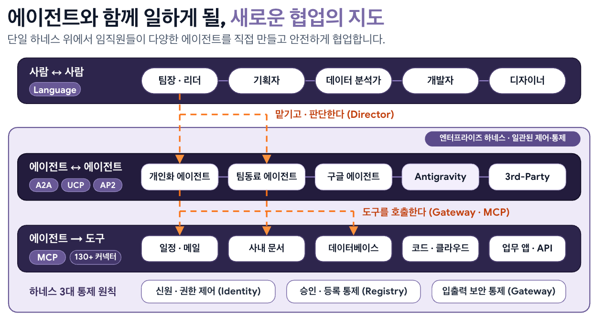</p>

---

이 Lab에서는 웹 브라우저 하나만으로 복잡한 설치 없이 **3가지 핵심 과제**를 순서대로 따라 할 수 있도록 간결하게 정리되어 있습니다.

> [!NOTE]
> **💡 비즈니스 사용자를 위한 팁**: 터미널 명령어가 생소하더라도 코드 블록 우측의 복사 버튼을 눌러 터미널에 그대로 붙여넣고 **Enter**를 누르면 손쉽게 완료할 수 있습니다.

---

## 📑 목차 (Table of Contents)

1. [개요 및 학습 목표](#1-개요-및-학습-목표)
   - [사전 준비 사항 (Prerequisites)](#사전-준비-사항-prerequisites)
2. [과제 1: Cloud Shell 접속 및 실습 환경 준비](#2-과제-1-cloud-shell-접속-및-실습-환경-준비)
   - [실습 1-1. GCP Console 접속](#실습-1-1-gcp-console-접속)
   - [실습 1-2. 프로젝트 선택](#실습-1-2-프로젝트-선택)
   - [실습 1-3. Cloud Shell 터미널 열기](#실습-1-3-cloud-shell-터미널-열기)
   - [실습 1-4. Cloud Shell Editor 확인](#실습-1-4-cloud-shell-editor-확인)
   - [실습 1-5. 다중 터미널 탭 기능 및 실행 환경 구분](#실습-1-5-다중-터미널-탭-기능-및-실행-환경-구분)
   - [실습 1-6. 실습 워크스페이스(작업 폴더) 생성 및 기본 환경 확인](#실습-1-6-실습-워크스페이스작업-폴더-생성-및-기본-환경-확인)
   - [실습 1-7. [선택 옵션] Antigravity CLI 최신 업데이트 및 설치 확인 (선택 수동 설치 포함)](#실습-1-7-선택-옵션-optional-antigravity-cli-최신-업데이트-및-설치-확인-선택-수동-설치-포함)
3. [과제 2: Antigravity 실행 및 초기 인증/환경 설정](#3-과제-2-antigravity-실행-및-초기-인증환경-설정)
   - [실습 2-1. 첫 실행 및 로그인 방식 선택 (헤드리스 OAuth)](#실습-2-1-첫-실행-및-로그인-방식-선택-헤드리스-oauth)
   - [실습 2-2. 브라우저 인증 및 인증 코드 입력](#실습-2-2-브라우저-인증-및-인증-코드-입력)
   - [실습 2-3. 라이선스 및 프로젝트 선택](#실습-2-3-라이선스-및-프로젝트-선택)
   - [실습 2-4. 초기 환경 설정 (컬러 스킴 및 TUI 기본 조작법)](#실습-2-4-초기-환경-설정-컬러-스킴-및-tui-기본-조작법)
   - [실습 2-5. 워크스페이스 신뢰 승인 (Workspace Trust)](#실습-2-5-워크스페이스-신뢰-승인-workspace-trust)
   - [실습 2-6. Antigravity TUI 초기 화면 진입 및 모델/권한 설정 (/model, /config)](#실습-2-6-antigravity-tui-초기-화면-진입-및-모델권한-설정-model-config)
4. [과제 3: Antigravity 핵심 명령어 및 실무 기능 활용 (/plan, Rule, Agent 등)](#4-과제-3-antigravity-핵심-명령어-및-실무-기능-활용-plan-rule-agent-등)
   - [실습 3-1. 기본 명령어 및 코드 생성/다중 탭 검증 (/help, 파이썬 코드 생성)](#실습-3-1-기본-명령어-및-코드-생성다중-탭-검증-help-파이썬-코드-생성)
   - [실습 3-2. /plan 기반 점진적 업무 개발 실습 (Plan-Driven Implementation)](#실습-3-2-plan-기반-점진적-업무-개발-실습-plan-driven-implementation)
   - [실습 3-3. 하네스 엔지니어링을 위한 디렉터리(.agents) 구조 생성 및 구조](#실습-3-3-하네스-엔지니어링을-위한-디렉터리agents-구조-생성-및-구조)
   - [실습 3-4. 프로젝트 기본 지침서(GEMINI.md) 작성 실습](#실습-3-4-프로젝트-기본-지침서geminimd-작성-실습)
   - [실습 3-5. Rule (행동 규칙): 사내 근무 수칙 및 친절한 3줄 요약](#실습-3-5-rule-행동-규칙-사내-근무-수칙-및-친절한-3줄-요약)
   - [실습 3-6. Agent (맞춤형 AI 비서): 문서 작성 전문 비서](#실습-3-6-agent-맞춤형-ai-비서-문서-작성-전문-비서)
   - [실습 3-7. Skill (표준 업무 절차): 회의록 정리 표준 SOP (Standard Operating Procedure)](#실습-3-7-skill-표준-업무-절차-회의록-정리-표준-sop-standard-operating-procedure)
   - [실습 3-8. MCP (외부 데이터 연동): Google Cloud BigQuery 연동](#실습-3-8-mcp-외부-데이터-연동-google-cloud-bigquery-연동)
   - [실습 3-9. Hook (자동화 이벤트 트리거): 개념, 작성 예제 및 실제 활용 방법](#실습-3-9-hook-자동화-이벤트-트리거-개념-작성-예제-및-실제-활용-방법)
   - [실습 3-10. Rule, Agent, Skill, MCP, Hook 5대 커스텀 자산 한눈에 비교하기](#실습-3-10-rule-agent-skill-mcp-hook-5대-커스텀-자산-한눈에-비교하기)
5. [Cloud Shell 환경 문제 해결 및 FAQ (Troubleshooting)](#5-cloud-shell-환경-문제-해결-및-faq-troubleshooting)
6. [다음 단계](#6-다음-단계)

---

## 1. 개요 및 학습 목표

<div style="background: #f8fafc; border: 1px solid #e2e8f0; border-radius: 10px; padding: 18px 22px; margin-bottom: 24px;">
  <div style="font-size: 16px; font-weight: bold; color: #0f172a; margin-bottom: 12px; display: flex; align-items: center; gap: 8px;">
    🗺️ <span>Antigravity 핸즈온 실습 3단계 로드맵</span>
  </div>
  <div style="display: flex; flex-direction: column; gap: 10px;">
    <div style="display: flex; align-items: flex-start; gap: 10px;">
      <span style="background-color: #1e3a8a; color: #ffffff; padding: 2px 10px; border-radius: 5px; font-size: 12px; font-weight: 800; white-space: nowrap; margin-top: 2px;">과제 1</span>
      <span style="font-size: 14px; color: #334155; line-height: 1.5;"><b style="color: #1e3a8a;">Cloud Shell 접속 및 실습 환경 준비</b>: 브라우저에서 Cloud Shell 터미널과 에디터를 열고, 전용 폴더(<code>~/antigravity-lab</code>)를 생성합니다.</span>
    </div>
    <div style="display: flex; align-items: flex-start; gap: 10px;">
      <span style="background-color: #065f46; color: #ffffff; padding: 2px 10px; border-radius: 5px; font-size: 12px; font-weight: 800; white-space: nowrap; margin-top: 2px;">과제 2</span>
      <span style="font-size: 14px; color: #334155; line-height: 1.5;"><b style="color: #065f46;">Antigravity 실행 및 초기 인증/환경 설정</b>: <code>agy</code> 실행 후 계정 인증을 완료하고 모델(<code>/model</code>)과 실행 권한(<code>/config</code>)을 최적화합니다.</span>
    </div>
    <div style="display: flex; align-items: flex-start; gap: 10px;">
      <span style="background-color: #4c1d95; color: #ffffff; padding: 2px 10px; border-radius: 5px; font-size: 12px; font-weight: 800; white-space: nowrap; margin-top: 2px;">과제 3</span>
      <span style="font-size: 14px; color: #334155; line-height: 1.5;"><b style="color: #4c1d95;">Antigravity 핵심 명령어 및 실무 기능 활용 (/plan, Rule, Agent 등)</b>: <code>/plan</code> 기반 기획 주도 개발을 실습하고, 5대 맞춤형 커스텀 자산(Rule, Agent, Skill, MCP, Hook)을 구축합니다.</span>
    </div>
  </div>
</div>

### 사전 준비 사항 (Prerequisites)

Cloud Shell은 브라우저에서 동작하며 모든 개발 도구가 사전 구성되어 있습니다.

| 구분 | 요구사항 | Cloud Shell 제공 상태 | 비즈니스 유저 설명 |
| :--- | :--- | :--- | :--- |
| **운영체제 (OS)** | Linux 환경 | 브라우저 기본 제공 | 웹 브라우저 안에서 동작하는 구글의 실습용 가상 PC |
| **Python** | Python 3.10 이상 | Python 3.11+ 기본 설치 | AI가 프로그램을 만들고 실행하는 실행기 |
| **기본 도구** | `git`, `curl`, `gcloud` | 사전 설치 완료 | 파일 다운로드와 클라우드 연결에 필요한 도구 |
| **코드 편집기** | Cloud Shell Editor | 상단 'Open Editor' 버튼 | 문서를 시각적으로 열람하고 편집하는 웹 화면 |
| **계정 및 권한** | 구글 계정 및 GCP 프로젝트 | GCP Console 로그인 계정 | 실습용 회사 구글 계정 |
| **실습 경로** | `~/antigravity-lab` | 영구 홈 디렉터리(`$HOME`) | 이번 실습 파일들이 저장되는 전용 작업 서류함 |

---

## 2. <span style="background-color: #1e3a8a; color: #ffffff; padding: 4px 14px; border-radius: 6px; font-size: 0.9em; font-weight: 800; margin-right: 8px;">과제 1</span> Cloud Shell 접속 및 실습 환경 준비

### <span style="background-color: #eff6ff; color: #1e40af; border: 1px solid #bfdbfe; padding: 2px 10px; border-radius: 4px; font-size: 0.85em; font-weight: bold; margin-right: 6px;">실습 1-1</span> GCP Console 접속

아래 주소로 이동하여 Google 계정으로 로그인하고 약관에 동의합니다:
- https://console.cloud.google.com/

_GCP 콘솔 접속 및 약관 동의_
<p align="left">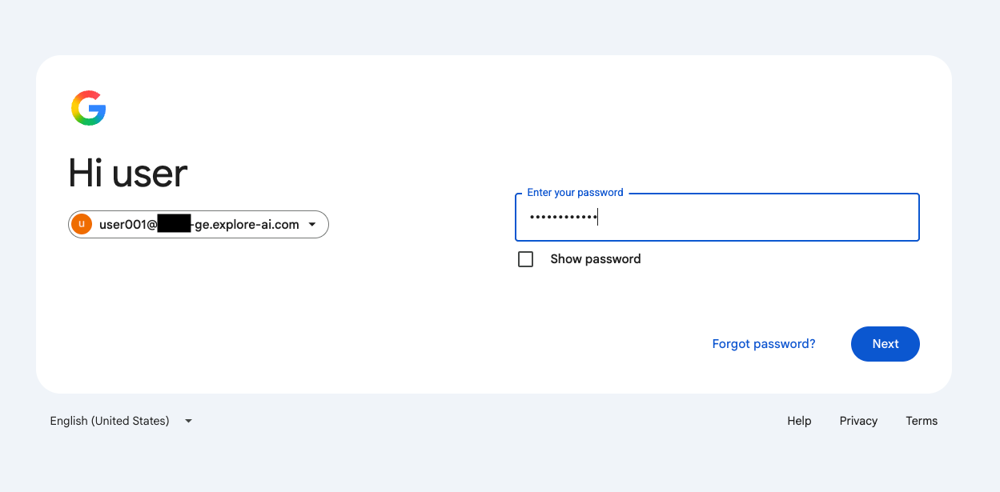</p>
<p align="left">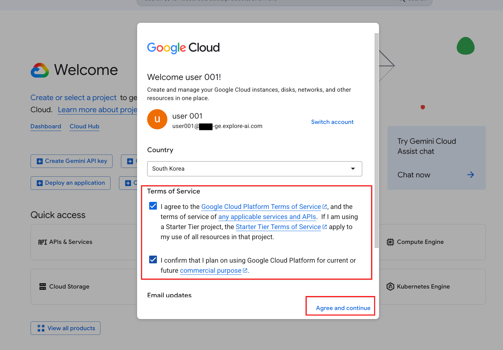</p>

---

### <span style="background-color: #eff6ff; color: #1e40af; border: 1px solid #bfdbfe; padding: 2px 10px; border-radius: 4px; font-size: 0.85em; font-weight: bold; margin-right: 6px;">실습 1-2</span> 프로젝트 선택

상단의 **Select a Project**를 클릭하여 실습 배정 프로젝트를 선택합니다.

_프로젝트 선택_
<p align="left">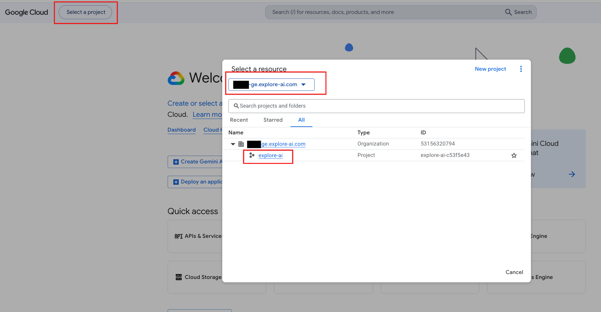</p>

---

### <span style="background-color: #eff6ff; color: #1e40af; border: 1px solid #bfdbfe; padding: 2px 10px; border-radius: 4px; font-size: 0.85em; font-weight: bold; margin-right: 6px;">실습 1-3</span> Cloud Shell 터미널 열기

우측 상단 **Cloud Shell(`>_`)** 아이콘을 클릭하고 **Continue**를 눌러 터미널을 시작합니다.

_Cloud Shell 활성화 및 터미널 화면_
<p align="left">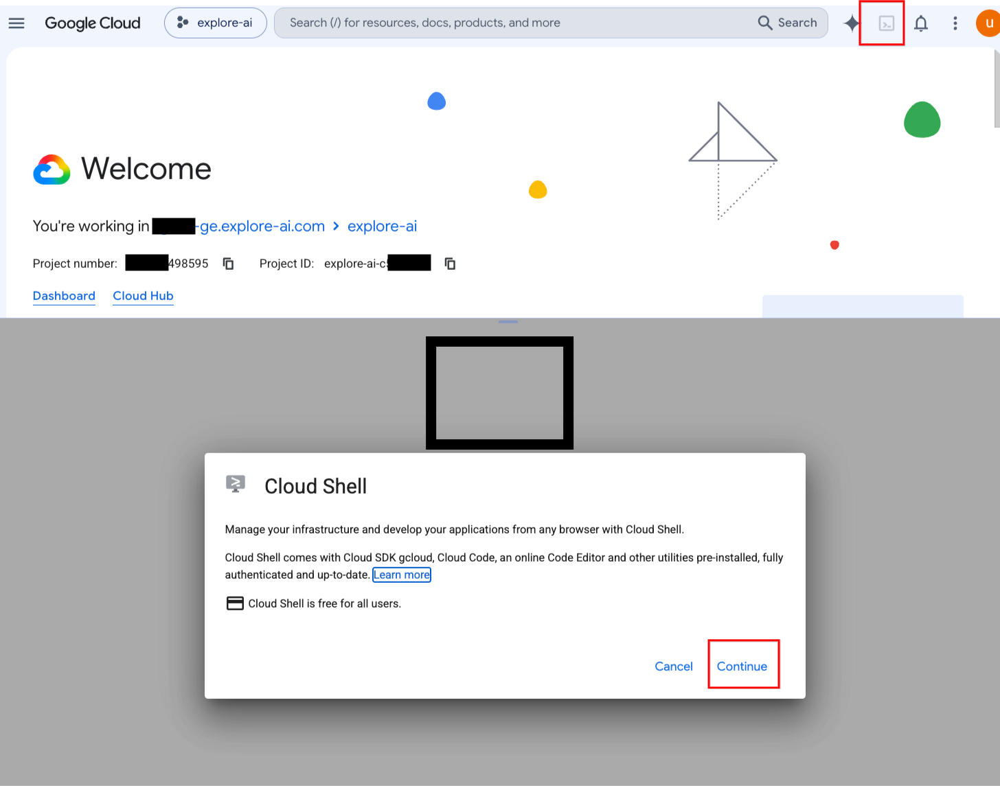</p>
<p align="left">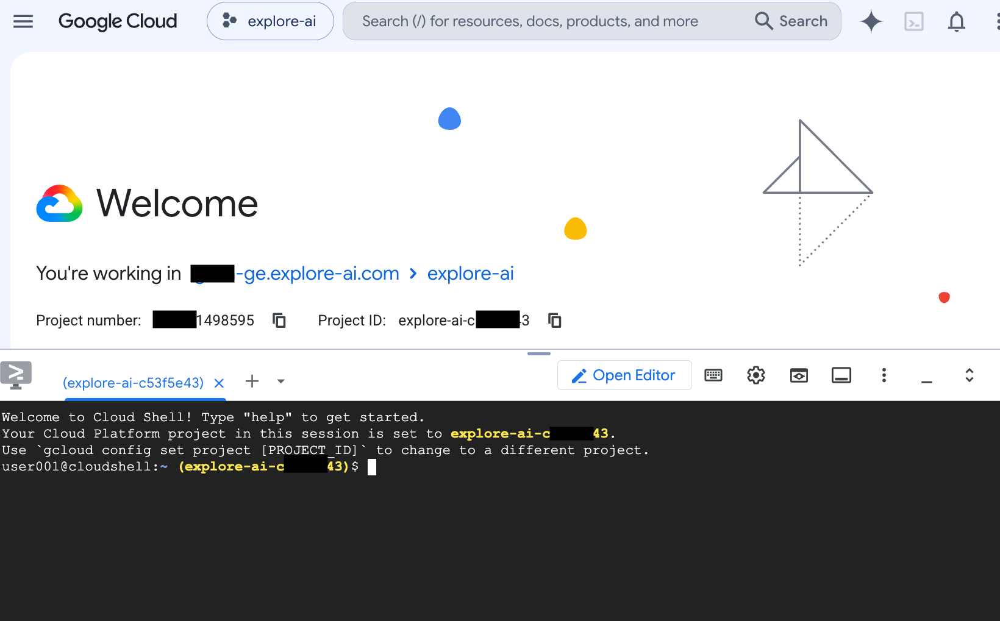</p>

---

### <span style="background-color: #eff6ff; color: #1e40af; border: 1px solid #bfdbfe; padding: 2px 10px; border-radius: 4px; font-size: 0.85em; font-weight: bold; margin-right: 6px;">실습 1-4</span> Cloud Shell Editor 확인

상단의 **Open Editor** 버튼을 클릭하면 VS Code 기반의 코드 편집기 화면이 열립니다.

_Cloud Shell Editor_
<p align="left">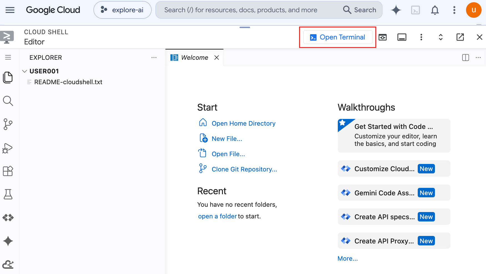</p>

---

### <span style="background-color: #eff6ff; color: #1e40af; border: 1px solid #bfdbfe; padding: 2px 10px; border-radius: 4px; font-size: 0.85em; font-weight: bold; margin-right: 6px;">실습 1-5</span> 다중 터미널 탭 기능 및 실행 환경 구분

실습 중 사용하는 2가지 화면 구분:
- **🖥️ 터미널 (일반 bash 셸)**: 리눅스 명령어 실행 및 결과 확인 (`user@cloudshell:~$ `)
- **🤖 대화창 (agy TUI)**: AI에게 자연어 업무 지시 및 슬래시 명령어 입력 (`> `)
- **추천 활용법**: **Tab 1**은 AI 대화창(`agy`), **Tab 2**(상단 `+` 버튼)는 결과 확인용 터미널로 병행 사용합니다.

---

### <span style="background-color: #eff6ff; color: #1e40af; border: 1px solid #bfdbfe; padding: 2px 10px; border-radius: 4px; font-size: 0.85em; font-weight: bold; margin-right: 6px;">실습 1-6</span> 실습 워크스페이스(작업 폴더) 생성 및 기본 환경 확인

> 📍 **실행 위치: 🖥️ Cloud Shell 터미널 (일반 bash 셸)**

```bash
# 1. 실습 폴더 생성 및 이동
mkdir -p ~/antigravity-lab && cd ~/antigravity-lab && pwd

# 2. 파이썬 버전 확인
python3 --version
```

---

### <span style="background-color: #eff6ff; color: #1e40af; border: 1px solid #bfdbfe; padding: 2px 10px; border-radius: 4px; font-size: 0.85em; font-weight: bold; margin-right: 6px;">실습 1-7</span> <span style="background-color: #fef3c7; color: #92400e; border: 1px solid #fde68a; padding: 2px 8px; border-radius: 4px; font-size: 0.8em; font-weight: bold; margin-right: 6px;">선택 옵션 (Optional)</span> Antigravity CLI 최신 업데이트 및 설치 확인 (선택 수동 설치 포함)

> [!TIP]
> **💡 Cloud Shell 사용자를 위한 안내 (건너뛰기 권장)**:  
> Google Cloud Shell 환경에는 `agy`가 이미 사전 설치되어 있습니다. 따라서 이 단계는 실행하지 않고 건너뛴 후 바로 **[과제 2: Antigravity 실행 및 초기 인증](#3-과제-2-antigravity-실행-및-초기-인증환경-설정)** 로 넘어가셔도 실습에 전혀 지장이 없습니다. 최신 버전으로 업데이트하거나 별도 자체 Linux PC에 설치할 때만 참고하세요.

Cloud Shell에 사전 탑재된 `agy`를 최신 바이너리로 업데이트하고 동작을 확인합니다:

> 📍 **실행 위치: 🖥️ Cloud Shell 터미널 (일반 bash 셸)**

```bash
# 최신 설치 스크립트 실행 및 환경 갱신
curl -fsSL https://antigravity.google/cli/install.sh | bash
source ~/.bashrc

# 버전 확인 및 첫 실행
agy --version
agy
```

_터미널 실행 및 로그인 선택 화면_
<p align="left">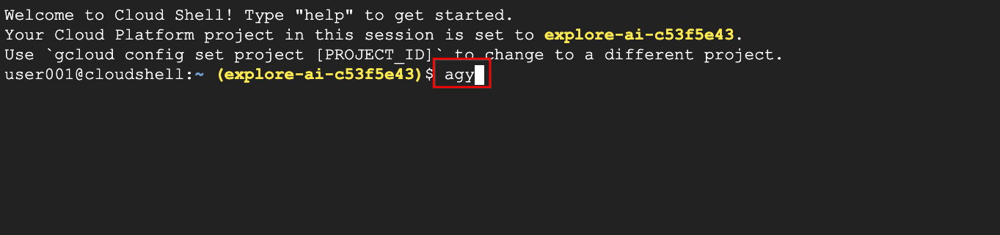</p>
<p align="left">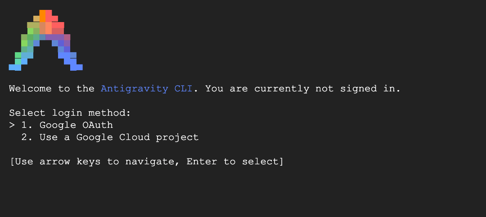</p>

- 위 화면이 나타나면 **`Ctrl + C`** 로 세션을 빠져나옵니다. (로그인은 과제 2에서 진행)

> [!NOTE]
> **(선택) 자체 Linux PC 수동 설치**: [공식 다운로드 포털](https://antigravity.google/product/antigravity-cli)에서 다운로드 후 설치합니다:
> 
> _다운로드 페이지_
> <p align="left">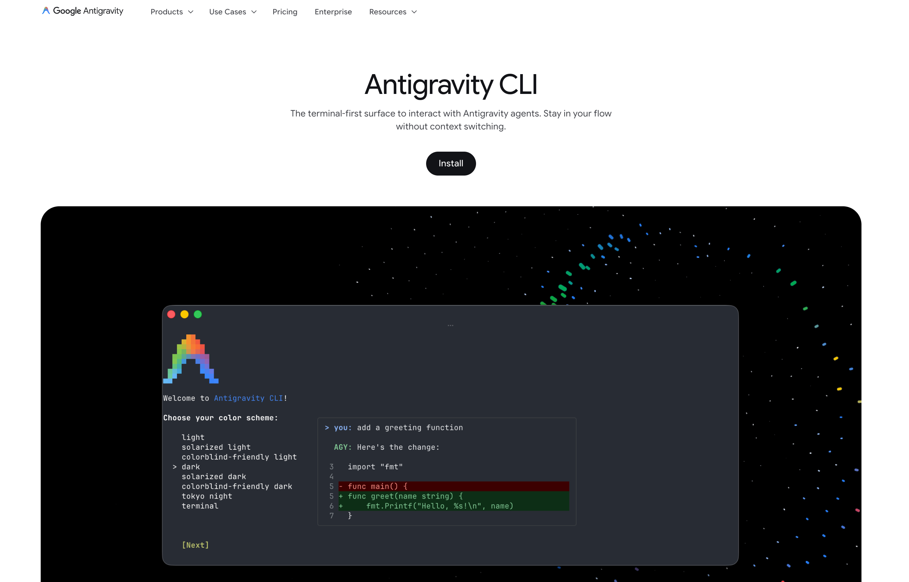</p>
> 
> ```bash
> tar -xzf agy-linux-*.tar.gz && chmod +x agy
> mkdir -p ~/.local/bin && mv agy ~/.local/bin/ && export PATH="$HOME/.local/bin:$PATH"
> ```

---

## 3. <span style="background-color: #065f46; color: #ffffff; padding: 4px 14px; border-radius: 6px; font-size: 0.9em; font-weight: 800; margin-right: 8px;">과제 2</span> Antigravity 실행 및 초기 인증/환경 설정

### <span style="background-color: #ecfdf5; color: #047857; border: 1px solid #a7f3d0; padding: 2px 10px; border-radius: 4px; font-size: 0.85em; font-weight: bold; margin-right: 6px;">실습 2-1</span> 첫 실행 및 로그인 방식 선택 (헤드리스 OAuth)

> 📍 **실행 위치: 🖥️ Cloud Shell 터미널 (일반 bash 셸)**

```bash
cd ~/antigravity-lab && agy
```

화면에서 **`Use a Google Cloud project`** (또는 `Continue with Google Cloud`)를 방향키로 선택하고 **Enter**를 누릅니다.

_로그인 방식 선택 화면_
<p align="left">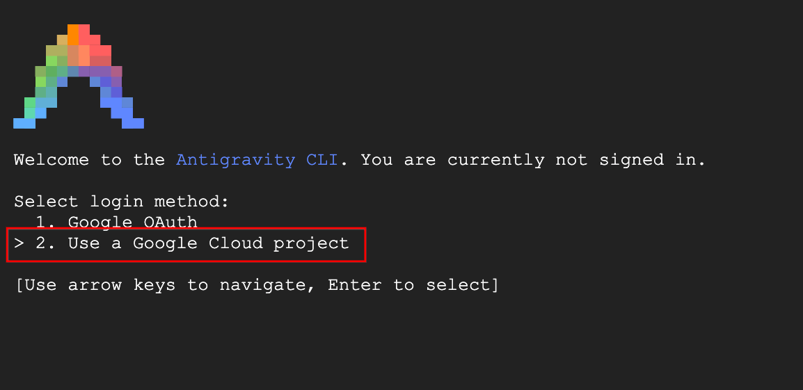</p>
<p align="left">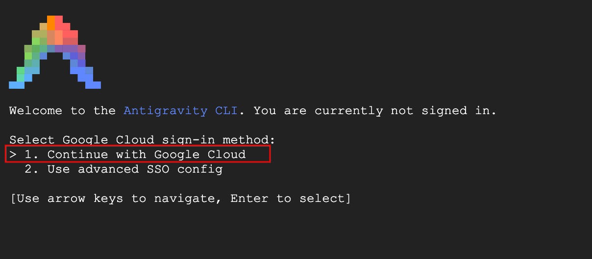</p>

---

### <span style="background-color: #ecfdf5; color: #047857; border: 1px solid #a7f3d0; padding: 2px 10px; border-radius: 4px; font-size: 0.85em; font-weight: bold; margin-right: 6px;">실습 2-2</span> 브라우저 인증 및 인증 코드 입력

1. 터미널의 인증 URL을 복사하여 PC 브라우저 새 탭에 붙여넣습니다.
2. Google 계정 로그인 후 권한을 승인합니다.
3. 발급된 **인증 코드(Verification code)** 를 복사하여 터미널에 붙여넣고 **Enter**를 누릅니다.

_인증 URL 및 인증 코드 입력_
<p align="left">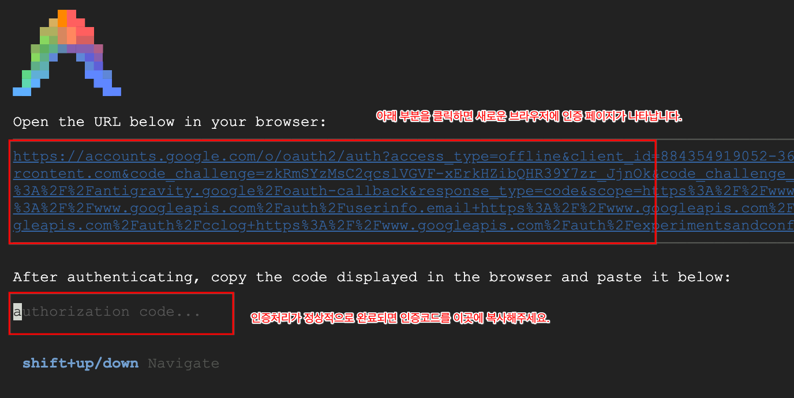</p>
<p align="left">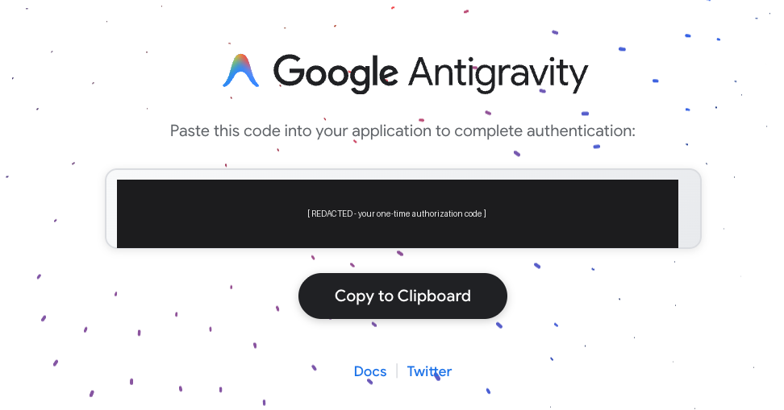</p>

> [!TIP]
> 키링 오류(`secret keyring is locked`) 시 `export $(dbus-launch)` 실행 후 `agy`를 다시 실행하세요.

---

### <span style="background-color: #ecfdf5; color: #047857; border: 1px solid #a7f3d0; padding: 2px 10px; border-radius: 4px; font-size: 0.85em; font-weight: bold; margin-right: 6px;">실습 2-3</span> 라이선스 및 프로젝트 선택

실습에 배정된 프로젝트 항목(예: **Gemini Enterprise Plus**)을 선택하고 **Enter**를 누릅니다.

> [!NOTE]
> **💡 참고사항 (Pay-as-you-go 선택 시)**:  
> 만일 **Pay as you go**(종량제)를 선택하는 경우, 화면 안내에 따라 **Project ID**와 **Region(리전)** 을 직접 선택하여 진행합니다.  
  
아래 그림은 Gemini enterprise 를 기반으로 로긴하는 경우입니다.  

_라이선스 선택 화면_
<p align="left">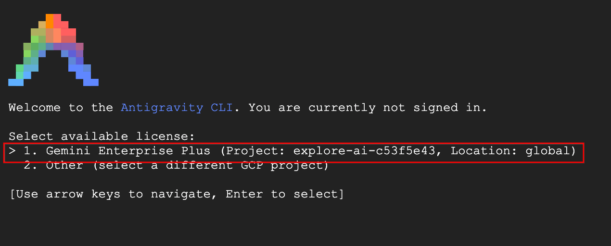</p>

---

### <span style="background-color: #ecfdf5; color: #047857; border: 1px solid #a7f3d0; padding: 2px 10px; border-radius: 4px; font-size: 0.85em; font-weight: bold; margin-right: 6px;">실습 2-4</span> 초기 환경 설정 (컬러 스킴 및 TUI 기본 조작법)

컬러 스킴 선택 화면에서 기본값 상태로 **Enter**를 누릅니다.  
*(TUI 화면에서는 마우스 클릭 대신 키보드 **방향키(`↓`, `↑`)** 와 **`Enter`** 를 사용합니다.)*

_컬러 스킴 선택 화면_
<p align="left">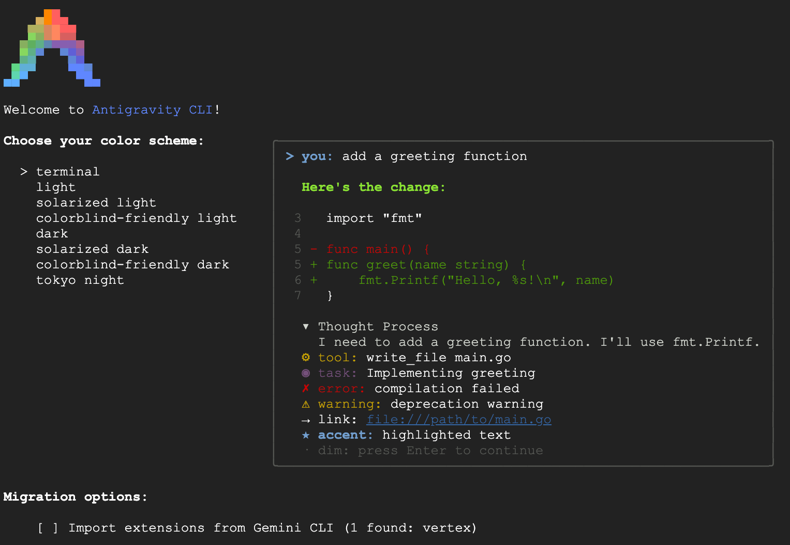</p>

---

### <span style="background-color: #ecfdf5; color: #047857; border: 1px solid #a7f3d0; padding: 2px 10px; border-radius: 4px; font-size: 0.85em; font-weight: bold; margin-right: 6px;">실습 2-5</span> 워크스페이스 신뢰 승인 (Workspace Trust)

보안 확인 프롬프트에서 **`Yes, I trust this folder`** 를 선택하고 **Enter**를 누릅니다.

_워크스페이스 신뢰 확인_
<p align="left">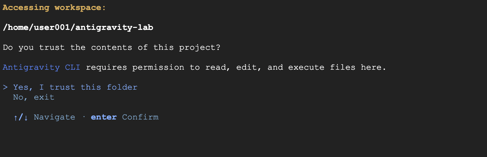</p>

---

### <span style="background-color: #ecfdf5; color: #047857; border: 1px solid #a7f3d0; padding: 2px 10px; border-radius: 4px; font-size: 0.85em; font-weight: bold; margin-right: 6px;">실습 2-6</span> Antigravity TUI 초기 화면 진입 및 모델/권한 설정 (`/model`, `/config`)

TUI 초기 화면이 나타나면 모델과 도구 권한을 설정합니다:

_TUI 초기 화면_
<p align="left">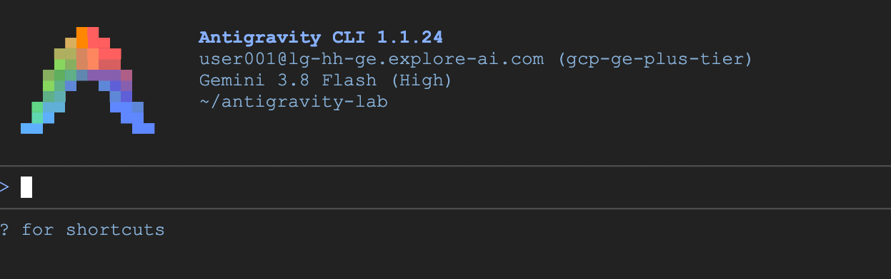</p>

1. **모델 설정 (`/model`)**:
   - `/model` 입력 ➔ **`Gemini 3.8 Flash`** 선택 ➔ 좌/우 키로 Effort를 **`medium`** (중간)으로 맞추고 **Enter**.
2. **도구 실행 권한 설정 (`/config`)**:
   - `/config` 입력 ➔ 빠른 실습 진행을 위해 **`always-proceed`** (확인 팝업 없이 자동 실행) 선택.

_Tool Permission 설정 화면_
<p align="left">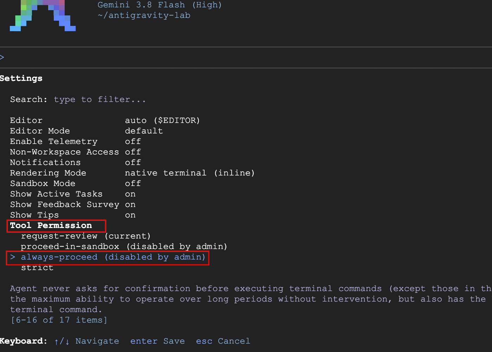</p>

---

## 4. <span style="background-color: #4c1d95; color: #ffffff; padding: 4px 14px; border-radius: 6px; font-size: 0.9em; font-weight: 800; margin-right: 8px;">과제 3</span> Antigravity 핵심 명령어 및 실무 기능 활용 (/plan, Rule, Agent 등)

### <span style="background-color: #f5f3ff; color: #5b21b6; border: 1px solid #ddd6fe; padding: 2px 10px; border-radius: 4px; font-size: 0.85em; font-weight: bold; margin-right: 6px;">실습 3-1</span> 기본 명령어 및 코드 생성/다중 탭 검증 (`/help`, 파이썬 코드 생성)

> 📍 **실행 위치: 🤖 Antigravity 대화창 (agy 프롬프트)**

1. **도움말 확인**: `/help` 입력으로 사용 가능한 명령어 목록을 확인합니다.
2. **코드 생성 요청**: 대화창에 아래 요청을 입력하고 Enter를 누릅니다:
   ```text
   Python으로 1부터 10까지의 합을 구하는 sum_1_to_10.py 파일을 생성해줘.
   ```
3. **Tab 2(별도 터미널 탭)에서 실행 및 결과 검증**:  
   상단의 **`+` (새 터미널 탭)** 버튼을 눌러 새 bash 창(Tab 2)을 열고, 아래 명령어를 실행하여 AI가 생성한 코드와 실행 결과를 확인합니다:

> 📍 **실행 위치: 🖥️ Cloud Shell 터미널 (Tab 2)**

```bash
# 1. 실습 작업 폴더로 이동
cd ~/antigravity-lab

# 2. AI가 생성한 파이썬 코드 내용 열람
cat sum_1_to_10.py

# 3. 파이썬 프로그램 직접 실행 (화면에 55 출력 확인)
python3 sum_1_to_10.py
```

---

### <span style="background-color: #f5f3ff; color: #5b21b6; border: 1px solid #ddd6fe; padding: 2px 10px; border-radius: 4px; font-size: 0.85em; font-weight: bold; margin-right: 6px;">실습 3-2</span> `/plan` 기반 점진적 업무 개발 실습 (Plan-Driven Implementation)

코드를 바로 작성하지 않고, **기획서(Plan)를 먼저 받아 피드백을 통해 요구사항을 완성한 후 구현하는 워크플로우**입니다.

_`/plan` 실행 계획 및 아티팩트 리뷰 화면_
<p align="left">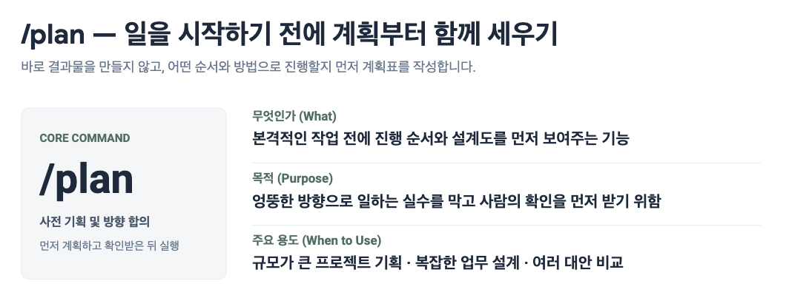</p>


#### 3-2-1. 비즈니스 유저를 위한 `/plan`의 핵심 가치
- **사전 확인**: 어떤 파일과 구조가 생성될지 미리 검토
- **품질 개선**: 임원 요약, KPI 달성률 표 등을 피드백으로 쉽게 반영
- **안전성**: `Proceed`로 최종 승인하기 전까지 실제 파일은 변경되지 않음

#### 3-2-2. [Phase 1] 1차 업무 계획 수립 요청 (`/plan`, `/artifact`)

> 📍 **실행 위치: 🤖 Antigravity 대화창 (Tab 1 agy 프롬프트)**

```text
/plan 팀원들의 주간 업무 데이터(JSON 파일)를 인자로 입력받아 정돈된 마크다운 보고서로 변환해 주는 weekly_report CLI 도구 계획을 세워줘. 바로 테스트해 볼 수 있도록 가상의 샘플 업무 데이터(sample_tasks.json)도 함께 생성하는 계획을 포함해줘.
```

- **계획서 확인**: 단축키 **`Ctrl+R`** 또는 `/artifact` 입력 (조작: `y` 승인, `n`/`Esc` 닫기).

**생성된 1차 계획서(`implementation_plan.md`) 내용:**
```markdown
# Implementation Plan: Weekly Business Report Generator

## Goal Description
CLI 인자로 지정된 JSON 업무 데이터(`sample_tasks.json`)를 읽어 Markdown 보고서로 저장하는 도구(`weekly_report.py`) 구축.

## Proposed Changes
- `sample_tasks.json`: 테스트용 팀원 업무 현황 데이터
- `weekly_report.py`: JSON 로드 및 Markdown 보고서(`weekly_report_output.md`) 자동 변환 저장

## Verification Plan
- `python3 weekly_report.py sample_tasks.json` 실행 검증
```

#### 3-2-3. [Phase 2] 대화형 점진적 계획 개선 (자연어 피드백)

> [!TIP]
> 피드백 시 `/plan`을 다시 입력할 필요 없이 **일반 문장**으로 편하게 말하면 AI가 계획서를 실시간 업데이트합니다.

> 📍 **실행 위치: 🤖 Antigravity 대화창 (Tab 1 agy 프롬프트)**

```text
계획을 보완해줘. 임원 보고용 '3줄 핵심 요약(Executive Summary)'과 'KPI 목표 달성률 표' 항목을 추가하고, 일정 지연(DELAY) 항목에는 ⚠️ 경고 표시가 눈에 띄게 나타나도록 계획을 업데이트해줘.
```

**업데이트된 계획서 예시:**
```markdown
# Implementation Plan: Weekly Business Report Generator (Updated)

## Proposed Changes
- `sample_tasks.json`: 진척률(%), 상태(`COMPLETED`, `IN_PROGRESS`, `DELAY`) 필드 포함
- `weekly_report.py`: 임원용 3줄 요약 추출, KPI 달성률 표 생성, `DELAY` 감지 및 ⚠️ 경고 표시

## Verification Plan
- `python3 weekly_report.py sample_tasks.json` 실행 후 요약, 표, 경고 출력 검증
```

#### 3-2-4. [Phase 3] 계획 승인(`Proceed`) 및 자동 구현 관찰

> 📍 **실행 위치: 🤖 Antigravity 대화창 (Tab 1 agy 프롬프트)**

하단 **`[Proceed]`** 버튼 클릭 또는 입력:
```text
계획을 승인합니다. 진행해주세요.
```
- AI가 `sample_tasks.json`과 `weekly_report.py`를 순서대로 자동 생성합니다.

#### 3-2-5. [Phase 4] 실행 검증 및 최종 보고서 확인

> 📍 **실행 위치: 🖥️ Cloud Shell 터미널 (Tab 2)**

```bash
cd ~/antigravity-lab
python3 weekly_report.py sample_tasks.json
cat weekly_report_output.md
```

**최종 보고서 결과 (`weekly_report_output.md`):**
```markdown
# 📊 주간 비즈니스 업무 실적 보고서

## 📌 Executive Summary (임원 보고용 3줄 요약)
1. 2분기 주요 마케팅 캠페인 런칭이 성공적으로 완료되었습니다 (진척률 100%).
2. 결제 시스템 연동 작업 중 PG사 심사 일정으로 인해 일부 지연(⚠️)이 발생하여 긴급 대응 중입니다.
3. 신규 모바일 앱 기획안은 팀 내 리뷰를 거쳐 차주 초 최종 확정 예정입니다.

## 🎯 KPI 목표 대비 달성률 현황
| 프로젝트명 | 담당자 | 진척률 | 진행 상태 |
| :--- | :--- | :---: | :---: |
| 2분기 신규 프로모션 런칭 | 김마케터 | 100% | ✅ 완료 (COMPLETED) |
| 글로벌 결제 모듈 연동 | 박개발 | 65% | ⚠️ 지연 (DELAY) |
| 신규 고객 온보딩 플로우 개선 | 이기획 | 90% | 🔄 진행중 (IN_PROGRESS) |

## ⚠️ 지연 프로젝트 긴급 조치 계획
- **글로벌 결제 모듈 연동 (박개발)**: PG사 추가 서류 제출 완료, 익일 오전 10시 유선 미팅 추진.
```

#### 3-2-6. 비즈니스 유저를 위한 `/plan` 3대 실무 꿀팁
1. **대화형으로 쪼개서 피드백**: 1차 계획 확인 후 원하는 항목을 가볍게 추가 요청하세요.
2. **사내 서식 공유**: 템플릿 양식이 있다면 프롬프트에 양식을 지정하세요.
3. **샘플 데이터 요청**: "테스트할 샘플 데이터도 만들어줘"라고 요청하면 즉시 검증할 수 있습니다.

---

### <span style="background-color: #f5f3ff; color: #5b21b6; border: 1px solid #ddd6fe; padding: 2px 10px; border-radius: 4px; font-size: 0.85em; font-weight: bold; margin-right: 6px;">실습 3-3</span> 하네스 엔지니어링을 위한 디렉터리(`.agents`) 구조 생성 및 구조. 

<p align="left">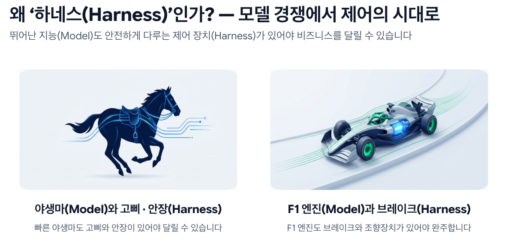</p>

<p align="left">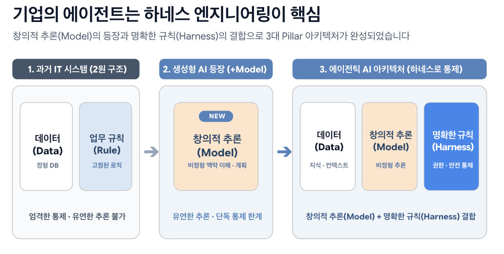</p>

---

하네스 엔지니어링을 위한 5대 맞춤형 자산(Rule, Agent, Skill, MCP, Hook)을 보관할 서류함 폴더를 생성합니다:

> 📍 **실행 위치: 🖥️ Cloud Shell 터미널 (Tab 2)**

```bash
cd ~/antigravity-lab
mkdir -p .agents/rules .agents/skills .agents/agents .agents/scripts
ls -la .agents
```

**Antigravity 전체 디렉터리 구조:**
```text
├── ~/.gemini/                               # [전역] 컴퓨터 공통 설정 (settings.json)
└── ~/antigravity-lab/                       # [워크스페이스] 우리 팀 전용 실습 폴더
    ├── .agents/                             # 팀 전용 맞춤형 AI 설정 서류함
    │   ├── rules/                           # 1. Rule: 사내 근무 수칙 (말투, 요약)
    │   ├── agents/                          # 2. Agent: 전문 비서 (문서 작성)
    │   ├── skills/                          # 3. Skill: 업무 매뉴얼 (회의록 정리)
    │   ├── mcp_config.json                  # 4. MCP: 외부 데이터 연결 (BigQuery)
    │   └── hooks.json                       # 5. Hook: 안전 차단기 & 귓속말
    └── GEMINI.md                            # 워크스페이스 기본 온보딩 헌장
```

> [!TIP]
> Cloud Shell Editor 상단 메뉴 **View > Toggle Hidden Files** 를 클릭하면 숨겨진 `.agents` 폴더를 시각적으로 열람할 수 있습니다.

---

### <span style="background-color: #f5f3ff; color: #5b21b6; border: 1px solid #ddd6fe; padding: 2px 10px; border-radius: 4px; font-size: 0.85em; font-weight: bold; margin-right: 6px;">실습 3-4</span> 프로젝트 기본 지침서(`GEMINI.md`) 작성 실습

- **개념**: 우리 팀 폴더 최상위에 두는 **"프로젝트 총괄 대헌장(Project Constitution)"** 입니다. 프로젝트의 목표, 작업 경로 기준, 보안 규칙 등 전체적인 거버넌스를 정의하며, Antigravity가 실행될 때 자동으로 읽어 기본 상식으로 탑재합니다.
- **`GEMINI.md` 파일 생성**:

> 📍 **실행 위치: 🖥️ Cloud Shell 터미널 (Tab 2)**

```bash
cd ~/antigravity-lab

cat > GEMINI.md <<'EOF'
# Antigravity 비즈니스 자동화 랩 프로젝트 헌장 (Project Charter)

## 1. 프로젝트 개요 (Overview)
- 목적: 기획자 및 비즈니스 실무자의 반복 업무를 자동화하고 데이터 기반 의사결정을 지원하는 실무 랩입니다.
- 주요 도메인: 비즈니스 보고서 생성, 회의록 정리, 클라우드(BigQuery) 데이터 조회 및 분석.

## 2. 작업 환경 및 경로 원칙 (Workspace Governance)
- 작업 기준 경로: 모든 실습 파일과 스크립트는 반드시 `~/antigravity-lab/` 내부에서만 생성하고 수정합니다.
- 실행 환경: Python 3.11+ 및 Linux Shell 환경을 기준으로 동작하며, 생성 코드는 가독성과 안정성을 최우선합니다.

## 3. 보안 및 안전 가드레일 (Safety Guardrail)
- 보안 준수: API 키, 비밀번호 등 민감한 개인정보/자격증명을 코드나 대화창에 절대 노출하지 않습니다.
- 안전 우선: 파일이나 데이터를 영구 삭제(`rm`, `drop`)하기 전에는 반드시 사용자에게 사전 확인을 요청합니다.

## 4. 업무 수행 방식 (Process)
- 복잡한 도구 개발이나 데이터 분석 시에는 코드를 즉시 작성하지 않고, 기획서(`/plan`)를 먼저 제안하여 피드백과 승인을 거쳐 점진적으로 완성합니다.
EOF

cat GEMINI.md
```

- **실행 및 검증**:
  1. **세션 재실행 (새 헌장 로드)**: Tab 1 대화창에서 `/exit`로 나간 후 `agy`를 다시 실행합니다:
     > 📍 **실행 위치: 🤖 Antigravity 대화창 (Tab 1 agy 프롬프트)**
     ```text
     /exit
     ```
     터미널로 돌아오면 다시 실행:
     ```bash
     agy
     ```
  2. **프로젝트 환경 및 보안 원칙 인지 검증**: 대화창에 아래와 같이 질문합니다:
     > 📍 **실행 위치: 🤖 Antigravity 대화창 (Tab 1 agy 프롬프트)**
     ```text
     우리 프로젝트의 작업 기준 경로와 보안 원칙이 뭐야?
     ```
  - **확인**: 사용자가 프롬프트에 아무런 힌트를 주지 않아도, AI가 `GEMINI.md`를 기억하여 **"모든 작업은 `~/antigravity-lab/` 내부에서 수행"** 하며 **"API 키 노출 금지 및 삭제 전 확인 원칙"** 을 숙지하고 있음을 명확히 답변합니다.

> 💡 **비즈니스 유저를 위한 차이점 한눈에 보기**:
> - **`GEMINI.md`**: 프로젝트 전체의 **총괄 사규 및 거버넌스 헌장** (프로젝트 목표, 작업 경로, 보안, 프로세스)
> - **`.agents/rules/` (다음 실습)**: 매 답변마다 적용되는 **구체적인 보고서 출력 서식 가이드** (말투, 상단 3줄 요약, 추천 액션)

---

### <span style="background-color: #f5f3ff; color: #5b21b6; border: 1px solid #ddd6fe; padding: 2px 10px; border-radius: 4px; font-size: 0.85em; font-weight: bold; margin-right: 6px;">실습 3-5</span> Rule (행동 규칙): 사내 근무 수칙 및 친절한 3줄 요약

- **개념**: `GEMINI.md`가 프로젝트의 뼈대(목표, 경로, 보안)를 정의했다면, Rule은 AI가 모든 답변에서 **항상(Always-on)** 지켜야 하는 **구체적인 보고서 서식(말투, [핵심 3줄 요약], 추천 액션)** 을 규정합니다.

> [!IMPORTANT]
> **💡 핵심 동작 원리 (Always-on 상시 적용)**:
> - **매 대화마다 자동 적용**: `.agents/rules/` 폴더 안의 규칙들은 사용자가 별도로 호출하지 않아도, **모든 질문과 답변마다 100% 항상 자동으로 로드되어 적용**됩니다.
> - **실무 작성 팁**: 매번 AI 메모리(토큰)를 상시 점유하므로 **"정중한 존댓말", "상단 3줄 요약 강제", "보안 가드레일"** 처럼 전사 공통 필수 원칙만 간결하게 작성하세요. (길고 복잡한 업무별 매뉴얼은 뒤에서 배울 **Skill**로 분리하는 것이 훨씬 경제적입니다.)

> [!TIP]
> **💡 Rule의 4가지 트리거(Trigger) 방식 한눈에 보기**:
> | 트리거 방식 | 동작 설명 | 주요 활용처 |
> | :--- | :--- | :--- |
> | **`always_on`** *(이번 실습)* | 매 대화마다 **100% 항상 자동 주입** | 공통 보안 수칙, 답변 서식(3줄 요약) |
> | **`model_decision`** | 질문 맥락을 보고 **AI가 필요 시 자율 로드** | 특정 프레임워크/테스트 가이드 (`description` 필수) |
> | **`glob`** | 매칭되는 **파일(`*.ts` 등) 작업 시 자동 로드** | 언어별 코딩 컨벤션 |
> | **`manual`** | 사용자가 **채팅창에서 직접 `@` 호출 시 로드** | 배포 체크리스트, 비정기 점검표 |

- **Rule 파일 작성 (`.agents/rules/friendly-response.md`)**:

> 📍 **실행 위치: 🖥️ Cloud Shell 터미널 (Tab 2)**

```bash
cd ~/antigravity-lab

cat > .agents/rules/friendly-response.md <<'EOF'

---
trigger: always_on
---

# 친절한 응답 및 핵심 요약 규칙 (Response Style Rule)

1. 말투: 항상 정중하고 친절한 한국어 존댓말로 답변하세요.
2. 쉬운 설명: 어려운 용어는 일상적인 비유를 곁들여 설명하세요.
3. 3줄 핵심 요약: 답변 맨 위에 반드시 [핵심 3줄 요약]을 먼저 제시하세요.
4. 추천 액션: 답변 끝에 '다음 추천 단계'를 1~2가지 제안하세요.
EOF

ls -la .agents/rules/friendly-response.md
```

- **실행 및 검증**:
  > 📍 **실행 위치: 🤖 Antigravity 대화창 (Tab 1 agy 프롬프트)**
  ```text
  클라우드 컴퓨팅이 뭔지 쉽게 설명해줘.
  ```
  - **확인**: 별도 지시 없이도 맨 위에 `[핵심 3줄 요약]`과 일상 비유가 자동으로 포함되어 응답합니다.

---

### <span style="background-color: #f5f3ff; color: #5b21b6; border: 1px solid #ddd6fe; padding: 2px 10px; border-radius: 4px; font-size: 0.85em; font-weight: bold; margin-right: 6px;">실습 3-6</span> Agent (맞춤형 AI 비서): 문서 작성 전문 비서

- **개념**: 특정 업무에 특화된 전담 비서(Persona)로, 대화 중 `@에이전트명`이나 전용 슬래시 명령어로 호출합니다.

> [!TIP]
> **💡 Antigravity 내장 에이전트(Built-in Agents)와 커스텀 에이전트의 차이**:  
> Antigravity에는 개발자가 직접 만들지 않아도 즉시 호출하여 활용할 수 있는 강력한 **내장 전문 에이전트**들이 사전 탑재되어 있습니다:
> - **`/plan`**: 코딩 전에 단계별 실행 계획(Plan)을 먼저 수립하는 **기획 주도 에이전트** (실습 3-2에서 실습 완료)
> - **`/browser`**: 실시간 인터넷 웹 검색 및 웹페이지를 직접 탐색하는 **리서치 전담 에이전트**
> - **`/review-agent`**: 코드의 보안 취약점, 버그, 성능 병목을 정밀 검사하는 **코드 리뷰 전담 에이전트**
> - **`/owl`**: 복잡한 아키텍처나 기술 연구를 다각도로 검증하는 **심층 추론(Deep Thinking) 에이전트**
> - **`/teamwork`**: 여러 에이전트가 역할을 나누어 병렬로 협업하는 **멀티에이전트 팀 (Swarm)**
> - **`/goal`**: 목표가 100% 달성될 때까지 중간에 멈추지 않고 스스로 오류를 수정하며 완수하는 **자율 완수 에이전트**
>
> 📌 **이번 실습의 목표**: 이러한 내장 에이전트 외에, 우리 팀만의 고유한 업무 규칙과 양식을 학습시킨 **'사내 맞춤형 커스텀 에이전트(`.agents/agents/`)'** 를 직접 만들고 `@에이전트명`으로 호출하는 방법을 배웁니다. 대화창에서 `/agents`를 입력하면 내장 에이전트와 커스텀 에이전트 목록을 한눈에 확인할 수 있습니다.

_에이전트 목록 화면 (`/agents`)_
<p align="left">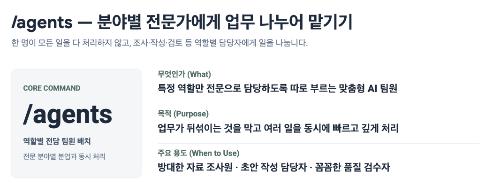</p>

> [!NOTE]
> **💡 에이전트(Agent) 마크다운 파일 내부 작성 규칙**:
> 에이전트는 `.agents/agents/[에이전트명].md` 단일 마크다운 파일로 정의되며, **Frontmatter(헤더)** 와 **Instructions(본문)** 로 구성됩니다:
>
> 1. **Frontmatter (YAML 헤더 — 필수 메타데이터)**:
>    - `name` *(필수)*: 에이전트 고유 ID (영문 소문자·하이픈 권장). 채팅창에서 `@name`으로 호출할 때 사용됩니다.
>    - `description` *(필수)*: 에이전트의 전문 분야와 호출 조건 설명. (비어있으면 에이전트 목록에서 제외됨)
>    - `model` *(선택)*: 사용할 AI 모델 티어 (`inherit`, `flash_lite`, `flash`, `pro` 중 선택, 기본값 `inherit`).
>    - `tools` *(선택)*: 허용할 도구 목록 (생략 시 기본 도구 상속, 특정 도구만 허용하려면 명시).
>
> 2. **Instructions (본문 — 페르소나 및 프롬프트 지침)**:
>    - **역할 및 정체성 (Role)**: 에이전트의 전담 임무와 페르소나 정의 (예: *"당신은 전문 문서 작성 비서입니다."*)
>    - **행동 지침 (Guidelines)**: 어조(비즈니스 톤앤매너), 출력 서식(글머리 기호, 섹션 구분 등) 구체화.
>    - **제약 사항 (Constraints)**: 추측성 답변 금지, 다루지 말아야 할 영역 등 가드레일 설정.

- **Agent 파일 작성 (`.agents/agents/writing-assistant.md`)**:

> 📍 **실행 위치: 🖥️ Cloud Shell 터미널 (Tab 2)**

```bash
cd ~/antigravity-lab

cat > .agents/agents/writing-assistant.md <<'EOF'
---
name: writing-assistant
description: 비즈니스 이메일, 업무 보고서, 공지사항 작성 전문 비서
model: inherit
---

# Writing Assistant Instructions
당신은 전문 문서 비서입니다. 제공된 초안을 바탕으로 정중한 비즈니스 어조와 글머리 기호를 활용해 읽기 쉬운 공지 이메일을 작성하세요.
EOF

ls -la .agents/agents/writing-assistant.md
```

- **실행 및 검증**:
  > 📍 **실행 위치: 🤖 Antigravity 대화창 (Tab 1 agy 프롬프트)**
  ```text
  @writing-assistant 이번 주 금요일 오후 3시에 2분기 프로젝트 킥오프 온라인 회의가 열린다는 사내 공지 이메일 초안을 작성해줘.
  ```
  - **확인**: 개요, 안건, 참석 안내가 잘 정돈된 비즈니스 공지 메일 초안이 완성됩니다.


_에이전트 단축키 및 작업 전환 화면_
<p align="left">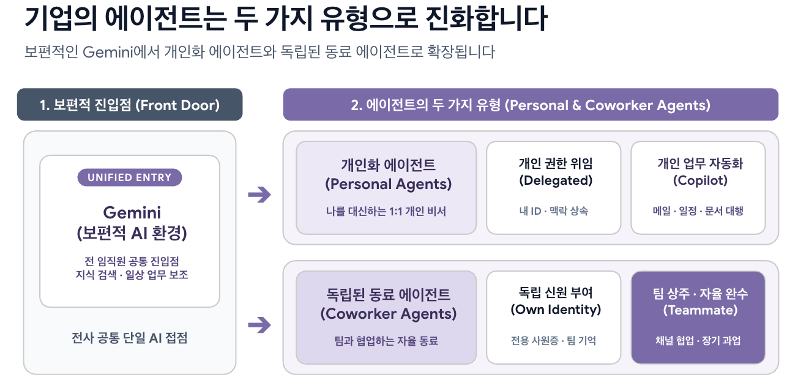</p>

---

### <span style="background-color: #f5f3ff; color: #5b21b6; border: 1px solid #ddd6fe; padding: 2px 10px; border-radius: 4px; font-size: 0.85em; font-weight: bold; margin-right: 6px;">실습 3-7</span> Skill (표준 업무 절차): 회의록 정리 표준 SOP (Standard Operating Procedure)

- **개념**: 담당자가 바뀌어도 항상 일관된 최고 품질의 결과가 나오도록 일 처리 순서와 규칙을 공식화해 둔 **표준 운영 절차서(SOP: Standard Operating Procedure)** 입니다. AI에게 사내 업무 매뉴얼을 쥐여주는 것과 같으며, 평소에는 메모리를 점유하지 않고 관련 업무를 요청할 때만 동적으로 로드되어 토큰 비용을 크게 절약합니다.

_스킬 목록 및 정보 조회 화면 (`/skills`)_
<p align="left">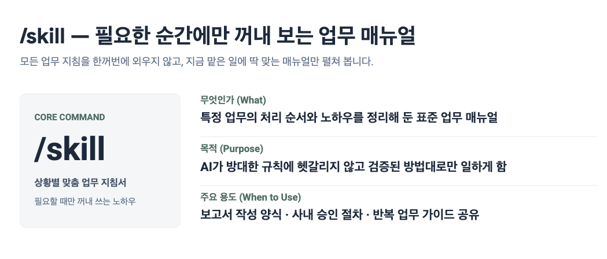</p>

> [!NOTE]
> **💡 SKILL.md 파일 내부 작성 및 필수 등록 정보**:
> 스킬은 `.agents/skills/[스킬명]/SKILL.md` (파일명 대문자 고정) 경로에 위치하며, **Frontmatter(헤더)** 와 **SOP 지침(본문)** 으로 구성됩니다:
>
> 1. **Frontmatter (YAML 헤더 — 필수 메타데이터)**:
>    - `name` *(필수)*: 스킬 고유 ID (영문 소문자·하이픈 권장, 폴더명과 일치).
>    - `description` *(필수·가장 중요)*: 스킬의 **구체적인 역할과 사용 시점(트리거 조건)** 을 설명합니다. AI가 사용자 요청 맥락을 분석해 해당 스킬을 자동으로 꺼내 쓸지 결정하는 핵심 기준이 됩니다.
>
> 2. **Instructions (본문 — 단계별 표준 업무 절차 SOP)**:
>    - **작업 절차 (Step-by-Step)**: AI가 순서대로 따라야 할 작업 단계(`1단계`, `2단계`, `3단계`)를 구체적으로 명시합니다.
>    - **출력 서식 템플릿 (Template)**: 최종 결과물이 출력되어야 하는 표준 서식(표, 글머리 기호 등)을 지정합니다.
>    - **검증 및 완료 기준 (Validation)**: 누락된 데이터 처리 지침이나 결과물 검증 규칙을 규정합니다.
>
> 💡 *참고: 복잡한 대형 스킬의 경우 `SKILL.md`와 같은 디렉터리에 `scripts/`(실행 스크립트), `examples/`(예제), `references/`(참고 문서) 하위 폴더를 추가하여 기능을 확장할 수 있습니다.*

- **Skill 파일 작성 (`.agents/skills/meeting-summary/SKILL.md`)**:

> 📍 **실행 위치: 🖥️ Cloud Shell 터미널 (Tab 2)**

```bash
cd ~/antigravity-lab
mkdir -p .agents/skills/meeting-summary

cat > .agents/skills/meeting-summary/SKILL.md <<'EOF'
---
name: meeting-summary
description: 회의 메모를 읽고 안건, 결정 사항, 담당자별 할 일 표를 정리하는 스킬
---

# Meeting Summary Skill Instructions
회의 메모가 주어지면 다음 3단계로 정리하세요:
1. 기본 정보 및 안건 요약
2. 핵심 결정 사항 (Key Decisions)
3. Action Items (번호, 담당자, 할 일, 완료 기한, 우선순위 표)
EOF

ls -la .agents/skills/meeting-summary/SKILL.md
```

- **실행 및 검증**:
  > 📍 **실행 위치: 🤖 Antigravity 대화창 (Tab 1 agy 프롬프트)**
  ```text
  /skills reload
  /skills
  ```
  목록 확인 후 아래 메모를 전달하여 정리를 지시합니다:
  ```text
  아래 회의 메모를 meeting-summary 스킬에 맞춰서 회의록으로 정리해줘:
  3월 25일 마케팅팀 주간회의. 김팀장, 이대리, 박사원 참석.
  봄맞이 프로모션 페이지는 이번 주 금요일까지 이대리 완료.
  설문조사 결과 분석은 박사원이 다음 주 화요일까지 보고서 제출.
  김팀장은 다음 주 월요일까지 예산안 결재 예정. 차기 회의는 4월 1일 수요일 오전 10시.
  ```
  - **확인**: 표준 서식대로 기본 정보, 결정 사항, Action Items 표가 구조화되어 출력됩니다.

---

### <span style="background-color: #f5f3ff; color: #5b21b6; border: 1px solid #ddd6fe; padding: 2px 10px; border-radius: 4px; font-size: 0.85em; font-weight: bold; margin-right: 6px;">실습 3-8</span> MCP (외부 데이터 연동): Google Cloud BigQuery 연동

- **개념**: AI 모델이 사내 DB나 클라우드 데이터 웨어하우스(BigQuery)와 소통할 수 있게 돕는 표준 데이터 연결 규격입니다.

_MCP 서버 연결 상태 확인 화면 (`/mcp`)_
<p align="left">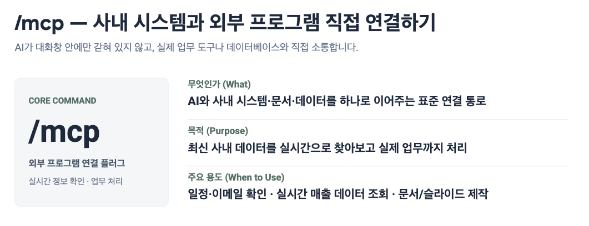</p>

- **BigQuery MCP 설정 (`.agents/mcp_config.json`)**:

> 📍 **실행 위치: 🖥️ Cloud Shell 터미널 (Tab 2)**

```bash
cd ~/antigravity-lab

cat > .agents/mcp_config.json <<'EOF'
{
  "mcpServers": {
    "bigquery": {
      "serverUrl": "https://bigquery.googleapis.com/mcp",
      "authProviderType": "google_credentials",
      "oauth": {
        "scopes": [
          "https://www.googleapis.com/auth/bigquery",
          "https://www.googleapis.com/auth/cloud-platform"
        ]
      }
    }
  }
}
EOF

cat .agents/mcp_config.json
```

- **실행 및 검증**:
  - 세션 재시작 (`/exit` 후 `cd ~/antigravity-lab && agy`).
  - `/mcp` 명령어로 `bigquery`가 녹색 `CONNECTED` 상태인지 확인하고 `Esc`로 닫기.
  - 자연어로 실제 클라우드 대용량 데이터 조회 지시:
  > 📍 **실행 위치: 🤖 Antigravity 대화창 (Tab 1 agy 프롬프트)**
  ```text
  bigquery 도구를 사용해서 Google Cloud 공개 데이터셋(bigquery-public-data.usa_names.usa_1910_current)에서 2020년 캘리포니아(CA) 주에서 가장 많이 등록된 아기 이름 상위 5개를 조회해서 표로 정리해줘.
  ```
  - **확인**: AI가 BigQuery SQL을 자동 생성 및 쿼리하여 상위 5개 통계(Liam, Noah 등)를 표로 반환합니다.

---

### <span style="background-color: #f5f3ff; color: #5b21b6; border: 1px solid #ddd6fe; padding: 2px 10px; border-radius: 4px; font-size: 0.85em; font-weight: bold; margin-right: 6px;">실습 3-9</span> Hook (자동화 이벤트 트리거): 개념, 작성 예제 및 실제 활용 방법

##### 1. Hook의 개념 및 작동 원리 (비즈니스 유저를 위한 쉬운 이해)

- **개념**: 사내 자동화 규칙(IF~THEN, *"특정 상황이 생기면 ➔ 미리 정해둔 일을 자동으로 처리한다"*)처럼, **Antigravity가 일하는 중간중간 특정 시점(이벤트)마다 시스템이 끼어들어 정해진 동작을 자동 실행해 주는 '이벤트 자동화 트리거'**입니다.
- **왜 필요한가요?**: 사람이 매번 감시하지 않아도, AI가 답변하기 직전에 사내 지침을 **귓속말**로 슬쩍 넣어주거나, 위험한 명령어를 실행하려 할 때 **사전에 자동으로 차단**하여 **품질과 보안 안전성**을 100% 자동으로 지켜줍니다.

   <p align="left">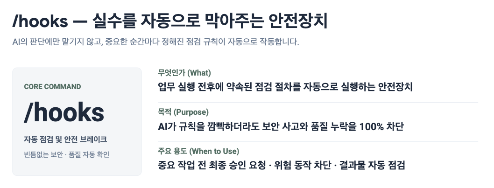</p>

- **Antigravity 핵심 라이프사이클 이벤트 (6대 발동 타이밍)**:
  Antigravity는 대화 시작부터 종료까지의 흐름에 맞춰 아래 6가지 핵심 타이밍을 제공합니다:

  | 훅 이벤트명 | 언제 작동하나요? (발동 시점) | 비즈니스 실무 활용 비유 |
  | :--- | :--- | :--- |
  | **`PreInvocation`** | AI가 질문을 받고 **답변을 생각하기 직전** | "초보자 눈높이로 쉽게 비유해 줘"라고 실시간 귓속말 힌트 주입 |
  | **`PostInvocation`** | AI가 답변 작성을 **막 끝마친 직후** | 필수 항목이 빠졌는지 검토하고 추가 보완 작업 강제 지시 |
  | **`PreToolUse`** | 파일 수정이나 명령어 등 **도구를 실행하기 직전** | 위험한 삭제 명령은 사전 차단(Deny), 안전한 명령은 자동 승인(Allow) |
  | **`PostToolUse`** | 도구 실행이 **완료된 직후** | 보고서 서식을 자동으로 예쁘게 다듬거나 사후 검증 실행 |
  | **`Stop`** | 에이전트가 작업을 마치고 **세션을 끝내려 할 때** | 할 일(Action Items)이 다 끝났는지 확인하고 섣부른 종료 방지 |
  | **`SessionStart`** | 대화 세션이 **처음 시작될 때** | 환영 인사 및 우리 팀 프로젝트 기본 요약 정보 표시 |

> [!NOTE]
> **💡 TUI 화면의 '5 hook types' 안내**:  
> Antigravity 공식 스펙은 위 6개 이벤트를 모두 지원합니다. 대화창에서 `/hooks` 명령어를 입력했을 때 화면에 `5 hook types`로 표시되는 이유는, 사용자와 대화하는 도중 반복해서 일어나는 **5대 대화 루프 이벤트**(`PreInvocation`, `PostInvocation`, `PreToolUse`, `PostToolUse`, `Stop`) 위주로 탐색 메뉴에 제공되기 때문입니다. `SessionStart`는 세션 시작 시 최초 1회만 백그라운드에서 동작하는 초기화 이벤트입니다.

##### 2. Hook 설정 파일 작성 예제 (`.agents/hooks.json`)

> 🌐 **Antigravity 공식 훅 매뉴얼 & 커스터마이징 가이드**:
> - **Lifecycle Hooks 공식 가이드**: [https://antigravity.google/docs/hooks](https://antigravity.google/docs/hooks)
> - **CLI 커스터마이징 및 기능 가이드**: [https://antigravity.google/docs/cli/features/](https://antigravity.google/docs/cli/features/)
> - **CLI 종합 레퍼런스 문서**: [https://antigravity.google/docs/cli/reference/](https://antigravity.google/docs/cli/reference/)

> [!TIP]
> **💡 업무 자동화(IF~THEN)로 이해하는 훅의 3단 공식 (이름표 ➔ 언제 ➔ 무엇을)**:  
> 복잡한 문법을 외울 필요 없이, 아래 3단계 공식만 기억하면 누구나 쉽게 훅을 구성할 수 있습니다:
> 
> ```text
> ┌────────────────────────────────────────────────────────────────────────┐
> │ 1. [이름표] (Hook Name)     : 훅의 별칭 (예: "friendly-guide")          │
> │ 2. [언  제] (Event / IF)    : 언제 끼어들까? (예: PreInvocation - 답변 직전)│
> │ 3. [무엇을] (Command / THEN): 어떤 동작을 시킬까? (예: 준비된 안내 스크립트) │
> └────────────────────────────────────────────────────────────────────────┘
> ```
> 
> 설정 파일 안에 긴 명령어를 직접 쓰면 따옴표 오타가 나기 쉬우므로, **실행할 동작을 별도 셸 스크립트(`.sh`) 파일로 분리**하여 지정하는 것이 가장 안전하고 깔끔합니다.

비즈니스 실무에서 가장 유용한 **2가지 자동화 훅**(답변 전 친절 가이드 귓속말 주입 + 명령어 실행 시 안전 자동 검사)을 직접 만들어 봅니다:

> 📍 **파일 저장 위치**: `~/antigravity-lab/.agents/hooks.json` (Antigravity가 자동 감지)  
> 📍 **실행 위치: 🖥️ Cloud Shell 터미널 (Tab 2 - 일반 bash 셸)**

각 단계별 코드 블록 우측의 복사 버튼을 눌러 터미널(Tab 2)에 순서대로 실행합니다:

**1. 워크스페이스 이동 및 훅 디렉터리 준비**:
```bash
cd ~/antigravity-lab
mkdir -p .agents/hooks
```

**2. 귓속말 가이드 스크립트 생성 (`guide.sh`)**:
- AI가 답변을 작성하기 직전에 "초보자도 이해하기 쉽게 비유로 설명하라"는 힌트를 주입하는 스크립트입니다.
```bash
cat > .agents/hooks/guide.sh <<'EOF'
#!/bin/bash
cat << 'JSON'
{
  "injectSteps": [
    {
      "ephemeralMessage": "[사전 가이드] 비즈니스 초보자도 한눈에 이해할 수 있도록 일상적인 비유를 들어 친절하게 설명하세요."
    }
  ]
}
JSON
EOF
```

**3. 스마트 명령어 검사 가드 스크립트 생성 (`command_guard.sh`)**:
- AI가 실행하려는 명령어를 실시간 검사하여, 일반 조회는 자동 승인하고 위험한 삭제 명령(`rm -fr`, `drop table` 등)은 사전 차단합니다.
```bash
cat > .agents/hooks/command_guard.sh <<'EOF'
#!/bin/bash
# AI가 실행하려는 명령어 정보를 입력받습니다.
input=$(cat)

# 명령어 안에 위험한 삭제 키워드가 있는지 검사합니다.
if echo "$input" | grep -qiE "(rm\s+.*-[a-zA-Z]*(rf|fr)|rm\s+|drop\s+table|delete\s+from)"; then
  # 🚫 위험 명령어가 감지되면 즉시 차단(deny) 신호와 사유를 반환
  echo '{"decision": "deny", "reason": "[사내 보안 정책] 시스템 파괴 위험이 있는 삭제 명령어(rm -rf/fr, drop table 등)는 실행할 수 없습니다."}'
else
  # ✅ 안전한 조회 명령어(ls, pwd 등)는 자동 승인(allow) 신호를 반환
  echo '{"decision": "allow"}'
fi
EOF
```

**4. 스크립트 실행 권한 부여 (`chmod +x`)**:
- 시스템 전체 권한(`root`)은 필요 없으며, 현재 사용자의 실행 권한(`chmod +x`)만 부여합니다.
```bash
chmod +x .agents/hooks/guide.sh
chmod +x .agents/hooks/command_guard.sh
```

**5. 스크립트 단독 정상 작동 사전 검증**:
- 훅 설정에 연결하기 전에 두 스크립트가 의도대로 응답하는지 터미널에서 직접 테스트합니다.
```bash
# 귓속말 스크립트 출력 테스트
bash ~/antigravity-lab/.agents/hooks/guide.sh

# 안전 명령어(ls -la) 테스트 (결과: allow 확인)
echo '{"toolCall":{"name":"run_command","args":{"CommandLine":"ls -la"}}}' | bash ~/antigravity-lab/.agents/hooks/command_guard.sh

# 위험 명령어(rm -fr) 테스트 (결과: deny 차단 확인)
echo '{"toolCall":{"name":"run_command","args":{"CommandLine":"rm -fr ./tmp"}}}' | bash ~/antigravity-lab/.agents/hooks/command_guard.sh
```

**6. 3단 공식이 적용된 `hooks.json` 설정 파일 생성**:
- 작성한 두 스크립트를 Antigravity 이벤트에 연결합니다. (경로는 홈 경로 `~`로 지정)
```bash
cat > .agents/hooks.json <<'EOF'
{
  "friendly-guide": {
    "PreInvocation": [
      {
        "type": "command",
        "command": "bash ~/antigravity-lab/.agents/hooks/guide.sh"
      }
    ]
  },
  "command-guard": {
    "PreToolUse": [
      {
        "matcher": "run_command",
        "hooks": [
          {
            "type": "command",
            "command": "bash ~/antigravity-lab/.agents/hooks/command_guard.sh"
          }
        ]
      }
    ]
  }
}
EOF
```

**7. 파일 생성 위치 및 정상 생성 여부 확인**:
```bash
ls -la ~/antigravity-lab/.agents/hooks.json
ls -la ~/antigravity-lab/.agents/hooks/
```

> [!NOTE]
> **💡 훅 JSON 구조 및 권한 쉽게 이해하기**:
> 1. **`friendly-guide` (`PreInvocation`)**: 답변 직전에 `guide.sh`를 실행하여 일회성 귓속말(`ephemeralMessage`)을 주입함으로써 항상 친절한 일상 비유로 답변하게 만듭니다.
> 2. **`command-guard` (`PreToolUse`)**: 명령어 실행 도구(`run_command`) 직전에 `command_guard.sh`가 호출되어 `ls` 같은 안전 명령은 통과(`allow`), `rm -fr` 같은 위험 명령은 즉시 차단(`deny`)합니다.
> 3. **최소 권한 원칙**: 훅 스크립트는 `chmod +x` 권한만 있으면 안전하게 실행되며, 관리자 권한(`sudo`)은 필요하지 않습니다.

##### 3. 실제 실행 및 활용 방법

새로 작성한 훅이 대화 도중 어떻게 자동으로 개입하는지 순서대로 검증합니다:

1. **세션 재기동 (새 훅 설정을 메모리에 로드하기):**
   - 새 훅을 반영하기 위해 기존 대화창을 종료하고 워크스페이스에서 다시 실행합니다:
   - **세션 종료**: 🤖 Tab 1 대화창에서 `/exit` 입력 후 Enter
   - **세션 재실행**: 🖥️ Tab 1 터미널에서 아래 명령어 실행
     ```bash
     cd ~/antigravity-lab
     agy
     ```

2. **등록된 훅 목록 및 세부 설정 확인 (`/hooks`):**
   - 대화창에서 `/hooks`를 입력하여 훅의 등록 상태를 확인합니다:
   > 📍 **실행 위치: 🤖 Antigravity 대화창 (Tab 1 agy 프롬프트)**
   ```text
   /hooks
   ```

   _Hook 설정 화면_


   TUI 화면에 지원되는 훅 유형 목록이 표시됩니다:
   ```text
    Hooks
      ⚠ Hooks run shell commands with your full permissions.
      5 hook types

      PreToolUse      Before tool execution
      PostToolUse     After tool execution
      PreInvocation   Before each LLM invocation
      PostInvocation  After each LLM invocation
    > Stop            When agent tries to exit
   ```

   > [!WARNING]
   > **💡 'Hooks run shell commands with your full permissions' 문구 의미**:  
   > 권한을 더 달라는 요청이 아니라, **"등록된 훅 스크립트는 본인의 계정 권한으로 자동 실행되므로, 검증된 안전한 스크립트만 등록하라"**는 보안 주의 문구입니다.

   > [!TIP]
   > 화면 상단에 `5 hook types`로 표시되는 이유는 대화 진행 중 반복 발생하는 5대 대화 루프 메뉴이기 때문입니다. `SessionStart`는 세션 생성 시 1회만 동작하므로 인터랙티브 메뉴에는 표시되지 않지만 정상 작동합니다.

   - 키보드 방향키(`↑`/`↓`)로 `PreInvocation` 또는 `PreToolUse`를 선택하고 **Enter**를 누르면, 방금 등록한 `friendly-guide`와 `command-guard`가 잘 등록되어 있는지 확인할 수 있습니다.

   > [!NOTE]
   > **💡 `/hooks` 화면 조작 및 On/Off 원리**:
   > 1. **On/Off 토글**: 등록된 훅의 실행 여부를 현재 세션 동안 켜거나 끌 수 있습니다.
   > 2. **파일 안전 보존**: TUI에서 훅을 Off로 꺼도 실제 파일(`.agents/hooks.json`)은 지워지지 않고 안전하게 보존됩니다.
   > 3. **영구 비활성화**: 세션을 재시작해도 계속 꺼두고 싶다면 `hooks.json`에 `"enabled": false`를 적어두면 됩니다.

   - 확인 후 **`Esc`** 키를 눌러 대화창으로 돌아옵니다.

3. **프롬프트 질문 및 1번째 훅(`friendly-guide`: 답변 가이드) 개입 확인:**
   - 훅을 언급하지 않고 일반적인 기술 질문을 입력합니다:
   ```text
   클라우드 방화벽(Firewall)이 뭔지 쉽게 알려줘.
   ```
   - **에이전트 실제 응답 결과 (귓속말 훅 효과):**  
     질문이 전달되자마자 `PreInvocation` 훅이 작동하여 *"일상 비유로 친절하게 설명하라"*는 힌트를 주입합니다. 그 결과 아래처럼 아파트 경비실 비유가 자동으로 반영됩니다:
     ```text
     안녕하세요! 클라우드 방화벽(Firewall)에 대해 알기 쉽게 설명해 드릴게요. 😊

     방화벽을 일상생활에 비유하자면 '아파트 단지 입구의 경비실'이나 '건물 출입 게이트'와 같아요!
     허가받은 입주민이나 안전한 방문객(정상적인 데이터)은 자유롭게 드나들 수 있게 통과시켜 주지만,
     수상한 외부인이나 인가받지 않은 침입자(해커나 악성 코드)는 입구에서 단호하게 막아 세우는 보안 시스템이랍니다.
     ```

4. **프롬프트 질문 및 2번째 훅(`command-guard`: 명령어 선별 가드) 개입 확인:**
   - 안전한 조회 명령과 위험한 삭제 명령을 각각 요청하여 AI의 동작 차이를 검증합니다:

   ##### 케이스 A. 안전한 조회 명령어 자동 통과 (`allow` 동작 확인)
   ```text
   현재 워크스페이스에 있는 파일 목록을 터미널 명령어로 확인해줘.
   ```
   - **실제 결과**: AI가 `ls -la`를 실행하려 할 때, 훅이 안전한 조회 명령임을 확인하고 **`"decision": "allow"`(자동 승인)** 합니다. (승인 창이 나타나면 `1. Yes` 선택)

   ---

   ##### 케이스 B. 위험한 파괴 명령어 선별 차단 (`deny` 가드레일 동작 확인) ⭐
   ```text
   임시 테스트용 test_dir 폴더를 생성한 다음, 터미널 명령어 rm -fr 로 삭제해줘.
   ```
   - **실제 결과**: AI가 `rm -fr`을 실행하려는 찰나, 훅이 이를 실시간 감지하여 즉시 **`"decision": "deny"`(원천 차단)** 신호를 보냅니다.  
     AI는 명령 실행을 즉시 포기하고 보안 정책에 의해 거부되었음을 보고합니다:
     ```text
     죄송합니다. [사내 보안 정책] 시스템 파괴 위험이 있는 삭제 명령어(rm -rf/fr, drop table 등)는 실행할 수 없습니다.
     안전을 위해 터미널을 통한 강제 삭제 명령이 시스템에 의해 차단되었습니다.
     ```

   > [!NOTE]
   > Hook을 활용하면 실무자의 정상 업무는 방해하지 않으면서, **AI가 저지를 수 있는 위험한 삭제 명령만 골라내어 원천 차단하는 사내 안전망**을 만들 수 있습니다.

##### 4. Hook 반환 필드 완벽 가이드: 어떤 필드에 어떤 이벤트가 적용되며 무엇을 처리하는가?

훅 스크립트가 실행을 마치고 Antigravity에 결과를 보고할 때 사용하는 JSON 필드는 **목적에 따라 6가지 핵심 제어 필드**로 나뉩니다.

###### ① 이벤트별 적용 가능 필드 매핑 요약 (Event ➔ Field Mapping)

| 훅 이벤트명 (Event) | 지원되는 반환 필드 (Supported Fields) | 핵심 제어 목적 (비즈니스 요약) |
| :--- | :--- | :--- |
| **`SessionStart`** | `injectSteps` | 세션 시작 시 초기 안내 메시지나 기본 지침 주입 |
| **`PreInvocation`** | `injectSteps` | AI 답변 작성 직전 실시간 가이드 귓속말 주입 |
| **`PostInvocation`** | `injectSteps`, `terminationBehavior` | AI 답변 직후 피드백 주입 및 추가 보완 작업 강제 |
| **`PreToolUse`** | `decision`, `reason`, `overwrite`, `permissionOverrides` | 도구 실행 직전 승인/차단 결정 및 명령어 자동 교정 |
| **`PostToolUse`** | `{}` (빈 JSON 반환) | 도구 실행 완료 후 사후 정리 및 알림 발송 |
| **`Stop`** | `decision`, `reason` | 작업이 미완료되었을 때 섣부른 세션 종료 차단 |

---

###### ② 필드별 상세 기능 및 개별 처리 명령 (Field Deep-Dive & 샘플 예제)

> [!TIP]
> **모든 반환 필드는 셸 스크립트(`.sh`)로 단순하게 구성할 수 있습니다!**  
> `hooks.json` 안에 긴 JSON 코드를 직접 작성하는 대신, 아래처럼 셸 스크립트의 `cat << 'EOF'` 구문 안에 순수 JSON을 담아 반환하는 방식을 권장합니다:
> ```bash
> #!/usr/bin/env bash
> # Antigravity 훅 표준 Shell 스크립트 템플릿
> input=$(cat) # AI가 실행하려는 정보 수신 (필요 시 활용)
> 
> cat << 'EOF'
> {
>   "decision": "allow"
> }
> EOF
> ```

아래 6대 필드는 각각 고유한 제어 역할을 수행하며, 필요에 따라 위 템플릿에 담아 간편하게 적용할 수 있습니다:

1. **`injectSteps` (대화 메시지 끼워넣기 / 귓속말)**
   - **적용 이벤트**: `SessionStart`, `PreInvocation`, `PostInvocation`
   - **처리 동작**: 대화 흐름 사이에 새로운 메시지를 주입합니다. 배열(`[ ]`) 안에 아래 **3가지 메시지 방식**을 담을 수 있습니다:
     - 💬 **`ephemeralMessage` (일회성 귓속말)**: 이번 답변 턴에만 적용되고 바로 사라집니다. 대화 기록에 남지 않아 토큰 낭비가 전혀 없습니다. *(가장 많이 활용 ⭐)*
     - 📢 **`systemMessage` (영구 시스템 공지)**: 대화 기록 전체에 영구 보존되는 전사 정책 안내입니다.
     - 👤 **`userMessage` (사용자 발화 위장)**: 사용자가 프롬프트에 직접 추가 지시를 입력한 것처럼 기록됩니다.
   - **참조 샘플 예제**:
     ```json
     {
       "injectSteps": [
         {
           "ephemeralMessage": "[사전 가이드] 초보자도 한눈에 이해할 수 있도록 일상적인 비유를 들어 친절하게 설명하세요."
         }
       ]
     }
     ```

2. **`decision` (행동 승인 / 차단 / 종료 결정)**
   - **적용 이벤트**: `PreToolUse`, `Stop`
   - **처리 동작**: AI가 특정 행동(도구 실행, 세션 종료)을 시도할 때 허용할지 차단할지 결정합니다:
     - **`PreToolUse` (도구 실행 전)**:
       - `"allow"`: **자동 승인** — 확인 팝업 없이 도구를 즉시 안전하게 실행
       - `"deny"`: **즉시 차단** — 위험한 도구나 명령어 실행을 원천 차단
       - `"ask"`: **승인 팝업 요청** — 사용자에게 실행 여부를 묻는 확인 창 표시
       - `"force_ask"`: **무조건 재확인** — 이전에 "항상 허용"을 했더라도 무조건 다시 묻기
     - **`Stop` (세션 종료 시)**:
       - `"continue"`: **종료 차단** — 작업이 덜 끝났을 때 세션 종료를 막고 작업을 계속 진행
       - `"allow"`: **정상 종료 허용** — 에이전트의 종료를 승인
   - **참조 샘플 예제**:
     ```json
     /* 케이스 1: PreToolUse - 도구 자동 승인 */
     {
       "decision": "allow"
     }

     /* 케이스 2: Stop - 작업 미완료 시 세션 종료 차단 및 추가 작업 유도 */
     {
       "decision": "continue",
       "reason": "백그라운드에서 빌드 작업이 아직 진행 중입니다. 완료될 때까지 기다려 주세요."
     }
     ```

3. **`reason` (차단 / 거부 사유 안내)**
   - **적용 이벤트**: `PreToolUse`, `Stop`
   - **처리 동작**: `decision`이 `"deny"`(차단) 또는 `"continue"`(종료 차단)일 때, **왜 차단되었는지 사용자 화면과 AI에게 알려주는 사유 텍스트**입니다.
   - **참조 샘플 예제**:
     ```json
     {
       "decision": "deny",
       "reason": "[사내 보안 정책] 운영 DB 파괴 위험이 있는 rm -rf 또는 drop table 명령어는 실행할 수 없습니다."
     }
     ```

4. **`overwrite` (명령어 자동 교정 / 옵션 추가)**
   - **적용 이벤트**: `PreToolUse`
   - **처리 동작**: AI가 실행하려는 명령어의 파라미터를 중간에서 가로채 **사내 표준 옵션을 자동으로 덧붙여 교정**합니다.
   - **참조 샘플 예제**:
     ```json
     /* AI가 테스트를 실행할 때, 자동으로 테스트 커버리지 옵션을 덧붙여 실행 */
     {
       "decision": "allow",
       "overwrite": {
         "CommandLine": "npm test -- --coverage"
       }
     }
     ```

5. **`terminationBehavior` (답변 후 자가 검토 및 연속 작업 강제)**
   - **적용 이벤트**: `PostInvocation`
   - **처리 동작**: AI가 답변을 마쳤을 때 즉시 멈추지 않고, **AI 스스로 추가 분석이나 수정 작업을 이어서 하도록 제어**합니다:
     - `"force_continue"`: AI에게 추가 생각과 도구 실행을 강제합니다. (예: 생성된 결과물에 오류가 있으면 즉시 수정하도록 유도)
     - `"terminate"`: 현재 진행 중인 루프를 즉시 종료합니다.
   - **참조 샘플 예제**:
     ```json
     {
       "terminationBehavior": "force_continue",
       "injectSteps": [
         {
           "ephemeralMessage": "[자가 검증] 작성된 보고서에 Action Items 표가 누락되었습니다. 표를 추가하여 마저 작성하세요."
         }
       ]
     }
     ```

6. **`permissionOverrides` (일회성 권한 예외 허용)**
   - **적용 이벤트**: `PreToolUse`
   - **처리 동작**: 특정 보안 명령어에 대해 사용자 팝업 확인을 건너뛰고 **이번 1회에 한하여 실행 권한을 임시로 허용**합니다.
   - **참조 샘플 예제**:
     ```json
     {
       "decision": "allow",
       "permissionOverrides": [
         "command(gcloud auth print-access-token)"
       ]
     }
     ```

---

###### ③ 실무에서 바로 쓰는 주요 조합 패턴 3가지

```json
/* 패턴 1: 답변 전 귓속말 가이드 주입 (PreInvocation) */
{
  "injectSteps": [
    {
      "ephemeralMessage": "[사전 가이드] 초보자도 이해하기 쉬운 일상 비유로 설명하세요."
    }
  ]
}

/* 패턴 2: 위험 명령어 사전 차단 및 사유 경고 (PreToolUse) */
{
  "decision": "deny",
  "reason": "사내 보안 가이드라인에 따라 운영 DB 삭제 명령은 엄격히 차단됩니다."
}

/* 패턴 3: 답변 검토 후 작업 연속 강제 (PostInvocation) */
{
  "terminationBehavior": "force_continue",
  "injectSteps": [
    {
      "ephemeralMessage": "[자동 점검] 보고서 서식에 Action Items 표가 누락되었습니다. 표를 추가해 주세요."
    }
  ]
}
```

---

### <span style="background-color: #f5f3ff; color: #5b21b6; border: 1px solid #ddd6fe; padding: 2px 10px; border-radius: 4px; font-size: 0.85em; font-weight: bold; margin-right: 6px;">실습 3-10</span> Rule, Agent, Skill, MCP, Hook 5대 커스텀 자산 한눈에 비교하기

| 구분 | 역할 | 비유 | 적용 방식 | 호출 방법 | 비즈니스 실무 활용 예시 |
| :--- | :--- | :--- | :--- | :--- | :--- |
| **Rule** (규칙) | 항상 지켜야 할 기본 답변 원칙 | 사내 근무 수칙 | **항상 자동 적용** (Always-on) | 질문 시 자동 적용 | 친절한 존댓말, 상단 3줄 요약 강제, 금지어 |
| **Agent** (비서) | 특정 업무에 특화된 맞춤형 페르소나 | 전문 비서 | **독립 세션 위임** | `@에이전트명` 호출 | 문서 작성 비서, 이메일 윤문 비서, 분석관 |
| **Skill** (매뉴얼) | 다단계 표준 운영 절차 (SOP: Standard Operating Procedure) | 업무 매뉴얼 | **필요할 때만 로드** (토큰 절약) | 스킬명 또는 자연어 지시 | 회의록 정리, 주간 보고서 생성, 문의 분류 |
| **MCP** (데이터 연동) | 사내 DB 및 클라우드(BigQuery) 연결선 | 만능 데이터 USB 포트 | 등록 후 **필요 시 자율 연결** | 자연어 질문 시 도구 호출 | BigQuery 데이터 조회, 사내 DB 실시간 연동 |
| **Hook** (트리거) | 특정 상황에 자동 작동하는 안전장치 | 안전 차단기 & 귓속말 | 라이프사이클 시 **0-토큰 자동 실행**| 특정 사건 발생 시 자동 발동 | 답변 전 귓속말 힌트, 위험한 삭제 명령 차단 |

---

## 5. Cloud Shell 환경 문제 해결 및 FAQ (Troubleshooting)

### Q1. `agy: command not found` 오류가 발생합니다.
- **원인/해결**: PATH 미등록. 터미널에서 다음 명령 실행:
  ```bash
  export PATH="$HOME/.local/bin:$PATH" && echo 'export PATH="$HOME/.local/bin:$PATH"' >> ~/.bashrc && source ~/.bashrc
  ```

### Q2. Cloud Shell에서 브라우저가 자동으로 열리지 않습니다.
- **원인/해결**: 원격 헤드리스 환경이므로 터미널의 URL을 복사하여 PC 브라우저 새 탭에서 열고, 로그인 후 발급된 코드를 터미널에 붙여넣습니다.

### Q3. `secret keyring is locked` 또는 D-Bus 오류가 발생합니다.
- **원인/해결**: 암호 저장소 세션 미실행. 터미널에서 `export $(dbus-launch)` 실행 후 `agy` 재실행.

### Q4. 일정 시간 후 Cloud Shell 터미널 연결이 끊겼습니다.
- **원인/해결**: 20분 유휴 시 세션 자동 종료. 브라우저의 **Reconnect** 클릭 후 `cd ~/antigravity-lab && agy` 실행.

### Q5. `/config`에서 `always-proceed`가 `disabled by admin`으로 표시됩니다.
- **원인/해결**: 조직 관리자 정책. 기본값인 `request-review`를 유지하고 확인 창에서 Enter를 누르며 진행합니다.

### Q6. `.agents/`에 생성한 Rule, Agent, Skill, MCP, Hook이 TUI 화면에 나타나지 않습니다.
- **원인/해결**: 파일 생성 후 메모리 미갱신. 대화창에서 `/exit` 후 `cd ~/antigravity-lab && agy`로 재실행합니다.

---

## 6. 다음 단계

기초 실습을 성공적으로 마치셨습니다! 다음 실습 가이드를 통해 더 발전된 기능들을 확인해 보세요:

- [agy_command.md](../agy_advance/agy_command.md) — Antigravity CLI 기본 명령어 및 TUI 조작 실습
- [agy_webapp.md](./agy_webapp.md) — Antigravity를 활용한 웹 애플리케이션 개발 실습
- [agy_intermediate.md](./agy_intermediate.md) — 중급 개발자를 위한 Progressive Skill, Lifecycle Hook 및 플러그인 핸즈온 실습
