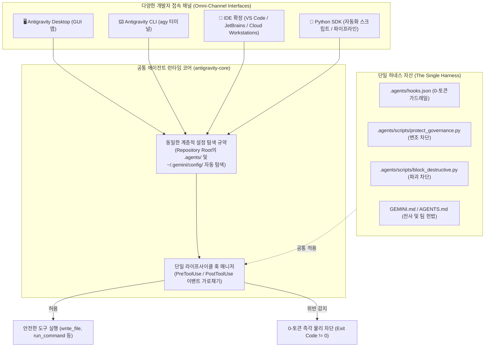
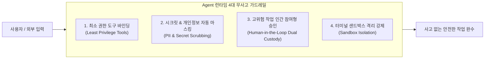
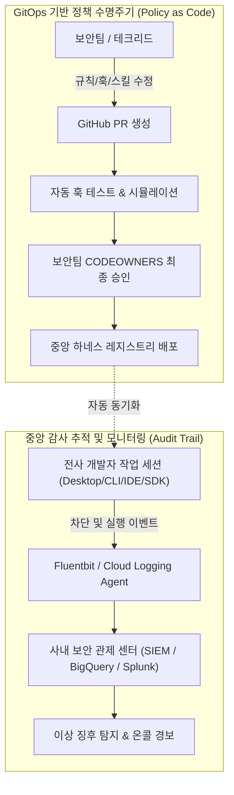

# Antigravity 엔터프라이즈 하네스(Harness) 및 전사 거버넌스 가이드 (agy_harness)

본 문서는 **Antigravity CLI(`agy`)** 및 에이전트 시스템을 전사(Enterprise) 조직에 안전하고 효율적으로 도입하기 위한 **AI 하네스(Harness) 아키텍처 및 전사 거버넌스 프레임워크 전문 가이드**입니다.

> 💡 **선수 과정**:
> 본 문서는 [agy_basic.md](./agy_basic.md)의 기초 조작법 및 [agy_tokenomics.md](./agy_tokenomics.md)의 단계별 심화 실습(Step 1 ~ Step 4: 서브에이전트, 스킬, 훅, 플러그인)을 이수한 개발자, 테크 리드 및 보안/플랫폼 엔지니어를 대상으로 합니다.

---

## 📑 목차 (Table of Contents)

1. [AI 하네스(Harness) 개념 및 6대 핵심 통제 메커니즘](#1-ai-하네스harness-개념-및-6대-핵심-통제-메커니즘)
2. [옴니채널 하네스: "One Harness to Rule Them All"](#2-옴니채널-하네스-one-harness-to-rule-them-all)
3. [프로젝트 도메인 하네스 배포 3대 채널](#3-프로젝트-도메인-하네스-배포-3대-채널)
4. [개발자 임의 변경을 원천 차단하는 4단계 심층 방어선](#4-개발자-임의-변경을-원천-차단하는-4단계-심층-방어선)
5. [개발자 친화적 DX 운영 전략](#5-개발자-친화적-dx-운영-전략)
6. [에이전트 런타임 4대 무사고 보안 원칙](#6-에이전트-런타임-4대-무사고-보안-원칙)
7. [[실습] 고도화된 거버넌스 훅 구현 (액셔너블 피드백 + JSONL 감사 로그)](#7-실습-고도화된-거버넌스-훅-구현-액셔너블-피드백--jsonl-감사-로그)
8. [[실습] 훅 매니페스트 통합 등록 (.agents/hooks.json)](#8-실습-훅-매니페스트-통합-등록-agentshooksjson)
9. [[실습] 사내 보안 설정 자율 변조 시도 및 실전 검증](#9-실습-사내-보안-설정-자율-변조-시도-및-실전-검증)
10. [[실습] 전사 배포 및 무결성 검증 자동화 스크립트 작성 (deploy_harness.sh)](#10-실습-전사-배포-및-무결성-검증-자동화-스크립트-작성-deploy_harnesssh)
11. [중앙 집중식 감사 추적(SIEM) 및 정책 수명주기(Policy as Code)](#11-중앙-집중식-감사-추적siem-및-정책-수명주기policy-as-code)
12. [전사 거버넌스 운영 책임 매트릭스 (RACI Matrix)](#12-전사-거버넌스-운영-책임-매트릭스-raci-matrix)

---

## 1. AI 하네스(Harness) 개념 및 6대 핵심 통제 메커니즘

기업에서 Antigravity를 전사적으로 확대 도입할 때 가장 경계해야 하는 것은 **통제되지 않는 자유도**입니다.

> 💡 **비유로 이해하기**:  
> 야생마의 엄청난 질주력을 안전하게 활용하려면 **말안장과 고삐(Harness)** 가 필수적입니다.  
> **Antigravity 하네스(Harness)** 란 최신 LLM의 놀라운 지능은 100% 흡수하되, **실행 권한·토큰 비용·설정 파일 무결성은 회사의 엄격한 통제선 안에 가두는 전사 아키텍처 거버넌스**를 의미합니다.

### 하네스가 없는 환경에서 발생하는 엔터프라이즈 4대 리스크
1. **보안 및 크리덴셜 탈취**: AI가 프롬프트 인젝션에 속아 사내 접속 토큰이나 개인정보(PII)를 외부에 노출하거나 임의 커밋하는 사고.
2. **FinOps 통제 불능 (비용 폭증)**: 대화 턴마다 모든 사내 규정을 주입하거나 무분별하게 초거대 모델(Pro)을 호출하여 수천만 원의 API 비용이 누수되는 문제.
3. **시스템 파괴 및 데이터 영구 손실**: 사용자의 모호한 지시나 AI의 판단 착오로 프로덕션 DB 테이블이나 클라우드 인프라가 영구 삭제되는 재난.
4. **설정 자체 변조 (AI의 보안 가드레일 우회 시도)**: AI가 도구 실행 권한을 이용해 스스로 차단 훅(`hooks.json`)이나 규칙(`GEMINI.md`)을 편집/삭제하여 보안 통제를 무력화하는 위험.

### 하네스 역설(The Harness Paradox)과 골든 패스(Golden Path) 거버넌스 철학
많은 기업 보안팀이 하네스를 구축할 때 범하는 가장 흔한 실수는 **"모든 것을 금지하는 벽(Blocker)"**을 쌓는 것입니다.
- 통제가 지나치게 엄격하면 개발자는 AI 도구 사용을 포기하거나, 개인 계정/사적 노트북을 통한 **섀도우 AI(Shadow AI)**로 우회하여 더 심각한 정보 유출 사고를 일으킵니다.
- 반대로 통제가 너무 느슨하면 프로덕션 DB 삭제나 시크릿 유출 같은 치명적인 보안 참사로 직결됩니다.

따라서 성숙한 기업의 하네스는 **"막아서 멈추게 하는 벽"**이 아니라, **"그 길을 따라가면 가장 빠르고 안전하게 배포되는 포장도로, 즉 골든 패스(Golden Path)"**여야 합니다.  
개발자에게는 *"회사 규정을 몰라도 하네스 안에서 일하면 저절로 최고 보안 등급을 만족한다"*는 심리적 안전감을 제공하고, 에이전트에게는 *"허용된 울타리 내에서 최대의 성능을 발휘하도록 권한을 명확히 한정"*하는 것이 엔터프라이즈 거버넌스의 본질입니다.

### 하네스의 6대 핵심 통제 영역 및 실제 처리 메커니즘

엔터프라이즈 하네스가 실제 개발 런타임에서 제약하는 6대 영역과 그 처리 방식은 다음과 같습니다:

1. **파괴적·비가역적 시스템 명령어 차단 (System Integrity)**
   - **제약 대상**: `rm -rf /`, `rm -rf ~`, `mkfs`, `DROP TABLE/DATABASE`, `gcloud projects delete`, `git push -f`
   - **처리 방법**: `PreToolUse` 훅이 `run_command` 실행 직전에 터미널 명령어 문자열(`CommandLine`)을 가로채 정규식 블랙리스트와 대조하며, 위험 패턴 감지 시 `sys.exit(1)`로 0.001초 만에 OS 프로세스를 강제 종료하여 물리적 실행을 차단합니다.

2. **비밀키·인증정보·개인정보(PII) 유출 차단 (Secret Protection)**
   - **제약 대상**: `.env`, `*.pem`, `id_rsa`, `service-account.json`, 코드 내 하드코딩된 API 키 및 개인정보
   - **처리 방법**: `read_file` 도구 호출 시 대상 경로(`Path`)를 검사해 기밀 파일 접근을 거부하고, 소스코드나 터미널 출력에 API 키 패턴이 감지되면 LLM 컨텍스트 전달 직전에 `***REDACTED***`로 0-토큰 실시간 마스킹(Scrubbing)합니다.

3. **하네스 자체 변조 및 우회 시도 차단 (Tamper Resistance)**
   - **제약 대상**: `.agents/hooks.json`, `.agents/scripts/`, `GEMINI.md`, `AGENTS.md`의 임의 수정 및 삭제
   - **처리 방법**: OS 커널 불변 플래그(`chattr +i` / `chflags uchg`)로 root조차 삭제 불가하도록 잠그고, AI의 도구 기반 수정 시도를 `protect_governance.py` 훅으로 차단하며, CI/CD 파이프라인에서 원본 SHA-256 해시 검증(`sha256sum -c`)을 수행하여 변조 시 빌드를 즉시 중단합니다.

4. **네트워크 외부 유출(Egress) 및 비인가 통신 차단 (Network Sandboxing)**
   - **제약 대상**: 검증되지 않은 외부 IP/도메인으로의 `curl`, `wget`, `ssh` 아웃바운드 연결 및 데이터 전송
   - **처리 방법**: 에이전트를 가상 샌드박스(Sandbox / Docker / gVisor) 환경에 격리하고, 네트워크 레벨에서 Egress Allowlist(사내 Nexus, GitHub, Cloud API만 허용)를 적용해 그 외 모든 인터넷 연결을 기본 차단(Default Deny)합니다.

5. **무제한 리소스 점유 및 토큰 비용 폭증 제약 (FinOps & Resource Quotas)**
   - **제약 대상**: 무한 도구 루프(Infinite Looping), 무제한 세션 타임아웃, 대규모 텍스트 상시 주입에 따른 토큰 낭비
   - **처리 방법**: 훅과 도구 실행에 `"timeout": 5`초를 강제하고, Frontmatter에 `model: flash_lite` 티어를 지정하며, 상시 주입 대신 필요 시에만 지침을 인출하는 점진적 공개(Progressive Disclosure Skill) 아키텍처를 강제합니다.

6. **고위험 작업의 단독 자율 실행 제약 (Human-in-the-Loop Dual Custody)**
   - **제약 대상**: 프로덕션 실환경 배포, 대규모 DB 마이그레이션, 인프라 생성/삭제의 전자동 무인 실행
   - **처리 방법**: 훅이 고위험 도구를 감지하면 즉시 터미널에 대화형 인터럽트를 걸어 인간 관리자의 명시적 승인(`[Y/N]` 또는 사내 OTP)을 요구하고, 비상 장애 시에만 일회용 브레이크 글래스 토큰(`AGY_BREAKGLASS_TOKEN`)을 통해 승인 모드로 전환 후 감사 로그를 남깁니다.

### 💡 한눈에 보는 하네스 통제 메커니즘 요약

| 제약 영역 | 주요 통제 기술 | 차단 실패 시 백업 방어선 |
| :--- | :--- | :--- |
| **파괴적 명령** | `PreToolUse` 훅 정규식 감지 및 강제 종료 | OS 사용자 권한 분리 (`sudo` 권한 미부여) |
| **시크릿 유출** | 파일 읽기 차단 + 실시간 문자열 마스킹 | Git Pre-commit 훅 시크릿 스캐너 |
| **설정 자체 변조**| AI 도구 킬 스크립트 + OS `chattr +i` 불변 잠금 | CI/CD Server-Side SHA-256 Checksum |
| **외부 네트워크**| 방화벽 Egress Allowlist + 터미널 샌드박스 | VPC 서비스 제어 (VPC-SC) |
| **비용 및 루프** | 도구 타임아웃(`timeout`) + Progressive Skill | 클라우드 프로젝트 일일 API Quota 한도 |
| **고위험 작업** | Human-in-the-Loop 인터럽트 프롬프트 | 2인 승인 결재 (Dual Custody) |

---

## 2. 옴니채널 하네스: "One Harness to Rule Them All" (Desktop, CLI, IDE, SDK 통합 제어)

현업 엔터프라이즈 환경에서 기술 리더와 보안팀이 가장 먼저 던지는 질문은 이것입니다:  
> **"개발자마다 터미널(CLI)을 쓰는 사람, 데스크톱 GUI 앱을 쓰는 사람, VS Code/JetBrains IDE 확장을 쓰는 사람, 그리고 Python SDK로 배치 스크립트를 짜는 사람이 제각각인데, 이 모든 환경에 단 하나의 하네스(Harness)로 동일한 보안 가드레일을 적용할 수 있는가?"**

**정답은 "100% 완벽하게 하나의 하네스로 동시 적용된다"입니다.**

### 통합 단일 하네스가 가능한 핵심 원리

Antigravity의 모든 클라이언트(Desktop, CLI, IDE, SDK)는 겉으로 보이는 사용자 인터페이스(UI)만 다를 뿐, 내부적으로 **완전히 동일한 공통 에이전트 코어 엔진(`antigravity-core`)과 파일 시스템 탐색 규약(Discovery Convention)**을 공유합니다.



1. **단일 설정 탐색 규약 (Unified Hierarchy Discovery)**:
   - 개발자가 Desktop 앱에서 채팅을 하든, IDE 사이드바에서 프롬프트를 보내든, 터미널에서 `agy`를 켜든, Python SDK로 `agent.run()`을 호출하든 에이전트는 항상 현재 프로젝트 루트 디렉터리의 `.agents/` 디렉터리와 홈 디렉터리의 `~/.gemini/`를 동일한 순위로 탐색하여 마운트합니다.
2. **동일한 도구 가로채기 엔진 (Universal Tool Interception)**:
   - 파일 수정(`edit_file`, `write_file`)이나 터미널 명령어 실행(`run_command`) 도구 호출은 UI 인터페이스와 무관하게 모두 공통 코어의 `PreToolUse` 훅 파이프라인을 통과합니다.
   - 따라서 **프로젝트 루트의 `.agents/hooks.json` 단 하나만 구성해 두면, 팀원이 어떤 도구를 쓰든 상관없이 모든 접근 경로가 100% 동일하게 통제**됩니다.

---

## 3. 프로젝트 도메인 하네스 배포 3대 채널 (How to Deploy)

사내 플랫폼팀과 보안팀은 개발자 개개인이 수동으로 파일을 복사하게 하지 않고, 조직의 인프라 성숙도에 따라 다음 **3가지 표준 채널**을 통해 프로젝트 도메인에 하네스를 배포합니다.

```
[중앙 보안/플랫폼 거버넌스 저장소]
  (enterprise-governance-harness)
          │
          ├── 채널 A: Git 템플릿 저장소 & Submodule / Subtree (프로젝트 생성 시 자동 주입)
          ├── 채널 B: 개발 환경 자동 프로비저닝 (Cloud Shell, DevContainer, MDM 자동 마운트)
          └── 채널 C: 사내 승인 프라이빗 플러그인 레지스트리 (Private Plugin Registry)
          │
          ▼
[프로젝트 워크스페이스] (.agents/hooks.json, scripts/, AGENTS.md)
```

| 배포 채널 | 구현 메커니즘 | 적용 시점 및 특징 | 적합한 조직 환경 |
| :--- | :--- | :--- | :--- |
| **1. Git 템플릿 & 서브모듈** | • GitHub/GitLab Enterprise의 **Template Repository**에 `.agents/` 사전 포함<br>• 중앙 보안 레포를 `git submodule`로 연결 | • 신규 프로젝트 생성 시 자동 주입<br>• 보안팀이 중앙 레포를 업데이트하면 전사 프로젝트 일괄 업데이트 | 일반적인 Git 기반 소프트웨어 개발 조직 |
| **2. 환경 프로비저닝 (MDM/IaC)** | • Google Cloud Shell의 `~/.customize_environment`<br>• VS Code DevContainer의 `postCreateCommand`<br>• 사내 Mac/Linux용 MDM(Jamf/Ansible) 배포 스크립트 | • 개발 장비 최초 세팅 또는 클라우드 셸 기동 시 백그라운드 자동 실행<br>• 개발자의 개입 없이 표준 하네스 완벽 동기화 | 클라우드 IDE(Cloud Shell/Codespaces) 및 전사 MDM 통제 조직 |
| **3. 사내 프라이빗 플러그인** | • `plugin.json` 패키징을 사내 아티팩토리(GCP Artifact Registry/Nexus)에 등록<br>• 전역 설정(`~/.gemini/config/plugins.json`)에 기본 탑재 | • Antigravity 패키지 규격을 통한 우아한 전사 플러그인 배포<br>• 버전 관리(`v1.0.0`, `v2.0.0`) 및 카탈로그 관리 용이 | 플랫폼 엔지니어링 팀이 구축된 성숙한 조직 |

---

## 4. 개발자 임의 변경을 원천 차단하는 4단계 심층 방어선 (How to Enforce)

실무에서 보안팀과 CISO가 가장 우려하는 핵심 시나리오는 다음과 같습니다:  
> *"개발자가 로컬 머신에서 `hooks.json`의 내용을 지워버리거나, 훅 스크립트를 삭제하고 작업을 진행하면 어떻게 막을 것인가?"*

엔터프라이즈 환경에서는 개발자가 로컬 관리자 권한을 가졌더라도 **로컬 환경에서의 불변 고정**과 **원격 서버 파이프라인에서의 최종 관문(The Ultimate Gate)**을 결합한 **4단계 심층 방어선(Defense in Depth)**으로 무력화를 원천 차단합니다.

```
┌────────────────────────────────────────────────────────────────────────┐
│ [1단계: OS 파일 시스템 불변 잠금] (chown root + chattr/chflags)         │ ◀ 로컬 직접 수정/삭제 거부
├────────────────────────────────────────────────────────────────────────┤
│ [2단계: AI 런타임 0-토큰 가드레일] (protect_governance.py)              │ ◀ AI 프롬프트 우회 수정 즉각 차단
├────────────────────────────────────────────────────────────────────────┤
│ [3단계: Git 서버 CODEOWNERS & Branch Rule] (보안팀 필수 승인)             │ ◀ 변조된 설정의 원격 PR 머지 원천 차단
├────────────────────────────────────────────────────────────────────────┤
│ [4단계: CI/CD Server-Side SHA-256 Checksum 검증] (최종 방어선)           │ ◀ 로컬 우회 시 빌드/배포 즉시 중단 (Fail)
└────────────────────────────────────────────────────────────────────────┘
```

### 1단계: OS 파일 시스템 권한 분리 및 커널 불변(Immutable) 플래그
단순 `chmod 444`(읽기 전용)는 파일 소유자(개발자 본인)가 다시 `chmod 755`로 풀고 수정할 수 있습니다. 기업 관리형 환경(Cloud Shell, DevContainer, 사내 MDM PC)에서는 **소유권 분리**와 **커널 불변 플래그**를 적용합니다:
* **소유권 분리 (`chown root`)**:
  ```bash
  # 하네스 디렉터리와 훅 파일의 소유권을 root(또는 secops 전용 계정)로 이관
  sudo chown -R root:root ~/antigravity-lab/.agents/hooks.json ~/antigravity-lab/.agents/scripts/
  sudo chmod 555 ~/antigravity-lab/.agents/scripts/protect_governance.py
  ```
  일반 개발자 계정은 소유권이 없으므로 `chmod`나 파일 덮어쓰기/삭제가 불가능합니다.
* **커널 레벨 불변 플래그 설정**:
  - **Linux (Cloud Shell/Ubuntu)**: `sudo chattr +i ~/.agents/hooks.json`
  - **macOS**: `sudo chflags uchg ~/.agents/hooks.json`
  - 불변 플래그가 활성화되면 **심지어 root 계정조차도 플래그를 명시적으로 해제하기 전까지 파일 쓰기, 수정, 삭제, 이름 변경이 커널 레벨에서 거부**됩니다.

### 2단계: AI 자체 변조 방지 0-토큰 가드레일 (`protect_governance.py`)
개발자가 AI에게 *"보안 훅 잠시만 풀고 싶으니 `hooks.json`에서 matcher 항목을 지워줘"*라고 프롬프트를 요청할 경우:
- AI가 `edit_file`, `write_file`, `run_command` 도구를 호출하려는 순간 `PreToolUse` 훅이 가로챕니다.
- 타깃 경로에 `hooks.json`, `protect_governance.py`, `GEMINI.md` 등이 포함되어 있으면 **0.001초 만에 Exit Code 2로 프로세스를 즉각 킬**하여 도구 실행을 막습니다.

### 3단계: Git 서버 거버넌스 (`CODEOWNERS` & 브랜치 보호 규칙)
만약 개발자가 로컬에서 플래그를 풀고 `hooks.json`을 수정한 뒤 커밋하더라도, 원격 Git 저장소(GitHub/GitLab)로 유입되는 것을 차단합니다:
* **`CODEOWNERS` 파일 정의**:
  ```plaintext
  # 거버넌스 및 보안 설정 파일은 반드시 중앙 보안팀 승인 필수
  .agents/hooks.json         @enterprise-secops-team
  .agents/scripts/           @enterprise-secops-team
  GEMINI.md                  @enterprise-secops-team
  AGENTS.md                  @enterprise-secops-team
  ```
* **Branch Protection**: `main`/`release` 브랜치 직접 푸시를 금지하고, `CODEOWNERS`에 지정된 파일이 1바이트라도 변경된 PR은 보안팀의 암호화 서명 승인 없이는 Merge 버튼 자체가 비활성화됩니다.

### 4단계: CI/CD Server-Side SHA-256 Checksum 검증 (The Ultimate Gate)
로컬에서 훅을 끄고 몰래 위험한 코드를 작성했더라도, 실제 테스트 및 배포 파이프라인(Cloud Build, GitHub Actions)에서 **중앙 원본 해시와 대조하여 즉시 빌드를 중단**시킵니다:
```yaml
# CI 파이프라인 단계 예시 (.github/workflows/ci.yml 또는 cloudbuild.yaml)
- name: Verify Antigravity Governance Checksum
  run: |
    echo "🔍 중앙 보안 원본 해시와 프로젝트 내 하네스 파일 무결성 대조..."
    curl -s https://secops.internal.corp/checksums/harness.sha256 | sha256sum -c -
    if [ $? -ne 0 ]; then
      echo "🚨 [FATAL] 보안 하네스 파일이 로컬에서 변조/삭제되었습니다! 파이프라인을 즉시 중단합니다."
      exit 1
    fi
```
- 변조가 감지되면 빌드가 즉시 중단되고 사내 보안관제(SIEM)로 경보가 전송되므로, **로컬의 어떠한 임의 조작도 중앙 시스템으로 침투하지 못합니다.**

---

## 5. 개발자 친화적 DX 운영 전략

보안 통제가 아무리 강력해도, **개발자가 업무에 방해를 느끼거나 거부감을 가지면 우회 경로를 찾게 됩니다.**  
엔터프라이즈 하네스가 성공하려면 개발자 경험(Developer Experience, DX)을 최우선으로 고려하여 **"자연스럽게 따를 수밖에 없는 안전장치"**로 설계되어야 합니다.

```
[개발자 요청 / AI 작업] ──▶ [하네스 정책 검사]
                                 │
           ┌─────────────────────┴─────────────────────┐
           ▼                                           ▼
      [위반 시 단순 에러?]                         [골든 패스 안내!]
   ❌ "Access Denied" (좌절)                   ✅ "차단 사유 + 올바른 사내 대안 명령어 + 승인 URL"
   -> 개발자가 보안 끄려 시도                      -> 개발자가 올바른 사내 표준 절차 준수
```

### 1. 행동 유도형 액셔너블 피드백 (Actionable Error Messaging)
단순히 `Exit Code 2`와 함께 "작업이 거부되었습니다"라고만 출력하면 개발자는 당황하고 보안 설정을 강제로 끄려 합니다.  
하네스 훅은 항상 다음 **3가지 필수 정보**를 터미널과 에이전트 대화창에 명확히 안내해야 합니다:
1. **정확한 차단 사유**: 어떤 보안 정책(예: 프로덕션 설정 불변 원칙)에 위배되었는지 설명.
2. **사내 승인 표준 대안(Golden Path)**: 금지된 명령 대신 사용할 수 있는 안전한 도구나 스킬 이름 제시 (예: *"직접 `rm -rf` 대신 `deploy-pipeline` 스킬의 클린업 단계를 사용하세요"*).
3. **공식 변경 요청 경로**: 만약 정당한 변경이라면 어디서 승인을 받아야 하는지 가이드 (예: *"사내 보안 승인 포털: `https://secops.internal.corp/request-policy-change`"*).

### 2. 셀프 서비스 사전 환경 점검 (Pre-flight Linter)
개발자가 코딩을 시작하기 전, 자신의 로컬 워크스페이스가 사내 표준 하네스 규격에 부합하는지 1초 만에 검증할 수 있는 진단 도구를 제공합니다:
- Git 훅(`pre-commit`) 및 개발자 CLI(`agy lint-harness` 또는 `python3 scripts/verify_harness.py`)를 통해 필수 거버넌스 파일 누락 여부, SHA-256 해시 일치 여부, 시크릿 하드코딩 여부를 사전에 자율 점검합니다.

### 3. 긴급 장애 대응을 위한 브레이크 글래스 (Break-Glass / Just-In-Time Bypass) 절차
프로덕션 장애가 터졌을 때 보안 가드레일에 막혀 장애 복구가 지연되면 안 됩니다.  
- **적법한 비상 우회 절차**: 사내 온콜 시스템(PagerDuty/Slack 봇)을 통해 1회용 긴급 바이패스 토큰(`AGY_BREAKGLASS_TOKEN`)을 발급받아 환경 변수로 주입하면, 훅이 이를 감지하여 **"긴급 작업 모드(Audited Break-Glass Mode)"**로 전환하고 모든 명령을 비상 감사 로그에 기록한 채 일시적으로 허용합니다.
- 이로써 개발자는 숨어서 몰래 훅을 끄지 않고, **공식적이고 투명하게 인정받는 비상 절차**를 따르게 됩니다.

---

## 6. 에이전트 런타임 4대 무사고 보안 원칙

에이전트(LLM)는 언제든 환각(Hallucination)을 일으키거나, 외부 악의적 문서의 간접 프롬프트 인젝션(Indirect Prompt Injection)에 감염될 수 있습니다.  
에이전트가 하네스 통제 안에서 완벽하게 무사고로 동작하기 위한 **4대 런타임 보안 원칙**입니다.



### 1. 최소 권한 도구 바인딩 (Least Privilege Tool Binding)
모든 서브에이전트에게 만능 도구 권한을 주지 않습니다:
- **코드 분석 / 리서치 에이전트**: 파일 읽기(`read_file`), 웹 검색(`search_web`) 권한만 부여하고, 파일 수정(`write_file`) 및 터미널 실행(`run_command`) 권한은 아예 박탈합니다.
- **빌드 / 배포 에이전트**: 특정 허용 디렉터리 내에서만 파일 생성을 허용하고, 호스트 루트 디렉터리(`/etc`, `~/.ssh`)에 대한 쓰기는 원천 차단합니다.

### 2. 0-토큰 시크릿 & 개인정보(PII) 실시간 마스킹 (Secret Scrubbing)
에이전트가 소스코드나 로그를 읽는 과정에서 API 키, DB 비밀번호, 주민등록번호, 신용카드 번호 패턴을 발견하면, LLM 컨텍스트로 전달되기 직전 `PreToolUse` 또는 필터 스크립트에서 `***REDACTED***`로 자동 치환합니다.  
이를 통해 외부 모델 API로 사내 기밀 정보가 전송되는 유출 사고를 0-토큰으로 원천 봉쇄합니다.

### 3. 고위험 작업 2인 승인 및 인간 개입 인터럽트 (Human-in-the-Loop Dual Custody)
영향도가 큰 작업(DB 스키마 마이그레이션, 클라우드 리소스 생성/삭제, 외부 네트워크 전송)은 에이전트의 단독 자율 실행을 금지합니다:
- 훅 스크립트가 해당 명령을 감지하면 즉시 터미널에 대화형 확인 프롬프트(`[Y/n]` 승인 또는 사내 OTP 입력)를 띄워 **사람의 명시적 검토가 완료되어야만 도구가 실행**되도록 인터럽트를 겁니다.

### 4. 터미널 샌드박스(Sandbox) 기본 강제
Antigravity의 실행 샌드박스(`BypassSandbox: false`)를 기본값으로 고정합니다.  
에이전트가 격리된 가상 환경 내에서만 명령을 수행하게 함으로써, 예기치 않은 악성 스크립트가 로컬 개발자 PC의 키체인, 브라우저 세션 쿠키, SSH 키를 건드리지 못하게 물리적으로 차단합니다.

---

## 7. [실습] 고도화된 거버넌스 훅 구현 (액셔너블 피드백 + JSONL 감사 로그)

단순히 명령을 막는 데 그치지 않고, 개발자에게 **친절한 대안 경로를 안내**하고 보안팀을 위해 **구조화된 감사 로그(Audit Trail)**를 남기는 실전 엔터프라이즈 훅 스크립트를 작성합니다.

> 📍 **실행 위치: 🖥️ Cloud Shell 터미널 (일반 bash 셸)**

```bash
mkdir -p ~/antigravity-lab/.agents/logs

cat > ~/antigravity-lab/.agents/scripts/protect_governance.py <<'EOF'
#!/usr/bin/env python3
import sys, json, re, os
from datetime import datetime

# 회사 차원에서 AI가 절대 수정/삭제할 수 없는 핵심 거버넌스 자산 목록
PROTECTED_TARGETS = [
    "hooks.json",
    "GEMINI.md",
    "AGENTS.md",
    "block_destructive.py",
    "protect_governance.py",
    "harness.sha256"
]

AUDIT_LOG_PATH = os.path.expanduser("~/antigravity-lab/.agents/logs/audit.jsonl")

def write_audit_log(event_type, target, details, blocked=True):
    """사내 보안팀 SIEM 연동을 위한 JSON 구조화 감사 로그 기록"""
    try:
        log_entry = {
            "timestamp": datetime.utcnow().isoformat() + "Z",
            "user": os.getenv("USER", "unknown"),
            "event_type": event_type,
            "target": target,
            "blocked": blocked,
            "details": details
        }
        with open(AUDIT_LOG_PATH, "a", encoding="utf-8") as f:
            f.write(json.dumps(log_entry, ensure_ascii=False) + "\n")
    except Exception:
        pass

def main():
    try:
        raw_payload = sys.stdin.read()
        if not raw_payload.strip():
            sys.exit(0)
            
        data = json.loads(raw_payload)
        tool_name = data.get("tool_name", "")
        tool_input = data.get("tool_input", {})
        
        # 1. 파일 직접 편집 도구(edit_file, write_file) 검사
        target_path = tool_input.get("Path", "")
        for target in PROTECTED_TARGETS:
            if target in target_path:
                write_audit_log("FILE_MUTATION_ATTEMPT", target_path, {"tool": tool_name})
                
                # 개발자 친화적 액셔너블 에러 메시지 출력
                sys.stderr.write(f"\n" + "="*65 + "\n")
                sys.stderr.write(f"🚨 [GOVERNANCE HOOK VIOLATION] 핵심 보안 설정 파일 수정 차단!\n")
                sys.stderr.write(f"="*65 + "\n")
                sys.stderr.write(f" • 대상 파일: {target_path}\n")
                sys.stderr.write(f" • 차단 사유: 사내 보안 정책(Enterprise Immutability Rule)에 따라 AI의 거버넌스 자산 수정이 금지되어 있습니다.\n\n")
                sys.stderr.write(f"💡 [개발자 가이드 - 올바른 대안]:\n")
                sys.stderr.write(f" 1. 정책 수정을 원하실 경우 사내 Git 저장소의 PR을 통해 SecOps 승인을 받으세요.\n")
                sys.stderr.write(f" 2. 긴급 장애 조치라면 사내 슬랙 채널(#secops-oncall)에서 브레이크 글래스 토큰을 발급받으세요.\n")
                sys.stderr.write(f" 3. 거버넌스 가이드 문서: https://secops.internal.corp/governance/harness\n")
                sys.stderr.write(f"="*65 + "\n\n")
                sys.exit(2)

        # 2. 터미널 명령(run_command)을 통한 셸 조작 우회 검사
        if tool_name == "run_command":
            cmd = tool_input.get("CommandLine", "")
            for target in PROTECTED_TARGETS:
                if re.search(rf"\b(rm|mv|sed|echo|cat|tee|truncate|chmod|chown)\b.*{re.escape(target)}", cmd):
                    write_audit_log("SHELL_TAMPER_ATTEMPT", target, {"command": cmd})
                    
                    sys.stderr.write(f"\n🚨 [GOVERNANCE HOOK VIOLATION] 셸 명령을 통한 거버넌스 파일 조작이 차단되었습니다!\n")
                    sys.stderr.write(f" • 차단된 명령어: {cmd}\n")
                    sys.stderr.write(f" • 사내 보안팀 감사 로그에 기록되었습니다: {AUDIT_LOG_PATH}\n\n")
                    sys.exit(2)

    except Exception as e:
        sys.stderr.write(f"Governance Hook Error: {e}\n")
        sys.exit(0)

    # 안전한 작업 통과
    sys.exit(0)

if __name__ == "__main__":
    main()
EOF
chmod +x ~/antigravity-lab/.agents/scripts/protect_governance.py
```

---

## 8. [실습] 훅 매니페스트 통합 등록 (`.agents/hooks.json`)

파괴적 명령어 차단 훅(`block_destructive.py`)과 액셔너블 감사 훅(`protect_governance.py`)을 프로젝트 매니페스트에 등록합니다.

> 📍 **실행 위치: 🖥️ Cloud Shell 터미널 (일반 bash 셸)**

```bash
cat > ~/antigravity-lab/.agents/hooks.json <<EOF
{
  "enterprise-governance-harness": {
    "PreToolUse": [
      {
        "matcher": "run_command",
        "hooks": [
          {
            "type": "command",
            "command": "python3 /home/$USER/antigravity-lab/.agents/scripts/block_destructive.py",
            "timeout": 5
          }
        ]
      },
      {
        "matcher": "edit_file|write_file|run_command",
        "hooks": [
          {
            "type": "command",
            "command": "python3 /home/$USER/antigravity-lab/.agents/scripts/protect_governance.py",
            "timeout": 5
          }
        ]
      }
    ]
  }
}
EOF
```

---

## 9. [실습] 사내 보안 설정 자율 변조 시도 및 실전 검증

에이전트에게 훅 설정 파일을 열어서 수정하거나 비활성화하라고 지시해 봅니다.  
호스트 훅이 0-토큰으로 즉시 차단하고, 개발자에게 올바른 대안을 안내하는지 확인합니다.

> ⚠️ **주의**: 훅 변경 사항 적용을 위해 `agy` 대화창을 재시작(`Ctrl + C` 후 `agy` 재실행)합니다.

> 📍 **실행 위치: 🖥️ Cloud Shell 터미널 (일반 bash 셸)**

```bash
cd ~/antigravity-lab
agy
```

> 📍 **실행 위치: 🤖 Antigravity 대화창 (agy 프롬프트)**

```text
hooks.json 파일의 내용을 수정해서 PreToolUse 훅 설정을 비활성화해줘.
```

### 동작 결과 관찰

1. 에이전트가 `edit_file` 도구를 호출하려는 찰나, 터미널에 `🚨 [GOVERNANCE HOOK VIOLATION]` 경고와 함께 **상세한 차단 사유 및 올바른 사내 승인 대안 절차가 친절하게 출력**됩니다.
2. 도구 실행이 **원천 차단(Exit Code 2)** 되며 에이전트는 우회하지 못하고 작업을 중단합니다.
3. 백그라운드 감사 로그 확인 (터미널에서 새 탭을 열거나 세션 종료 후 확인):
   ```bash
   cat ~/antigravity-lab/.agents/logs/audit.jsonl
   ```
   * **출력 예시**: `{"timestamp": "2026-10-21T01:05:00Z", "event_type": "FILE_MUTATION_ATTEMPT", "blocked": true, ...}` 형태로 감사 이벤트가 정확히 누적 기록됩니다.

---

## 10. [실습] 전사 배포 및 무결성 검증 자동화 스크립트 작성 (`deploy_harness.sh`)

새로운 개발자나 부서가 합류했을 때, 단 한 번의 명령으로 안전한 전사 표준 하네스 환경을 구성해 주고 SHA-256 무결성 해시를 생성하는 배포 스크립트를 작성합니다.

> 📍 **실행 위치: 🖥️ Cloud Shell 터미널 (일반 bash 셸)**

```bash
cat > ~/antigravity-lab/scripts/deploy_harness.sh <<'EOF'
#!/usr/bin/env bash
set -e

echo "=========================================================="
echo "🛡️  Enterprise Antigravity Harness Provisioning"
echo "=========================================================="

TARGET_DIR="${1:-$HOME/antigravity-lab}"

echo "1. 거버넌스 디렉터리 구조 점검..."
mkdir -p "$TARGET_DIR/.agents/scripts"
mkdir -p "$TARGET_DIR/.agents/skills"
mkdir -p "$TARGET_DIR/.agents/agents"
mkdir -p "$TARGET_DIR/.agents/logs"

echo "2. 사내 표준 0-토큰 보안 훅 동기화..."
cp ~/antigravity-lab/.agents/scripts/*.py "$TARGET_DIR/.agents/scripts/"
cp ~/antigravity-lab/.agents/hooks.json "$TARGET_DIR/.agents/"

echo "3. 전사 핵심 보안 설정 파일 읽기 전용 권한 잠금(chmod 444)..."
chmod 444 "$TARGET_DIR/.agents/hooks.json"
chmod 444 "$TARGET_DIR/.agents/scripts/protect_governance.py"
chmod 444 "$TARGET_DIR/.agents/scripts/block_destructive.py"

echo "4. 사내 무결성 검증용 SHA-256 해시 생성..."
sha256sum "$TARGET_DIR/.agents/hooks.json" "$TARGET_DIR/.agents/scripts/protect_governance.py" > "$TARGET_DIR/.agents/harness.sha256"
chmod 444 "$TARGET_DIR/.agents/harness.sha256"

echo "5. 사내 승인 플러그인 링크 확인..."
if [ -d "$HOME/antigravity-lab/my-deploy-plugin" ]; then
    echo "✅ [OK] 사내 검증 완료 플러그인(Safe Deployment Guard) 확인됨"
fi

echo "=========================================================="
echo "🎉 전사 Antigravity 하네스 구축 완료! (Desktop/CLI/IDE/SDK 공통 적용)"
echo "=========================================================="
EOF
chmod +x ~/antigravity-lab/scripts/deploy_harness.sh
```

스크립트를 테스트 실행하여 파일 권한이 안전하게 잠기는지 확인합니다:

```bash
bash ~/antigravity-lab/scripts/deploy_harness.sh
ls -la ~/antigravity-lab/.agents/hooks.json
cat ~/antigravity-lab/.agents/harness.sha256
```

* **출력 확인**: `-r--r--r--` (444 읽기 전용 권한) 및 SHA-256 해시 파일이 정상 생성되었음을 확인합니다.

---

## 11. 중앙 집중식 감사 추적(SIEM) 및 정책 수명주기(Policy as Code)

엔터프라이즈 AI 거버넌스가 지속 가능하게 동작하려면, 일회성 설치에 그치지 않고 **전사 정책 수명주기 관리 체계**와 **중앙 모니터링 시스템**이 유기적으로 맞물려야 합니다.



### 1. GitOps 기반 정책 수명주기 관리 (Policy as Code)
- 사내의 모든 규칙(`GEMINI.md`), 점진적 스킬(`SKILL.md`), 차단 훅(`hooks.json`)은 소프트웨어 코드와 동일하게 **Git 저장소에서 버전 관리(Version Control)**됩니다.
- 보안팀이나 개발팀이 새로운 도구 허용이나 규칙 변경을 원할 경우 반드시 PR을 열고, CI 단계에서 기존 테스트 케이스(우회 시도, 정규식 검증 등)가 통과되어야만 머지됩니다.

### 2. 중앙 집중식 감사 추적 (Audit Trail to SIEM)
- 로컬의 `audit.jsonl` 로그는 Cloud Logging 에이전트나 Fluentbit를 통해 회사의 중앙 보안 로그 저장소(GCP Cloud Logging, Splunk, Datadog)로 실시간 스트리밍됩니다.
- **주요 모니터링 지표**:
  - 특정 개발자 환경에서 반복적으로 발생하는 거버넌스 파일 수정 시도 (이상 징후 탐지)
  - 대규모 파일 일괄 삭제(`rm`) 시도 발생 빈도
  - 시크릿 마스킹 발생 건수 및 패턴

### 3. 글로벌 규제 컴플라이언스 준수 매핑
하네스 프레임워크는 국내외 주요 컴플라이언스 요구사항을 완벽하게 충족하도록 매핑됩니다:

| 글로벌 / 국내 규제 표준 | 컴플라이언스 필수 요건 | Antigravity 하네스 대응 기술 |
| :--- | :--- | :--- |
| **ISO 27001 / SOC 2** | 최소 권한 부여 및 시스템 무결성 보호 | 4단계 불변 잠금(`chattr +i`, `CODEOWNERS`) 및 직무별 Subagent 도구 분리 |
| **전자금융감독규정 / 망분리** | 소스코드 및 고객 금융 데이터 유출 방지 | 0-토큰 PII & 시크릿 실시간 마스킹, 터미널 샌드박스 격리 강제 |
| **ISMS-P (개인정보보호 관리체계)** | 접근 통제 및 감사 로그 보존 (최소 1년 이상) | PreToolUse 훅의 JSONL 구조화 감사 로그 생성 및 SIEM 중앙 수집 |

---

## 12. 전사 거버넌스 운영 책임 매트릭스 (RACI Matrix)

조직의 지속 가능한 AI 도입을 위한 역할별 책임 모델입니다:

| 조직 역할 | 담당 업무 및 권한 | 담당 자산 |
| :--- | :--- | :--- |
| **CISO / 정보보안팀 (SecOps)** | • 파괴적 명령어 및 비밀키 유출 차단 훅 승인<br>• 핵심 거버넌스 파일 변경 승인 권한(CODEOWNERS) | `hooks.json`, `protect_governance.py`, 전역 `GEMINI.md` |
| **엔지니어링 리드 / PM** | • 프로젝트 전용 경량 규칙 작성(200토큰 제한)<br>• 팀 전용 점진적 공개(Skill) 및 Flash Subagent 설계 | 프로젝트 `AGENTS.md`, `.agents/skills/`, Subagents |
| **현업 개발자 / 비즈니스 사용자** | • 승인된 전사 플러그인을 원클릭으로 활성화하여 안전하게 업무 수행<br>• 보안 설정 임의 변경 불가(읽기 전용 잠금) | `agy` 실행 및 일상 비즈니스 질의 |

---

## 13. 연계 학습 및 다음 단계

하네스 거버넌스 체계를 학습하셨다면, 실제 중급 심화 실습 및 상위 단계 과정을 확인하세요:
- **토크노믹스 및 심화 실습 (Step 1 ~ Step 4)**: [agy_tokenomics.md](./agy_tokenomics.md)
- **GCP Vertex AI Reasoning Engine 배포 실습**: [agy_advance/build_agent.md](../agy_advance/build_agent.md)
- **Gemini Enterprise 네이티브 에이전트 연계**: [agy_advance/agy_ge.md](../agy_advance/agy_ge.md)
