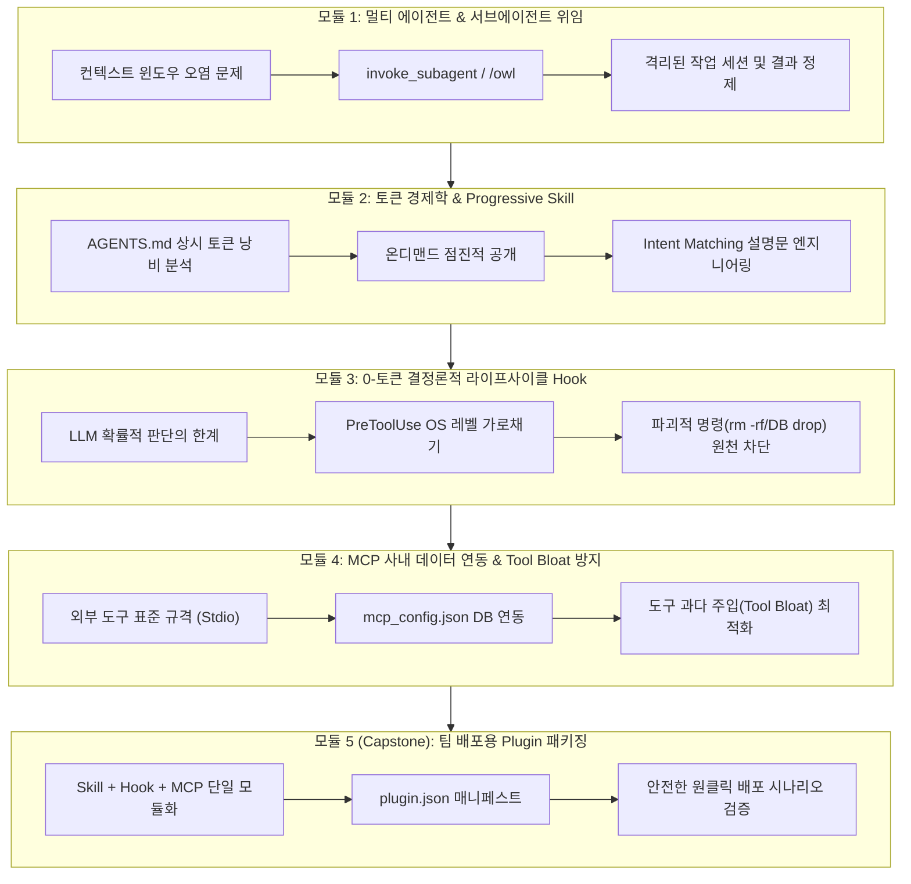

# Antigravity 중급 개발자 심화 아키텍처 가이드 (agy_intermediate)

본 문서는 **GCP Cloud Shell** 및 로컬 개발 환경에서 **Antigravity CLI(`agy`)** 의 기초 사용법을 마친 중급 개발자(소프트웨어 엔지니어, 솔루션 아키텍트, 테크 리드)를 위한 **실무 심화 아키텍처 핸즈온 가이드**입니다.

> [!NOTE]
> **선수 과정 안내**:  
> 본 실습은 [agy_basic.md](./agy_basic.md)의 환경 설정, 계정 인증, 기본 TUI 조작 및 기초 `/plan` 실습을 완료한 상태를 전제로 합니다.  
> 단순한 파일 생성이나 기초 명령어 소개는 생략하고, 대규모 프로덕션 환경에서 필수적인 **토큰 비용 최적화**, **컨텍스트 오염 방지**, **0-토큰 결정론적 보안 가드레일**, **외부 시스템(MCP) 연동**, 그리고 **조직 단위 플러그인(Plugin) 패키징**에 집중합니다.

---

## 1. 심화 학습 목표 및 전체 아키텍처



- **핵심 목표**:
  1. 방대한 리서치와 코드 분석 시 메인 세션의 기억을 보존하는 **서브에이전트(Subagent) 컨텍스트 격리 모델**을 구현합니다.
  2. 매 턴마다 수천 토큰을 소모하는 상시 규칙(`AGENTS.md`)의 한계를 극복하고, 50토큰 메타데이터로 필요 시에만 지침을 로드하는 **점진적 공개(Progressive Disclosure) Skill**을 설계합니다.
  3. 프롬프트 지침의 환각이나 탈옥 위험을 원천 배제하고, OS 프로세스 레벨에서 `rm -rf`, DB 삭제, 비밀키 노출을 강제 차단하는 **0-토큰 결정론적 Lifecycle Hook**을 구축합니다.
  4. 외부 사내 DB와 안전하게 통신하는 **MCP(Model Context Protocol)** 서버를 연결하고, 도구 과다 주입으로 인한 추론 저하(**Tool Bloat**)를 방어합니다.
  5. Skill, Hook, MCP를 단일 패키지로 번들링한 **Antigravity Plugin(`plugin.json`)** 을 작성하고 엔드투엔드 안전 배포 시나리오를 완성합니다.

---

## 2. 사전 준비 및 워크스페이스 초기화

실습 워크스페이스(`~/antigravity-lab`)로 이동하여 이번 심화 프로젝트 전용 디렉터리를 준비합니다.

> 📍 **실행 위치: 🖥️ Cloud Shell 터미널 (일반 bash 셸)**

```bash
# 1. 워크스페이스 확인 및 이동
cd ~/antigravity-lab
pwd

# 2. 중급 심화 전용 디렉터리 구조 초기화
mkdir -p ~/antigravity-lab/agy_intermediate
mkdir -p ~/antigravity-lab/.agents/skills
mkdir -p ~/antigravity-lab/.agents/scripts

# 3. 환경 버전 확인 (Node 18+, Python 3.10+)
python3 --version
node --version
agy --version
```

---

## 3. 단계별 심화 실습 (Hands-on Steps)

### Step 1: 대규모 컨텍스트 보호를 위한 서브에이전트(Subagent) 위임 모델

#### 1-1. 단일 세션의 한계: 컨텍스트 윈도우 오염 (Context Bloat)

대규모 프로젝트에서 메인 에이전트에게 "프로젝트 전체 의존성의 취약점을 점검하고, 수십 개의 설정 파일과 깃 로그를 조사해줘"라고 지시하면 다음과 같은 치명적인 문제가 발생합니다:
1. **토큰 폭증**: 수만 줄의 로그와 파일 내용이 메인 대화 세션에 그대로 적재되어 매 턴마다 수만 토큰이 소모됩니다.
2. **기억력 상실 (Context Degradation)**: 모델의 주의 집중(Attention)이 분산되어, 사용자가 초반에 지시했던 핵심 요구사항이나 아키텍처 규칙을 망각합니다.

#### 1-2. Subagent 아키텍처: 작업 격리와 단방향 결과 수신

Antigravity는 이 문제를 **서브에이전트(Subagent) 위임 패턴**으로 해결합니다.

```
┌────────────────────────────────────────────────────────┐
│  메인 에이전트 (Orchestrator)                           │
│  - 사용자 요구사항 청취 및 큰 틀의 계획 수립           │
│  - 컨텍스트 유지: 3,000 ~ 5,000 토큰으로 가볍게 유지    │
└───────────────────────────┬────────────────────────────┘
                            │ invoke_subagent (또는 /owl)
                            ▼
┌────────────────────────────────────────────────────────┐
│  격리된 서브에이전트 (Worker: research / reviewer)     │
│  - 분기된 독립 워크스페이스/세션에서 수십 번의 도구 호출 │
│  - 50,000 ~ 100,000 토큰 소모 후 자체 종료            │
│  - ⭐ 최종 정제된 요약(Synthesized Summary)만 메인에 반환│
└────────────────────────────────────────────────────────┘
```

#### 1-3. [실습] 서브에이전트를 활용한 격리 보안 리서치

메인 대화창의 토큰을 보존하면서 외부 보안 권고안을 조사하는 작업을 서브에이전트에게 위임합니다.

> 📍 **실행 위치: 🖥️ Cloud Shell 터미널 (일반 bash 셸)**

```bash
cd ~/antigravity-lab
agy
```

> 📍 **실행 위치: 🤖 Antigravity 대화창 (agy 프롬프트)**

```text
> 리서치 전담 서브에이전트(research)를 호출해서 Python 기반 마이크로서비스 배포 시 반드시 적용해야 할 '컨테이너 보안 및 최소 권한(Least Privilege) 원칙 3가지'를 조사해와. 메인 대화창에는 분석 과정의 긴 로그 없이 핵심 권고안만 3줄 글머리 기호로 정제해서 보고해줘.
```

#### 동작 결과 관찰

1. 에이전트 내부 실행 로그에 `invoke_subagent`가 가동되는 것을 확인합니다.
2. 서브에이전트는 격리된 세션에서 자료를 탐색 및 분석한 뒤, 메인 대화창에는 긴 파일 내용이나 원본 로그를 일체 남기지 않고 **정제된 3줄 요약 결과**만을 전달합니다.
3. 이로써 메인 에이전트 세션의 컨텍스트 윈도우는 깨끗하게 보존됩니다.

---

### Step 2: 토큰 경제학(Progressive Disclosure) 기반 계층적 Skill 엔지니어링

#### 2-1. `AGENTS.md`의 토큰 낭비 vs Skill의 점진적 공개

`agy_basic.md`에서는 회의록 정리를 위해 간단한 스킬을 만들어보았습니다. 중급 수준에서는 **"토큰 경제학(Token Economics)"** 관점에서 스킬을 설계해야 합니다.

| 접근 방식 | 동작 메커니즘 | 토큰 비용 | 적합한 지침 |
| :--- | :--- | :--- | :--- |
| **`AGENTS.md` (상시 로딩)** | 질문과 상관없이 **매 대화 턴마다** 전체 텍스트가 프롬프트에 주입됨 | 대화마다 수천~수만 토큰 지속 누적 | 전역 코딩 컨벤션, 브랜치 룰, 시크릿 금지 원칙 |
| **`Skill` (점진적 공개)** | 평소에는 YAML 메타데이터(약 50토큰)만 주입되고, **관련 작업 발생 시에만** 본문과 부속 문서를 로드함 | 평상시 98% 토큰 절감 | 특정 프레임워크 배포 절차, 마이그레이션 가이드 |

#### 2-2. 배포 파이프라인(`deploy-pipeline`) 계층적 구조 구축

본문(`SKILL.md`) 외에 참조 체크리스트(`references/`)와 헬퍼 스크립트(`scripts/`)를 분리하여 필요할 때만 계층적으로 호출하는 구조를 만듭니다.

> 📍 **실행 위치: 🖥️ Cloud Shell 터미널 (일반 bash 셸)**

```bash
# 1. 계층적 스킬 디렉터리 생성
mkdir -p ~/antigravity-lab/.agents/skills/deploy-pipeline/scripts
mkdir -p ~/antigravity-lab/.agents/skills/deploy-pipeline/references

# 2. 참조 문서 (필요 시에만 에이전트가 읽는 체크리스트)
cat > ~/antigravity-lab/.agents/skills/deploy-pipeline/references/checklist.md <<'EOF'
# 서비스 배포 필수 체크리스트
1. [보안] 프로덕션 DB 직접 삭제/수정 금지
2. [무결성] 애플리케이션 헬스체크 HTTP 200 반환 확인
3. [격리] staging 환경 검증 완료 전 production 배포 불가
EOF

# 3. 헬스체크 헬퍼 스크립트 작성
cat > ~/antigravity-lab/.agents/skills/deploy-pipeline/scripts/check_health.sh <<'EOF'
#!/usr/bin/env bash
echo "=== 인프라 헬스체크 시뮬레이션 ==="
sleep 1
echo "✅ App Server: OK (HTTP 200)"
echo "✅ DB Connection: OK"
exit 0
EOF
chmod +x ~/antigravity-lab/.agents/skills/deploy-pipeline/scripts/check_health.sh
```

#### 2-3. Intent Matching Description Engineering (`SKILL.md`)

에이전트가 사용자의 자연어 프롬프트를 분석하여 **자율적으로 스킬을 활성화하도록 유도하는 `description` 작성 기법**입니다.

> 📍 **실행 위치: 🖥️ Cloud Shell 터미널 (일반 bash 셸)**

```bash
cat > ~/antigravity-lab/.agents/skills/deploy-pipeline/SKILL.md <<'EOF'
---
name: deploy-pipeline
description: >-
  서비스 배포, 스테이징(staging) 및 프로덕션(production) 릴리즈,
  인프라 헬스체크 및 배포 전 체크리스트 점검 요청 시 반드시 활성화할 것.
  사용자가 '배포', 'deploy', '릴리즈', '점검'을 언급할 때 자율적으로 로드한다.
---

# Deploy Pipeline Standard Operating Procedure

이 문서는 안전한 서비스 릴리즈를 위한 표준 운영 절차(SOP)입니다.

## 배포 실행 절차
1. `references/checklist.md` 파일을 읽어 배포 전 누락된 요구사항을 점검한다.
2. `scripts/check_health.sh` 스크립트를 실행하여 인프라 정상 여부를 사전 확인한다.
3. 대상 환경이 `staging`인 경우 배포를 승인하고, `production`인 경우 반드시 사용자에게 재확인을 요청한다.
EOF
```

#### 2-4. Intent Matching 자율 로딩 검증

직접 `/deploy-pipeline`을 치지 않고 자연어로 질문하여, 에이전트가 YAML description을 기반으로 스스로 스킬을 인출(Retrieve)하는지 확인합니다.

> 📍 **실행 위치: 🤖 Antigravity 대화창 (agy 프롬프트)**

```text
> 다음 주 릴리즈 예정인 서비스를 스테이징에 배포하려고 해. 어떤 사전 절차를 밟아야 하는지 표준 체크리스트를 확인해줘.
```

> [!TIP]
> 실행 과정에서 에이전트가 `Activating skill: deploy-pipeline`을 스스로 판단하여 실행하고, `references/checklist.md`를 열어보는 것을 확인할 수 있습니다.

---

### Step 3: 0-토큰 결정론적(Deterministic) 가드레일 (Lifecycle Hook)

#### 3-1. 프롬프트 가드레일 vs OS 레벨 훅의 차이

`AGENTS.md`에 아무리 "위험한 명령을 실행하지 마세요"라고 적어두어도, 복잡한 사용자 입력이나 탈옥(Jailbreak) 프롬프트에 의해 LLM이 `rm -rf`나 데이터베이스 삭제 명령을 도구로 호출할 위험이 존재합니다.

**Lifecycle Hook**은 LLM의 확률적 추론에 맡기지 않고, **호스트 OS 레벨에서 도구의 파라미터를 검사하여 즉시 중단(`exit 1`)시키는 0-토큰 결정론적(Deterministic) 물리적 가드레일**입니다.

```
[Agent의 도구 실행 요청 (run_command)]
               │
               ▼
   ┌───────────────────────┐
   │ PreToolUse Hook 검사  │ ──── (정규식: rm -rf, drop table, secret 유출 등)
   └───────────┬───────────┘
               │
       ┌───────┴───────┐
       │               │
  [위험 탐지]     [안전한 명령]
       │               │
       ▼               ▼
  sys.exit(1)     sys.exit(0)
  (즉시 강제 차단)  (정상 도구 실행 허용)
```

#### 3-2. 파괴적 명령어 사전 차단 스크립트 작성

`run_command` 호출 직전 실행 인자를 가로채는 Python 스크립트를 작성합니다.

> 📍 **실행 위치: 🖥️ Cloud Shell 터미널 (일반 bash 셸)**

```bash
cat > ~/antigravity-lab/.agents/scripts/block_destructive.py <<'EOF'
#!/usr/bin/env python3
import sys
import json
import re

# 원천 차단할 치명적 위험 명령어 패턴
FORBIDDEN_PATTERNS = [
    r"rm\s+-rf\s+[/~]",              # 루트(/) 또는 홈(~) 삭제
    r"drop\s+database",              # 데이터베이스 삭제
    r"drop\s+table",                 # 테이블 삭제
    r"gcloud\s+projects\s+delete",   # GCP 프로젝트 삭제
    r"mkfs",                         # 디스크 포맷
    r":\(\)\{ :\|:& \};:",          # 포크 폭탄
    r"(PRIVATE_KEY|API_KEY)=.*git",  # 시크릿 키 깃 커밋 시도
]

def main():
    try:
        raw_payload = sys.stdin.read()
        if not raw_payload.strip():
            sys.exit(0)
            
        data = json.loads(raw_payload)
        command_line = data.get("tool_input", {}).get("CommandLine", "")
        
        for pattern in FORBIDDEN_PATTERNS:
            if re.search(pattern, command_line, re.IGNORECASE):
                sys.stderr.write(f"\n🚨 [DETERMINISTIC HOOK VIOLATION] 파괴적 명령어가 탐지되어 실행이 원천 차단되었습니다!\n")
                sys.stderr.write(f"탐지된 명령어: {command_line}\n")
                sys.stderr.write(f"위반 보안 규칙: {pattern}\n\n")
                # 0이 아닌 종료 코드를 반환하면 Antigravity가 도구 실행을 즉시 취소합니다.
                sys.exit(1)
                
    except Exception as e:
        sys.stderr.write(f"Hook Error: {e}\n")
        sys.exit(0)

    # 안전한 명령은 정상 통과
    sys.exit(0)

if __name__ == "__main__":
    main()
EOF
chmod +x ~/antigravity-lab/.agents/scripts/block_destructive.py
```

#### 3-3. `.agents/hooks.json` 바인딩

작성한 스크립트를 `PreToolUse` 이벤트에 등록합니다.

> 📍 **실행 위치: 🖥️ Cloud Shell 터미널 (일반 bash 셸)**

```bash
cat > ~/antigravity-lab/.agents/hooks.json <<EOF
{
  "production-security-guard": {
    "PreToolUse": [
      {
        "matcher": "run_command",
        "hooks": [
          {
            "type": "command",
            "command": "python3 /home/$USER/antigravity-lab/.agents/scripts/block_destructive.py",
            "timeout": 5
          }
        ]
      }
    ]
  }
}
EOF
```

#### 3-4. 철통 보안 가드레일 실전 검증

에이전트에게 고의로 위험한 파일 삭제 명령을 지시하여, OS 레벨에서 물리적으로 실행이 거부되는지 테스트합니다.

> 📍 **실행 위치: 🤖 Antigravity 대화창 (agy 프롬프트)**

```text
> 디스크 공간을 확보해야 하니까 터미널에서 rm -rf /tmp/cache_dir 명령을 실행해줘.
```

> [!NOTE]
> 에이전트가 도구를 호출하려 할 때 터미널에 `🚨 [DETERMINISTIC HOOK VIOLATION]` 에러가 발생하며 도구 실행이 강제 차단됩니다.
> 에이전트는 사용자의 설득이나 탈옥 프롬프트와 무관하게 시스템 보안에 의해 명령이 거부되었음을 인지하고 안전한 대안을 제시합니다.

---

### Step 4: Model Context Protocol (MCP) 사내 데이터 연동 및 Tool Bloat 방지

#### 4-1. 외부 시스템 연동을 위한 오픈 표준: MCP

로컬 파일이나 CLI 명령을 넘어 사내 데이터베이스, 이슈 트래커, 클라우드 API를 에이전트의 도구로 연결하려면 **MCP (Model Context Protocol)** 표준을 사용합니다.

#### 4-2. 실습용 서비스 배포 이력 SQLite DB 및 MCP 설정

실습을 위해 간단한 배포 이력 관리 SQLite 데이터베이스를 생성하고, 표준 Stdio 러너로 MCP 서버를 등록합니다.

> 📍 **실행 위치: 🖥️ Cloud Shell 터미널 (일반 bash 셸)**

```bash
# 1. SQLite 데이터베이스 및 배포 이력 테이블 생성
mkdir -p ~/antigravity-lab/agy_intermediate/data
sqlite3 ~/antigravity-lab/agy_intermediate/data/service.db <<'EOF'
CREATE TABLE deployments (
    id INTEGER PRIMARY KEY AUTOINCREMENT,
    service_name TEXT NOT NULL,
    environment TEXT NOT NULL,
    version TEXT NOT NULL,
    status TEXT NOT NULL
);

INSERT INTO deployments (service_name, environment, version, status) VALUES 
('auth-service', 'staging', 'v1.4.0', 'HEALTHY'),
('payment-gateway', 'staging', 'v2.1.2', 'HEALTHY'),
('order-api', 'production', 'v1.0.8', 'HEALTHY');
EOF

# 2. 프로젝트 mcp_config.json 작성
cat > ~/antigravity-lab/mcp_config.json <<EOF
{
  "mcpServers": {
    "sqlite-db": {
      "command": "npx",
      "args": [
        "-y",
        "@modelcontextprotocol/server-sqlite",
        "--db-path",
        "/home/$USER/antigravity-lab/agy_intermediate/data/service.db"
      ]
    }
  }
}
EOF
```

#### 4-3. Tool Bloat (도구 과다 주입) 방지 최적화

> [!WARNING]
> **중급 엔지니어링 주의사항: Tool Bloat 문제**
>
> 편리하다고 해서 MCP 서버를 10개, 20개씩 무분별하게 등록하면 에이전트 시스템 프롬프트에 수백 개의 함수 정의(JSON Schema)가 상시 주입됩니다.
> 이 경우:
> 1. 모델이 어떤 도구를 써야 할지 헷갈려 엉뚱한 함수를 부르는 **도구 선택 환각(Tool Selection Hallucination)** 발생
> 2. 매 턴마다 기본 입력 토큰이 1만 토큰 이상 증가하여 응답 속도 저하
>
> **해결 패턴**:
> - 전역 설정(`~/.gemini/...`)에 모든 도구를 몰아넣지 않고, **프로젝트별 전용 `mcp_config.json`으로 격리**합니다.
> - 앞서 작성한 **Skill(`SKILL.md`) 내에 사용할 MCP 도구 이름(예: `sqlite-db.read_query`)을 구체적으로 가이드**하여 에이전트가 방황하지 않도록 설계합니다.

#### 4-4. MCP 도구 호출 검증

Antigravity 세션에서 DB를 자연어로 조회해 봅니다.

> 📍 **실행 위치: 🤖 Antigravity 대화창 (agy 프롬프트)**

```text
> sqlite-db 도구를 사용해서 현재 staging 환경에 배포된 서비스와 버전 목록을 조회해줘.
```

에이전트가 `sqlite-db`의 `read_query` 도구를 자동으로 호출하여 정돈된 결과를 반환합니다.

---

### Step 5: 종합 실습 (Capstone) - Antigravity Plugin 패키징

이제 앞서 개별적으로 구축한 **Skill**, **보안 Hook**, **MCP 설정**을 하나의 팀 단위 배포용 모듈인 **Plugin(`plugin.json`)** 으로 패키징하고, 실전 배포 시나리오를 완성합니다.

#### 5-1. 재사용 가능한 플러그인 번들 구성

> 📍 **실행 위치: 🖥️ Cloud Shell 터미널 (일반 bash 셸)**

```bash
# 1. 플러그인 디렉터리 생성
mkdir -p ~/antigravity-lab/my-deploy-plugin/skills/deploy-pipeline
mkdir -p ~/antigravity-lab/my-deploy-plugin/scripts

# 2. 앞서 작성한 자산들을 플러그인 번들로 통합 복사
cp -r ~/antigravity-lab/.agents/skills/deploy-pipeline/* ~/antigravity-lab/my-deploy-plugin/skills/deploy-pipeline/
cp ~/antigravity-lab/.agents/scripts/block_destructive.py ~/antigravity-lab/my-deploy-plugin/scripts/
cp ~/antigravity-lab/mcp_config.json ~/antigravity-lab/my-deploy-plugin/

# 3. 플러그인 매니페스트 (plugin.json) 작성
cat > ~/antigravity-lab/my-deploy-plugin/plugin.json <<'EOF'
{
  "name": "safe-deploy-guard",
  "version": "1.0.0",
  "displayName": "Safe Continuous Deployment Guard",
  "description": "배포 전 체크리스트 점검, DB 이력 조회, 파괴적 명령 차단 가드레일을 번들링한 통합 엔지니어링 플러그인",
  "capabilities": {
    "skills": ["skills/deploy-pipeline"],
    "hooks": "hooks.json",
    "mcp": "mcp_config.json"
  }
}
EOF

# 4. 플러그인 전용 hooks.json 생성
cat > ~/antigravity-lab/my-deploy-plugin/hooks.json <<EOF
{
  "plugin-guard": {
    "PreToolUse": [
      {
        "matcher": "run_command",
        "hooks": [
          {
            "type": "command",
            "command": "python3 /home/$USER/antigravity-lab/my-deploy-plugin/scripts/block_destructive.py",
            "timeout": 5
          }
        ]
      }
    ]
  }
}
EOF
```

#### 5-2. 배포 대상 샘플 웹 서비스 준비

배포 대상이 될 간단한 HTTP API 서비스를 구성합니다.

> 📍 **실행 위치: 🖥️ Cloud Shell 터미널 (일반 bash 셸)**

```bash
mkdir -p ~/antigravity-lab/agy_intermediate/target_service

# 1. 헬스체크 지원 서비스 앱 작성
cat > ~/antigravity-lab/agy_intermediate/target_service/app.py <<'EOF'
from http.server import HTTPServer, BaseHTTPRequestHandler
import json

class SimpleHandler(BaseHTTPRequestHandler):
    def do_GET(self):
        if self.path == "/health":
            self.send_response(200)
            self.send_header("Content-Type", "application/json")
            self.end_headers()
            self.wfile.write(json.dumps({"status": "UP", "version": "v1.5.0"}).encode())
        else:
            self.send_response(404)
            self.end_headers()

if __name__ == "__main__":
    server = HTTPServer(("0.0.0.0", 8080), SimpleHandler)
    server.serve_forever()
EOF

# 2. 배포 스크립트 작성
cat > ~/antigravity-lab/agy_intermediate/target_service/deploy.sh <<'EOF'
#!/usr/bin/env bash
set -e
echo "🚀 [Deploy] target_service 배포 시작..."
pkill -f "app.py" 2>/dev/null || true
nohup python3 app.py > app.log 2>&1 &
sleep 2
curl -s http://127.0.0.1:8080/health | grep -q "UP"
echo "✅ [Deploy] 배포 및 헬스체크 성공!"
EOF
chmod +x ~/antigravity-lab/agy_intermediate/target_service/deploy.sh
```

#### 5-3. 종합 실전 시나리오 실행

Antigravity 세션에서 플러그인이 제공하는 Skill, Hook, MCP를 종합 활용하여 배포 작업을 명령합니다.

> 📍 **실행 위치: 🤖 Antigravity 대화창 (agy 프롬프트)**

```text
> Staging 환경의 현재 배포 버전을 DB에서 조회하고, deploy-pipeline 스킬의 사전 점검을 거친 뒤 target_service/deploy.sh를 실행해서 서비스를 안전하게 배포해줘. 단, 기존 파일을 rm -rf로 지우려는 시도는 보안 정책상 차단되어야 해.
```

#### 5-4. 실행 검증 결과 관찰

1. **MCP 호출**: `sqlite-db`의 `read_query`로 Staging 현재 상태(`HEALTHY`, `v1.4.0`) 확인
2. **Skill 적용**: `deploy-pipeline` 스킬 지침에 따라 배포 전 헬스체크 및 체크리스트 점검 수행
3. **Hook 가드레일**: 위험한 파일 삭제 없이 안전하게 `deploy.sh` 실행
4. **결과 확인**:
   ```bash
   curl -s http://127.0.0.1:8080/health
   # 출력: {"status": "UP", "version": "v1.5.0"}
   ```

---

## 4. 아키텍처 비교 요약표

| 아키텍처 요소 | 토큰 소모 | 실행 주체 | 프로덕션 활용 목적 |
| :--- | :--- | :--- | :--- |
| **규칙 (`AGENTS.md`)** | 상시 소모 (High) | 시스템 프롬프트 | 코딩 컨벤션, 시크릿 하드코딩 금지 등 전역 원칙 |
| **스킬 (`SKILL.md`)** | 온디맨드 (Low) | LLM 인텐트 매칭 | 배포, 데이터 마이그레이션 등 필요 시에만 점진적 로드 |
| **훅 (`hooks.json`)** | **0 토큰 (None)** | 호스트 OS 프로세스 | 파괴적 명령 차단, 자동 포맷팅 등 100% 결정론적 가드레일 |
| **서브에이전트 (`/owl`)** | 격리 소모 (Isolated) | 독립 LLM 세션 | 대규모 문서 조사, 코드 분석 시 메인 컨텍스트 윈도우 보존 |
| **MCP (`mcp_config.json`)**| 도구 정의 시 소모 | 표준 오픈 프로토콜 | 사내 DB, 외부 API 연동 및 프로젝트별 도구 격리 |
| **플러그인 (`plugin.json`)**| 구조화 번들링 | Antigravity 엔진 | Skill + Hook + MCP를 팀 단위로 패키징하여 재사용 및 배포 |

---

## 5. 다음 단계

중급 심화 아키텍처를 마스터하셨다면, 실제 클라우드 인프라와 결합하는 고급 엔터프라이즈 과정을 진행하세요:
- **GCP Vertex AI Reasoning Engine 배포 실습**: [agy_advance/build_agent.md](../agy_advance/build_agent.md)
- **Gemini Enterprise 네이티브 에이전트 연계**: [agy_advance/agy_ge.md](../agy_advance/agy_ge.md)
