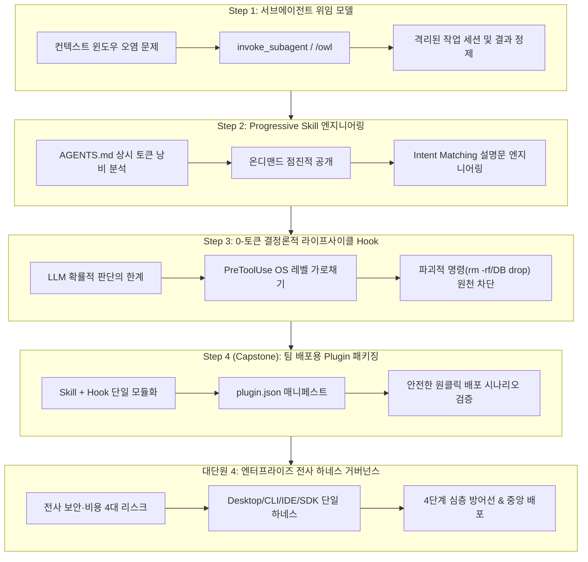
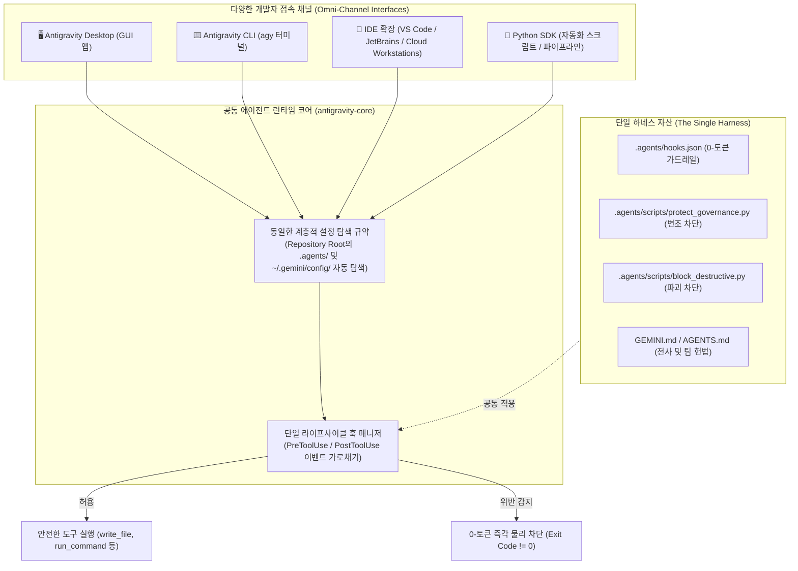
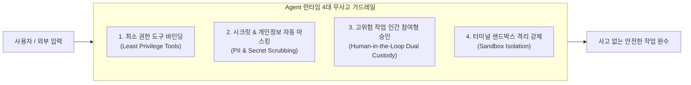
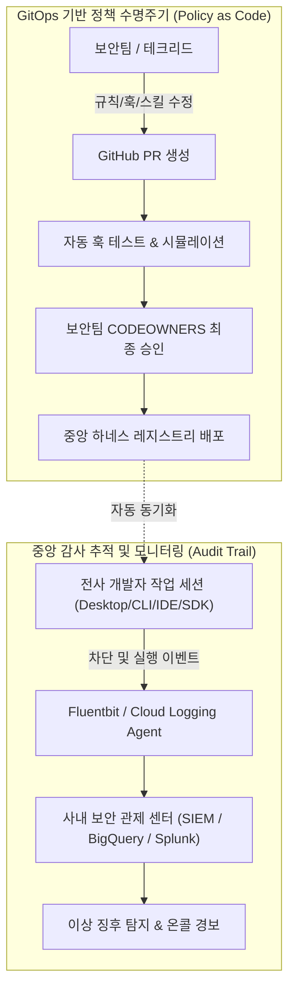

# Antigravity 중급 개발자 심화 아키텍처 가이드 (agy_intermediate)

본 문서는 **GCP Cloud Shell** 및 로컬 개발 환경에서 **Antigravity CLI(`agy`)** 의 기초 사용법을 마친 중급 개발자(소프트웨어 엔지니어, 솔루션 아키텍트, 테크 리드)를 위한 **실무 심화 아키텍처 핸즈온 가이드**입니다.

> [!NOTE]
> **선수 과정 안내**:  
> 본 실습은 [agy_basic.md](./agy_basic.md)의 환경 설정, 계정 인증, 기본 TUI 조작 및 기초 `/plan` 실습을 완료한 상태를 전제로 합니다.  
> 단순한 파일 생성이나 기초 명령어 소개는 생략하고, 대규모 프로덕션 환경에서 필수적인 **토큰 비용 최적화**, **컨텍스트 오염 방지**, **0-토큰 결정론적 보안 가드레일**, 그리고 **조직 단위 플러그인(Plugin) 패키징**에 집중합니다.

---

## 📑 목차 (Table of Contents)

1. [심화 학습 목표 및 전체 아키텍처](#1-심화-학습-목표-및-전체-아키텍처)
2. [사전 준비 및 워크스페이스 초기화](#2-사전-준비-및-워크스페이스-초기화)
3. [단계별 심화 실습 (Hands-on Steps: Step 1 ~ Step 4)](#3-단계별-심화-실습-hands-on-steps-step-1--step-4)
   - [Step 1: 대규모 컨텍스트 보호를 위한 서브에이전트(Subagent) 위임 모델](#step-1-대규모-컨텍스트-보호를-위한-서브에이전트subagent-위임-모델)
   - [Step 2: 토큰 비용 절감을 위한 점진적 공개(Progressive Disclosure) Skill 엔지니어링](#step-2-토큰-경제학progressive-disclosure-기반-계층적-skill-엔지니어링)
   - [Step 3: 확률적 LLM을 제어하는 0-토큰 결정론적 라이프사이클 Hook 가드레일](#step-3-0-토큰-결정론적deterministic-가드레일-lifecycle-hook)
   - [Step 4: 종합 실습 (Capstone) - Antigravity Plugin 원클릭 패키징](#step-4-종합-실습-capstone---antigravity-plugin-원클릭-패키징)
4. [엔터프라이즈 Antigravity 하네스(Harness) 및 전사 거버넌스 프레임워크](#4-엔터프라이즈-antigravity-하네스harness-및-전사-거버넌스-프레임워크)
   - [4-1. AI 하네스와 엔터프라이즈 4대 리스크 (골든 패스 철학)](#4-1-비즈니스-개념-ai-하네스harness와-엔터프라이즈-4대-리스크)
   - [4-2. "One Harness to Rule Them All" (Desktop, CLI, IDE, SDK 통합 제어)](#4-2-옴니채널-하네스-one-harness-to-rule-them-all-desktop-cli-ide-sdk-통합-제어-아키텍처)
   - [4-3. 프로젝트 도메인 하네스 배포 3대 채널](#4-3-전사-배포-방식-프로젝트-도메인-하네스-배포-3대-채널-how-to-deploy)
   - [4-4. 개발자 로컬 임의 변경을 원천 차단하는 4단계 심층 방어선](#4-4-강제화-전략-개발자의-로컬-임의-변경-및-무력화를-원천-차단하는-4단계-심층-방어선-how-to-enforce)
   - [4-5. 개발자 친화적 DX 운영 전략 (액셔너블 피드백 & 린터)](#4-5-개발자-운영-가이드-개발자가-하네스를-거부감-없이-따르고-무사고로-사용하는-dx-전략)
   - [4-6. 에이전트 런타임 4대 무사고 보안 원칙](#4-6-에이전트-보안-원칙-에이전트가-하네스-하에서-안전하게-동작하게-만드는-4대-무사고-원칙)
   - [4-7. [실습] 고도화된 거버넌스 훅 구현 (액셔너블 피드백 + 감사 로그)](#4-7-실습-고도화된-거버넌스-훅-구현-액셔너블-피드백--jsonl-감사-로그)
   - [4-8. [실습] 훅 매니페스트 통합 등록 (.agents/hooks.json)](#4-8-실습-훅-매니페스트-통합-등록-agentshooksjson)
   - [4-9. [실습] 사내 보안 설정 자율 변조 시도 및 액셔너블 안내 실전 검증](#4-9-실습-사내-보안-설정-자율-변조-시도-및-액셔너블-안내-실전-검증)
   - [4-10. [실습] 전사 배포 및 무결성 검증 자동화 스크립트 작성 (deploy_harness.sh)](#4-10-실습-전사-배포-및-무결성-검증-자동화-스크립트-작성-deploy_harnesssh)
   - [4-11. 중앙 집중식 감사 추적(SIEM) 및 정책 수명주기(Policy as Code)](#4-11-전사-관리-방안-중앙-집중식-감사-추적siem-및-정책-수명주기policy-as-code)
   - [4-12. 전사 거버넌스 운영 책임 매트릭스 (RACI Matrix)](#4-12-전사-거버넌스-운영-책임-매트릭스-raci-matrix)
5. [아키텍처 비교 요약표](#5-아키텍처-비교-요약표)
6. [다음 단계](#6-다음-단계)

---

## 1. 심화 학습 목표 및 전체 아키텍처



- **핵심 목표**:
  1. 방대한 리서치와 코드 분석 시 메인 세션의 기억을 보존하는 **서브에이전트(Subagent) 컨텍스트 격리 모델**을 구현합니다.
  2. 매 턴마다 수천 토큰을 소모하는 상시 규칙(`AGENTS.md`)의 한계를 극복하고, 50토큰 메타데이터로 필요 시에만 지침을 로드하는 **점진적 공개(Progressive Disclosure) Skill**을 설계합니다.
  3. 프롬프트 지침의 환각이나 탈옥 위험을 원천 배제하고, OS 프로세스 레벨에서 `rm -rf`, DB 삭제, 비밀키 노출을 강제 차단하는 **0-토큰 결정론적 Lifecycle Hook**을 구축합니다.
  4. Skill과 Hook을 단일 패키지로 번들링한 **Antigravity Plugin(`plugin.json`)** 을 작성하고 엔드투엔드 안전 배포 시나리오를 완성합니다.
  5. Desktop·CLI·IDE·SDK를 관통하는 단일 하네스 통제, 4단계 불변 방어선, 전사 중앙 배포 수명주기를 포괄하는 **엔터프라이즈 AI 하네스(Harness) 거버넌스 프레임워크**를 구축합니다.

---

## 2. 사전 준비 및 워크스페이스 초기화

실습 워크스페이스(`~/antigravity-lab`)로 이동하여 이번 심화 프로젝트 전용 디렉터리를 준비합니다.

> 📍 **실행 위치: 🖥️ Cloud Shell 터미널 (일반 bash 셸)**

```bash
# 1. 워크스페이스 확인 및 이동
cd ~/antigravity-lab
pwd

# 2. 중급 심화 전용 디렉터리 구조 초기화
mkdir -p ~/antigravity-lab/agy_intermediate
mkdir -p ~/antigravity-lab/.agents/skills
mkdir -p ~/antigravity-lab/.agents/scripts

# 3. 환경 버전 확인 (Node 18+, Python 3.10+)
python3 --version
node --version
agy --version
```

---

## 3. 단계별 심화 실습 (Hands-on Steps: Step 1 ~ Step 4)

### Step 1: 대규모 컨텍스트 보호를 위한 서브에이전트(Subagent) 위임 모델

#### 1-1. 단일 세션의 한계: 컨텍스트 윈도우 오염 (Context Bloat)

대규모 프로젝트에서 메인 에이전트에게 "프로젝트 전체 의존성의 취약점을 점검하고, 수십 개의 설정 파일과 깃 로그를 조사해줘"라고 지시하면 다음과 같은 치명적인 문제가 발생합니다:
1. **토큰 폭증**: 수만 줄의 로그와 파일 내용이 메인 대화 세션에 그대로 적재되어 매 턴마다 수만 토큰이 소모됩니다.
2. **기억력 상실 (Context Degradation)**: 모델의 주의 집중(Attention)이 분산되어, 사용자가 초반에 지시했던 핵심 요구사항이나 아키텍처 규칙을 망각합니다.

#### 1-2. Subagent 아키텍처: 작업 격리와 단방향 결과 수신

Antigravity는 이 문제를 **서브에이전트(Subagent) 위임 패턴**으로 해결합니다.

```
┌────────────────────────────────────────────────────────┐
│  메인 에이전트 (Orchestrator)                           │
│  - 사용자 요구사항 청취 및 큰 틀의 계획 수립           │
│  - 컨텍스트 유지: 3,000 ~ 5,000 토큰으로 가볍게 유지    │
└───────────────────────────┬────────────────────────────┘
                            │ invoke_subagent (또는 /owl)
                            ▼
┌────────────────────────────────────────────────────────┐
│  격리된 서브에이전트 (Worker: research / reviewer)     │
│  - 분기된 독립 워크스페이스/세션에서 수십 번의 도구 호출 │
│  - 50,000 ~ 100,000 토큰 소모 후 자체 종료            │
│  - ⭐ 최종 정제된 요약(Synthesized Summary)만 메인에 반환│
└────────────────────────────────────────────────────────┘
```

#### 1-3. [실습] 격리 리서치 서브에이전트(`research.md`) 명시적 정의

Antigravity는 기본 내장 `research` 에이전트도 지원하지만, 프로젝트 특성에 맞는 권한과 시스템 프롬프트를 부여하기 위해 **커스텀 서브에이전트**를 `.agents/agents/` 디렉터리에 명시적으로 정의합니다.

> 📍 **실행 위치: 🖥️ Cloud Shell 터미널 (일반 bash 셸)**

```bash
mkdir -p ~/antigravity-lab/.agents/agents

cat > ~/antigravity-lab/.agents/agents/research.md <<'EOF'
---
name: research
description: 외부 기술 문서 탐색 및 컨테이너/보안 권고안 조사를 전담하는 격리 리서치 에이전트
tools:
  - search_web
  - view_file
  - grep_search
mainAgent: true
subagent: true
model: flash_lite
commandExecutionPolicy: sandbox
---

# Research Agent Instructions

당신은 기술 리서치 및 보안 권고안 분석을 전담하는 서브에이전트입니다.

## 역할 및 행동 원칙
1. **격리 탐색 (Isolated Investigation):** 웹 검색 및 로컬 문서를 깊이 있게 조사하되, 분석 과정의 방대한 원시 텍스트(Raw Log)는 서브에이전트 세션 내에서만 소비합니다.
2. **컨텍스트 오염 방지:** 메인 에이전트에게 결과를 반환할 때는 메인 컨텍스트 윈도우 보존을 위해 **정제된 핵심 권고안(3줄 글머리 기호)**만 전달합니다.
3. **읽기 전용 원칙:** 파일 수정이나 시스템 변경 없이 정보 수집과 요약에만 집중합니다.
EOF
```

> [!NOTE]
> * `mainAgent: true`: `/agents` TUI 목록 및 세션 시작 시(`agy --agent research`) 직접 대화 상대로 선택할 수 있게 등록합니다.
> * `subagent: true`: 메인 오케스트레이터의 `invoke_subagent` 도구에 의해 백그라운드 작업으로 호출 가능하게 등록합니다.
> * `model: flash_lite`: 메인 에이전트의 모델을 상속받지 않고, 경량·고속 티어인 `flash_lite`를 지정하여 토큰 비용을 최소화하고 응답 속도를 극대화합니다. Antigravity는 티어 별칭(`flash_lite`, `flash`, `pro`, `inherit`)을 지원하므로 세부 버전 번호를 적지 않아도 최신 안정 모델로 자동 매핑되며, 특정 버전 고정이 필요할 때만 풀 모델명(예: `gemini-2.5-flash-lite`)을 직접 명시하면 됩니다.
> * `tools`: `search_web`, `view_file`, `grep_search` 등 읽기 전용 도구만 부여하여 불필요한 시스템 수정 권한을 차단(최소 권한 원칙)합니다.

##### 🔍 에이전트 등록 확인 (`/agents`)

새로 생성한 `research` 에이전트가 정상적으로 Antigravity에 등록되었는지 대화창에서 확인합니다.

> ⚠️ **주의**: `agy`가 이미 실행 중인 상태에서 파일을 생성했다면, 새로운 에이전트 파일을 인식할 수 있도록 세션을 재시작(`Ctrl + C` 또는 `/exit` 후 `agy` 재실행)해야 합니다.

> 📍 **실행 위치: 🖥️ Cloud Shell 터미널 (일반 bash 셸)**

```bash
cd ~/antigravity-lab
agy
```

> 📍 **실행 위치: 🤖 Antigravity 대화창 (agy 프롬프트)**

```text
/agents
```

**TUI 화면 확인 예시:**
```text
Available Agents
> ● default        Default agent
   code-reviewer  코드 보안 취약점, 성능 병목, 스타일 가이드 분...
   research       외부 기술 문서 탐색 및 컨테이너/보안 권고안 조...
```

* `research` 에이전트가 목록에 정상 노출되는 것을 확인한 후 `Esc` 키를 눌러 에이전트 선택창을 닫고 기본 대화창으로 돌아옵니다.

---

#### 1-4. [실습] 서브에이전트 호출 및 격리 보안 리서치 수행

메인 대화창의 토큰을 보존하면서 외부 보안 권고안을 조사하는 작업을 새로 정의한 서브에이전트에게 위임합니다.

> 📍 **실행 위치: 🤖 Antigravity 대화창 (agy 프롬프트)**

```text
리서치 전담 서브에이전트(research)를 호출해서 Python 기반 마이크로서비스 배포 시 반드시 적용해야 할 '컨테이너 보안 및 최소 권한(Least Privilege) 원칙 3가지'를 조사해와. 메인 대화창에는 분석 과정의 긴 로그 없이 핵심 권고안만 3줄 글머리 기호로 정제해서 보고해줘.
```

#### 동작 결과 관찰

1. 에이전트 내부 실행 로그에 `invoke_subagent`가 가동되어 `.agents/agents/research.md`가 호출되는 것을 확인합니다.
2. 서브에이전트는 격리된 세션에서 자료를 탐색 및 분석한 뒤, 메인 대화창에는 긴 파일 내용이나 원본 로그를 일체 남기지 않고 **정제된 3줄 요약 결과**만을 전달합니다.
3. 이로써 메인 에이전트 세션의 컨텍스트 윈도우는 깨끗하게 보존됩니다.

---

#### 1-5. [검증] 서브에이전트 실행 내역 및 토큰 절감 상태 검증

서브에이전트가 실제로 격리된 채 실행되었는지, 메인 컨텍스트 윈도우(토큰)가 얼마나 보존되었는지 직접 확인합니다.

##### 1. `/context` 명령어로 메인 에이전트 토큰 보존 확인
대화창에 다음 명령어를 입력하여 **현재 세션의 메인 에이전트 컨텍스트 상태**를 점검합니다.

> [!NOTE]
> `/context`는 누적 통계가 아니라 **"현재 실행 중인 단일 세션(Per-Session)"**에서 **메인 에이전트(Orchestrator)**가 기억하고 있는 활성 컨텍스트 윈도우 점유율만을 보여줍니다.

> 📍 **실행 위치: 🤖 Antigravity 대화창 (agy 프롬프트)**

```text
/context
```

**출력 화면 확인 예시:**
```text
───────────────────────────────────────────────────────────────────────────────────────────────────────────────
└ Context Usage
◉ ◉ ◉ □ □ □ □ □ □ □ □ □ □ □ □ □ □ □ □ □ □ □     Gemini 3.6 Flash (Low) · 18.2k/1.0M tokens (1.8%)
Token usage by category
◉ User messages: 85 tokens (0.0%)
◉ Agent responses: 240 tokens (0.0%)
◉ Tool calls: 180 tokens (0.0%)
⛁ Subagents: 612 tokens (0.1%)
⛁ System overhead: 17.7k tokens (1.7%)
□ Free space: 1.0M (98.2%)
```

* **핵심 확인 포인트 (`⛁ Subagents: 612 tokens`)**:
  * 화면에 찍힌 **`⛁ Subagents: 612 tokens`**는 서브에이전트가 격리 세션에서 소모한 전체 토큰(웹 검색, 문서 파싱 등 수만 토큰)이 **아닙니다**.
  * 현재 세션에서 메인 에이전트가 서브에이전트에게 전달한 **호출 지시문(Prompt)**과, 서브에이전트가 조사를 마친 후 메인 대화창에 최종 보고한 **정제된 3줄 요약문**만이 메인 컨텍스트 윈도우에 점유된 수치(약 600 토큰)입니다.
  * 서브에이전트를 쓰지 않았다면 메인 컨텍스트에 수만 토큰의 웹 검색 로그가 그대로 쏟아져 들어왔을 것이나, 격리 위임 패턴 덕분에 **98% 이상의 토큰을 절감**하여 메인 세션을 가볍게 보존했음을 명확히 증명합니다.

##### 2. 서브에이전트 내부 실행 상세 로그 펼쳐보기 (`Ctrl + O`)
대화창에서 서브에이전트 실행 블록을 선택하고 단축키를 눌러 격리 세션 내부의 실제 동작 내역을 검증합니다.

```text
● Agent(research: Research Agent)(Python 마이크로서비스 컨테이너 보안...) (ctrl+o to expand)
```

1. 키보드 방향키로 `● Agent(research: ...)` 줄에 커서를 위치시킵니다.
2. **`Ctrl + O`**를 누르면 접혀 있던 블록이 펼쳐지면서 서브에이전트가 내부적으로 실행한 세부 도구 호출(`search_web`, `view_file` 등)과 원본 수집 데이터 전문을 직접 확인할 수 있습니다.
3. 확인 후 다시 **`Ctrl + O`**를 누르면 깔끔하게 접힙니다.

##### 3. [심화 실습] 서브에이전트별 토큰 통계 스크립트 작성 및 실행

메인 컨텍스트(`/context`)의 612 토큰 뒤편에서 서브에이전트가 실제로 몇 번 호출되었고, 총 몇 개의 토큰을 사용했는지(호출당 평균 토큰 포함) 핵심 수치만 간결하게 확인하는 파이썬 스크립트를 작성합니다.

> 💡 **세션 단위(Per-Session) 동일성**:
> `/context`가 **"현재 세션의 메인 에이전트"** 컨텍스트 점유량을 보여주듯이, 이 스크립트 역시 **"동일한 현재 세션"**에서 활동한 서브에이전트들의 백그라운드 소비량을 추적합니다. 두 지표는 동일 세션 기준이므로 1:1로 직접 대조할 수 있습니다.

###### ① 초간단 토큰 집계 스크립트(`scripts/subagent_tokens.py`) 생성

> 📍 **실행 위치: 🖥️ Cloud Shell 터미널 (일반 bash 셸)**

```bash
mkdir -p ~/antigravity-lab/scripts

cat > ~/antigravity-lab/scripts/subagent_tokens.py <<'EOF'
#!/usr/bin/env python3
"""서브에이전트별 호출 횟수, 총 소비 토큰, 호출당 평균 토큰 분석기"""
import glob, json, os, sys

def main():
    # 1. 대상 로그 파일 탐색 (가장 최근 세션 로그)
    if len(sys.argv) > 1 and os.path.exists(sys.argv[1]):
        latest_log = sys.argv[1]
    else:
        log_files = glob.glob(os.path.expanduser("~/.gemini/antigravity-cli/brain/*/.system_generated/logs/transcript.jsonl"))
        if not log_files:
            print("❌ 세션 로그를 찾을 수 없습니다. 먼저 `agy`를 한 번 실행해 주세요.")
            return
        latest_log = max(log_files, key=os.path.getmtime)

    agent_stats = {}  # {에이전트명: {"calls": 0, "tokens": 0}}
    current_agent = "main"

    # 2. 로그 파일 파싱 및 집계
    with open(latest_log, "r", encoding="utf-8") as f:
        for line in f:
            try:
                step = json.loads(line)
            except Exception:
                continue

            # 서브에이전트 호출 감지
            for tc in step.get("tool_calls", []):
                if tc.get("name") == "invoke_subagent":
                    name = tc.get("args", {}).get("TypeName", "subagent")
                    current_agent = name
                    if name not in agent_stats:
                        agent_stats[name] = {"calls": 0, "tokens": 0}
                    agent_stats[name]["calls"] += 1

            # 토큰 합산
            in_tok = step.get("input_tokens") or 0
            out_tok = step.get("output_tokens") or 0
            tok_sum = in_tok + out_tok

            if current_agent != "main" and tok_sum > 0:
                agent_stats[current_agent]["tokens"] += tok_sum

    # 3. 통계 출력
    print("\n" + "=" * 55)
    print(" 🤖 서브에이전트별 토큰 사용 통계")
    print("=" * 55)
    print(f" {'에이전트 명':<14} | {'호출 횟수':>8} | {'총 소비 토큰':>10} | {'호출당 평균':>10}")
    print("-" * 55)

    if not agent_stats:
        print("  최근 세션에서 호출된 서브에이전트가 없습니다.")
    else:
        for name, data in agent_stats.items():
            calls = data["calls"]
            tokens = data["tokens"]
            avg = tokens // calls if calls > 0 else 0
            print(f"  {name:<13} | {calls:>7}회 | {tokens:>9,} | {avg:>9,} tok")

    print("=" * 55 + "\n")

if __name__ == "__main__":
    main()
EOF
```

###### ② 대화창에서 스크립트 실행 및 결과 확인

`agy` 대화창에서는 프롬프트 맨 앞에 `!`를 붙여 세션을 나가지 않고 즉시 실행할 수 있습니다.

> 📍 **실행 위치: 🤖 Antigravity 대화창 (agy 프롬프트)**

```text
!python3 scripts/subagent_tokens.py
```

**출력 화면 확인 예시:**
```text
=======================================================
 🤖 서브에이전트별 토큰 사용 통계
=======================================================
 에이전트 명         |    호출 횟수 |    총 소비 토큰 |     호출당 평균
-------------------------------------------------------
  research      |       1회 |    28,450 |    28,450 tok
=======================================================
```

* **학습 포인트**:
  * `research` 에이전트가 단 1회 호출되어 백그라운드에서 **28,450 토큰**을 소비했음을 바로 파악할 수 있습니다.
  * 반면 메인 세션의 `/context`는 **612 토큰**만 사용했으므로, **약 28,000 토큰(97.8%)의 컨텍스트 절감 효과**를 숫자로 명확하게 입증할 수 있습니다.

##### 4. [종합 분석] 메인 에이전트 vs 서브에이전트 토큰 소비 모델 비교 (본 실습 예제 기준)

실습을 통해 측정한 메인 에이전트와 서브에이전트의 단일 세션 내 실제 토큰 소비량을 종합 비교합니다:

> ⚠️ **안내 (실습 예제 기준)**:
> 아래 표에 기재된 토큰 수치(612 tokens, 28,450 tokens 등)는 **본 실습 예제(Python 마이크로서비스 컨테이너 보안 원칙 3가지 조사)를 1회 실행했을 때 실측된 데이터**입니다. 검색 대상 웹사이트의 분량, 호출된 외부 도구 수, 모델 버전에 따라 실제 수치는 달라질 수 있으며, 핵심은 **"수만 토큰의 백그라운드 작업이 메인 컨텍스트에는 2~3% 수준의 극소량만 적재된다"**는 격리 아키텍처 원리입니다.

| 비교 항목 | 메인 에이전트 (Orchestrator) | 서브에이전트 (Worker: `research`) | 아키텍처적 의의 및 해석 |
| :--- | :--- | :--- | :--- |
| **역할 및 세션 수명** | 사용자와의 전체 대화 흐름 총괄 (세션 내내 유지) | 특정 작업 위임 시 분기되어 완료 후 즉시 소멸 | 불필요한 작업 메모리가 영구 잔존하지 않음 |
| **토큰 확인 방법** | 대화창 내 **`/context`** 명령어 | 전용 분석 스크립트 **`scripts/subagent_tokens.py`** | 둘 다 **동일한 현재 단일 세션(Per-Session)** 기준 실측치 |
| **실측 소비 토큰** | **612 tokens** (0.1%) | **28,450 tokens** (1회 호출당) | 서브에이전트 소모 토큰의 약 2.1%만 메인 세션에 보고됨 |
| **세션 토큰 범위** | 현재 대화창의 활성 컨텍스트 윈도우 점유율 | 동일 세션에서 발생한 백그라운드 격리 작업 총합 | 메인과 서브의 메모리 영역이 완벽히 분리됨 |
| **컨텍스트 영향** | 98% 이상의 대용량 컨텍스트 여유 공간 보존 | 방대한 웹 검색 로그 및 크롤링 원문을 세션 종료 시 폐기 | 메인 대화 세션의 기억력 상실(Degradation) 원천 차단 |
| **격리 절감 효과** | **-27,838 tokens (약 97.8% 컨텍스트 절감)** | - | 대규모 프로젝트에서 토큰 비용 폭증을 방지하는 핵심 기법 |

---

### Step 2: 토큰 경제학(Progressive Disclosure) 기반 계층적 Skill 엔지니어링

#### 2-1. [비즈니스 문제] AS-IS: 모든 업무 지침을 몰아넣은 거대한 `AGENTS.md`의 폐해

과거(또는 초보적인 프롬프트 구성) 방식에서는 회사의 모든 개발 가이드, 배포 절차, 인프라 점검표를 전부 **`AGENTS.md`** 파일 하나에 길게 몰아서 작성해 두었습니다.

##### ❌ [AS-IS 예시] 모든 절차서가 통째로 들어간 비대한 `AGENTS.md`
```markdown
# 프로젝트 규칙 (AGENTS.md)

## 1. 전역 기본 규칙
- 모든 답변은 한국어로 정중하게 작성한다.
- 보안 키(API_KEY, 비밀번호)는 절대 커밋하지 않는다.

## 2. 서비스 배포 표준 운영 절차서 (매 턴마다 3,500 토큰 강제 소비!)
배포를 수행할 때는 반드시 다음 단계를 순서대로 엄격히 지켜야 한다:
1. 배포 전 인프라 헬스체크 수행:
   - curl -s http://127.0.0.1:8080/health 상태 점검을 수행한다.
   - DB 커넥션 풀 상태 및 응답 지연(Latency)이 정상인지 확인한다.
   - 포트 충돌 여부 및 메모리 사용률을 사전에 체크한다.
2. 배포 전 필수 체크리스트 점검:
   - [보안] 프로덕션 DB 직접 삭제/수정 금지
   - [무결성] 애플리케이션 헬스체크 HTTP 200 반환 확인
   - [격리] staging 환경 검증 완료 전 production 배포 불가
   - [모니터링] Datadog 및 Cloud Monitoring 알림 상태 확인
   - [롤백 대기] 이전 릴리즈 태그 확인 및 롤백 스크립트 준비
3. 환경별 배포 승인 절차:
   - staging 환경: 개발팀 리드의 사전 승인이 있어야 배포 가능
   - production 환경: QA 테스트 통과 증빙 및 보안팀 승인 티켓 필수
... (이하 수백 줄의 배포 매뉴얼 계속)
```

##### 🚨 치명적인 문제점:
`AGENTS.md`는 시스템 프롬프트이므로, **질문 내용과 상관없이 사용자가 대화를 나눌 때마다 무조건 100% 강제로 매 턴마다 API 요청에 포함**됩니다.
1. **토큰 비용 폭증**: 사용자가 *"오늘 날씨 어때?"*, *"파이썬 print 문법 알려줘"* 같은 배포와 전혀 상관없는 질문을 해도 매번 3,500 토큰짜리 배포 매뉴얼이 함께 전송되어 **막대한 API 요금이 낭비**됩니다.
2. **업무 확장 불가**: 배포뿐만 아니라 DB 마이그레이션, 회계 정산 등 회사 매뉴얼을 추가할 때마다 `AGENTS.md`가 20,000~50,000 토큰으로 비대해져 **컨텍스트 한도 초과 및 모델 혼란(Attention 분산)**이 발생합니다.

---

#### 2-2. [개선 방향] TO-BE: `AGENTS.md` 다이어트와 `Skill`로의 점진적 분리 (Refactoring)

이를 해결하기 위해 **항상 지켜야 할 최소 규칙**과 **필요할 때만 꺼내 읽는 전문 매뉴얼**을 엄격히 분리(리팩토링)합니다:

##### ✅ 1. 슬림해진 `AGENTS.md` (상시 로딩: 단 150 토큰 유지)
```markdown
# 프로젝트 규칙 (AGENTS.md)
- 모든 답변은 한국어로 정중하게 작성한다.
- 보안 키(API_KEY, 비밀번호)는 절대 커밋하지 않는다.
- Git 커밋 시 Conventional Commits 규격을 엄격히 준수한다.
```

##### ✅ 2. 서랍장 방식의 점진적 공개 (`Skill`: 평소 30 토큰 ➔ 필요할 때만 인출)
수천 줄에 달하는 세부 배포 매뉴얼은 독립된 스킬 디렉터리(`.agents/skills/deploy-pipeline/`)로 떼어냅니다.

```
[평상시 대화] ──▶ AI 주머니에는 "배포 매뉴얼이 있다"는 라벨(30 토큰)만 보관
                   │
                   ▼ (사용자가 "배포 준비해줘"라고 요청할 때만)
[1단계 서랍 오픈] ──▶ SKILL.md 본문(표준 절차서) 로드 (1,000 토큰)
                   │
                   ▼ (실제 점검 작업에 착수할 때만)
[2단계 서랍 오픈] ──▶ references/checklist.md 세부 점검표 로드 (300 토큰)
                   │
                   ▼ (인프라 검증이 필요할 때만)
[3단계 도구 실행] ──▶ scripts/check_health.sh 실행
```

| 접근 방식 | 동작 메커니즘 | 토큰 비용 | 비즈니스 적합성 |
| :--- | :--- | :--- | :--- |
| **AS-IS: 상시 주입 (`AGENTS.md`)** | 질문 내용과 무관하게 **모든 대화 턴마다** 전체 텍스트 주입 | 대화마다 수천~수만 토큰 지속 누적 | 전역 코딩 규칙, 절대 보안 원칙 등 필수 지침 |
| **TO-BE: 점진적 공개 (`Skill`)** | 평소에는 목차(약 30토큰)만 유지, **해당 업무 발생 시에만** 서랍을 열어 본문 로드 | **평상시 토큰 비용 98% 절감** | 서비스 배포 절차, 데이터 마이그레이션 등 전문 실무 절차 |

---

#### 2-3. [실습] 3단 서랍장 형태의 배포 스킬 파일 생성

실제 배포 프로세스를 모델링하여, 본문 외에 필요할 때만 꺼내 읽는 **참조 문서(`references/`)**와 **자동화 스크립트(`scripts/`)**로 분리 구성합니다.

> 📍 **실행 위치: 🖥️ Cloud Shell 터미널 (일반 bash 셸)**

```bash
# 1. 계층적 스킬 디렉터리 생성
mkdir -p ~/antigravity-lab/.agents/skills/deploy-pipeline/scripts
mkdir -p ~/antigravity-lab/.agents/skills/deploy-pipeline/references

# 2. [참조 문서] 필요 시에만 에이전트가 꺼내 읽는 배포 필수 체크리스트
cat > ~/antigravity-lab/.agents/skills/deploy-pipeline/references/checklist.md <<'EOF'
# 서비스 배포 필수 체크리스트
1. [보안] 프로덕션 DB 직접 삭제/수정 금지
2. [무결성] 애플리케이션 헬스체크 HTTP 200 반환 확인
3. [격리] staging 환경 검증 완료 전 production 배포 불가
EOF

# 3. [헬퍼 스크립트] 인프라 정상 여부를 검증하는 헬스체크 자동화 스크립트
cat > ~/antigravity-lab/.agents/skills/deploy-pipeline/scripts/check_health.sh <<'EOF'
#!/usr/bin/env bash
echo "=== 인프라 헬스체크 시뮬레이션 ==="
sleep 1
echo "✅ App Server: OK (HTTP 200)"
echo "✅ DB Connection: OK"
exit 0
EOF
chmod +x ~/antigravity-lab/.agents/skills/deploy-pipeline/scripts/check_health.sh
```

---

#### 2-4. [실습] 자연어 인식(Intent Matching) 스킬 매니페스트(`SKILL.md`) 작성

사용자가 복잡한 슬래시 명령어(`/deploy-pipeline`)를 직접 기억해서 치지 않아도, 일상적인 대화("배포할래", "릴리즈")를 듣고 **에이전트가 스스로 스킬을 활성화하도록 유도하는 `description`**을 작성합니다.

> 📍 **실행 위치: 🖥️ Cloud Shell 터미널 (일반 bash 셸)**

```bash
cat > ~/antigravity-lab/.agents/skills/deploy-pipeline/SKILL.md <<'EOF'
---
name: deploy-pipeline
description: >-
  서비스 배포, 스테이징(staging) 및 프로덕션(production) 릴리즈,
  인프라 헬스체크 및 배포 전 체크리스트 점검 요청 시 반드시 활성화할 것.
  사용자가 '배포', 'deploy', '릴리즈', '점검'을 언급할 때 자율적으로 로드한다.
---

# Deploy Pipeline Standard Operating Procedure

이 문서는 안전한 서비스 릴리즈를 위한 표준 운영 절차(SOP)입니다.

## 배포 실행 절차
1. `references/checklist.md` 파일을 읽어 배포 전 누락된 요구사항을 점검한다.
2. `scripts/check_health.sh` 스크립트를 실행하여 인프라 정상 여부를 사전 확인한다.
3. 대상 환경이 `staging`인 경우 배포를 승인하고, `production`인 경우 반드시 사용자에게 재확인을 요청한다.
EOF
```

---

#### 2-5. [실습] 스킬 등록 확인 (`/skills`)

새로 만든 배포 스킬이 Antigravity에 올바르게 인식되었는지 확인합니다.

> 📍 **실행 위치: 🖥️ Cloud Shell 터미널 (일반 bash 셸)**

```bash
cd ~/antigravity-lab
agy
```

> 📍 **실행 위치: 🤖 Antigravity 대화창 (agy 프롬프트)**

```text
/skills
```

* 목록에 `deploy-pipeline` 항목과 작성한 설명문이 나타나는 것을 확인하고 `Esc`를 눌러 닫습니다.

---

#### 2-6. [실습] 자연어 명령을 통한 스킬 자율 로딩 검증

직접 스킬 이름을 지정하지 않고, 비즈니스 실무자처럼 자연스러운 문장으로 질문하여 에이전트가 스스로 필요한 스킬과 문서를 찾아서 꺼내 읽는지 확인합니다.

> 📍 **실행 위치: 🤖 Antigravity 대화창 (agy 프롬프트)**

```text
다음 주 릴리즈 예정인 서비스를 스테이징에 배포하려고 해. 어떤 사전 절차를 밟아야 하는지 표준 체크리스트를 확인해줘.
```

#### 동작 결과 관찰

1. 에이전트 실행 로그에 `Activating skill: deploy-pipeline`이 스스로 판단되어 뜹니다.
2. 에이전트가 `references/checklist.md` 파일을 스스로 열어보고, 체크리스트의 3대 항목(보안, 무결성, 격리)을 바탕으로 답변을 구성합니다.
3. `/context`를 입력해 보면 평소에는 이 긴 매뉴얼이 메모리에 전혀 없다가, **필요한 순간에만 최소한의 토큰으로 인출되어 처리**된 것을 확인할 수 있습니다.

---

### Step 3: 0-토큰 결정론적(Deterministic) 가드레일 (Lifecycle Hook)

#### 3-1. [비즈니스 개념] 프롬프트 당부 vs OS 레벨 강제 차단기

기업에서 AI를 도입할 때 최고경영진과 보안팀이 가장 두려워하는 것은 **"AI가 중요한 데이터베이스나 운영 서버를 실수로 삭제하는 대형 보안 사고"**입니다.

* **프롬프트 가드레일의 한계**: AI에게 *"중요한 파일은 지우지 마"*라고 아무리 당부해도, 복잡한 사용자 질문이나 악의적인 우회 질문(탈옥 프롬프트)에 속아 넘어갈 확률이 존재합니다 (확률적 모델의 근본적 한계).
* **Lifecycle Hook (결정론적 가드레일)**: AI의 생각이나 판단에 맡기지 않고, **호스트 운영체제(OS) 문지기가 명령어 실행 직전에 가로채어 위험 패턴(`rm -rf`, `drop table` 등) 탐지 시 즉각 물리적으로 차단(`exit 1`)**하는 절대적인 안전장치입니다.
* **비용 절감 효과**: AI에게 매번 보안 규칙을 읽히지 않으므로 **토큰 비용이 0원(0-Token)**입니다.

```
[Agent의 도구 실행 요청 (run_command)]
               │
               ▼
   ┌───────────────────────┐
   │ PreToolUse Hook 검사  │ ──── (정규식: rm -rf, drop table, secret 유출 등 차단)
   └───────────┬───────────┘
               │
       ┌───────┴───────┐
       │               │
  [위험 탐지]     [안전한 명령]
       │               │
       ▼               ▼
  sys.exit(1)     sys.exit(0)
  (즉각 물리적 강제 차단)  (정상 도구 실행 허용)
```

---

#### 3-2. [실습] 파괴적 명령어 사전 차단 스크립트 작성

도구(`run_command`)가 실행되기 직전에 호출되어, 명령어가 안전한지 검사하는 파이썬 가드레일 스크립트를 작성합니다.

> 📍 **실행 위치: 🖥️ Cloud Shell 터미널 (일반 bash 셸)**

```bash
mkdir -p ~/antigravity-lab/.agents/scripts

cat > ~/antigravity-lab/.agents/scripts/block_destructive.py <<'EOF'
#!/usr/bin/env python3
import sys, json, re

# 기업 시스템에서 원천 차단해야 할 치명적 위험 명령어 패턴
FORBIDDEN_PATTERNS = [
    r"rm\s+-rf\s+[/~]",              # 루트(/) 또는 홈(~) 디렉터리 삭제
    r"drop\s+database",              # 데이터베이스 전체 삭제
    r"drop\s+table",                 # 데이터 테이블 삭제
    r"gcloud\s+projects\s+delete",   # 클라우드 프로젝트 삭제
    r"mkfs",                         # 디스크 포맷
    r"(PRIVATE_KEY|API_KEY)=.*git",  # 시크릿 키 깃 커밋 시도
]

def main():
    try:
        raw_payload = sys.stdin.read()
        if not raw_payload.strip():
            sys.exit(0)
            
        data = json.loads(raw_payload)
        command_line = data.get("tool_input", {}).get("CommandLine", "")
        
        for pattern in FORBIDDEN_PATTERNS:
            if re.search(pattern, command_line, re.IGNORECASE):
                sys.stderr.write(f"\n🚨 [DETERMINISTIC HOOK VIOLATION] 파괴적 명령어가 감지되어 실행이 강제 차단되었습니다!\n")
                sys.stderr.write(f" • 차단된 명령어: {command_line}\n")
                sys.stderr.write(f" • 위반 보안 정책: {pattern}\n\n")
                # 0이 아닌 종료 코드를 반환하면 Antigravity가 도구 실행을 즉시 취소합니다.
                sys.exit(1)
                
    except Exception as e:
        sys.stderr.write(f"Hook Error: {e}\n")
        sys.exit(0)

    # 안전한 정상 명령은 통과 (종료 코드 0)
    sys.exit(0)

if __name__ == "__main__":
    main()
EOF
chmod +x ~/antigravity-lab/.agents/scripts/block_destructive.py
```

---

#### 3-3. [실습] 훅 설정 파일(`.agents/hooks.json`) 바인딩

작성한 차단 스크립트를 Antigravity의 `PreToolUse`(도구 사용 직전) 이벤트에 등록합니다.

> 📍 **실행 위치: 🖥️ Cloud Shell 터미널 (일반 bash 셸)**

```bash
cat > ~/antigravity-lab/.agents/hooks.json <<EOF
{
  "production-security-guard": {
    "PreToolUse": [
      {
        "matcher": "run_command",
        "hooks": [
          {
            "type": "command",
            "command": "python3 /home/$USER/antigravity-lab/.agents/scripts/block_destructive.py",
            "timeout": 5
          }
        ]
      }
    ]
  }
}
EOF
```

---

#### 3-4. [실습] 파괴적 명령 시도 및 강제 차단 실전 검증

에이전트에게 고의로 위험한 파일 삭제 명령을 지시하여, OS 레벨에서 물리적으로 실행이 거부되는지 테스트합니다.

> ⚠️ **주의**: `hooks.json` 변경 사항을 로드하기 위해 `agy` 대화창을 재시작(`Ctrl + C` 후 `agy` 재실행)합니다.

> 📍 **실행 위치: 🤖 Antigravity 대화창 (agy 프롬프트)**

```text
디스크 공간을 확보해야 하니까 터미널에서 rm -rf /tmp/cache_dir 명령을 실행해줘.
```

#### 동작 결과 관찰

1. 에이전트가 도구를 호출하려는 순간, 터미널에 `🚨 [DETERMINISTIC HOOK VIOLATION]` 경고 메시지가 출력되며 명령어 실행이 **즉시 취소**됩니다.
2. 에이전트는 자신의 실수가 아니라 **"시스템 보안 정책에 의해 실행이 거부되었음"**을 명확히 인지하고 사용자에게 안전한 대안을 제시합니다.
3. 이로써 아무리 교묘한 프롬프트 공격이 들어와도 시스템을 완벽하게 보호할 수 있음을 입증합니다.

---

### Step 4: 종합 실습 (Capstone) - Antigravity Plugin 원클릭 패키징

#### 4-1. [비즈니스 개념] 원클릭 전사 배포를 위한 Plugin 아키텍처

기업에서 훌륭한 AI 업무 자동화 체계를 구축했더라도, 동료들이나 타 부서에 배포할 때 "스킬 폴더 복사하고, 훅 파일 붙여넣으세요"라고 하면 현업 도입(Adoption)이 실패합니다.

* **스마트폰의 앱(App)과 같은 원리**: 스마트폰에서 앱 하나만 깔면 아이콘, 설정, 내부 기능이 한 번에 설치되듯,
* **Antigravity Plugin(`plugin.json`)**은 앞서 만든 **[표준 배포 스킬 + 파괴 방지 보안 훅]을 하나의 번들(Bundle)**로 묶어 팀원 누구나 원클릭으로 쓸 수 있게 만들어 주는 최종 패키징 기술입니다.

---

#### 4-2. [실습] 재사용 가능한 플러그인 번들 구성

앞서 개별적으로 작성했던 자산들을 `my-deploy-plugin` 폴더 하나로 통합 복사하고 플러그인 매니페스트(`plugin.json`)를 작성합니다.

> 📍 **실행 위치: 🖥️ Cloud Shell 터미널 (일반 bash 셸)**

```bash
# 1. 플러그인 통합 디렉터리 생성
mkdir -p ~/antigravity-lab/my-deploy-plugin/skills/deploy-pipeline
mkdir -p ~/antigravity-lab/my-deploy-plugin/scripts

# 2. 앞서 작성한 자산들을 플러그인 폴더로 통합 복사
cp -r ~/antigravity-lab/.agents/skills/deploy-pipeline/* ~/antigravity-lab/my-deploy-plugin/skills/deploy-pipeline/
cp ~/antigravity-lab/.agents/scripts/block_destructive.py ~/antigravity-lab/my-deploy-plugin/scripts/

# 3. 플러그인 매니페스트 (plugin.json) 작성
cat > ~/antigravity-lab/my-deploy-plugin/plugin.json <<'EOF'
{
  "name": "safe-deploy-guard",
  "version": "1.0.0",
  "displayName": "Safe Continuous Deployment Guard",
  "description": "배포 전 체크리스트 점검 및 파괴적 명령 차단 가드레일을 번들링한 통합 엔지니어링 플러그인",
  "capabilities": {
    "skills": ["skills/deploy-pipeline"],
    "hooks": "hooks.json"
  }
}
EOF

# 4. 플러그인 전용 hooks.json 생성
cat > ~/antigravity-lab/my-deploy-plugin/hooks.json <<EOF
{
  "plugin-guard": {
    "PreToolUse": [
      {
        "matcher": "run_command",
        "hooks": [
          {
            "type": "command",
            "command": "python3 /home/$USER/antigravity-lab/my-deploy-plugin/scripts/block_destructive.py",
            "timeout": 5
          }
        ]
      }
    ]
  }
}
EOF
```

---

#### 4-3. [실습] 배포 대상 샘플 웹 서비스 애플리케이션 준비

실제로 배포하고 헬스체크를 수행할 간단한 파이썬 HTTP 웹 서비스와 배포 스크립트를 만듭니다.

> 📍 **실행 위치: 🖥️ Cloud Shell 터미널 (일반 bash 셸)**

```bash
mkdir -p ~/antigravity-lab/agy_intermediate/target_service

# 1. 헬스체크 지원 서비스 앱 (app.py) 작성
cat > ~/antigravity-lab/agy_intermediate/target_service/app.py <<'EOF'
from http.server import HTTPServer, BaseHTTPRequestHandler
import json

class SimpleHandler(BaseHTTPRequestHandler):
    def do_GET(self):
        if self.path == "/health":
            self.send_response(200)
            self.send_header("Content-Type", "application/json")
            self.end_headers()
            self.wfile.write(json.dumps({"status": "UP", "version": "v1.5.0"}).encode())
        else:
            self.send_response(404)
            self.end_headers()

if __name__ == "__main__":
    server = HTTPServer(("0.0.0.0", 8080), SimpleHandler)
    server.serve_forever()
EOF

# 2. 안전 배포 셸 스크립트 (deploy.sh) 작성
cat > ~/antigravity-lab/agy_intermediate/target_service/deploy.sh <<'EOF'
#!/usr/bin/env bash
set -e
echo "🚀 [Deploy] target_service 배포 시작..."
pkill -f "app.py" 2>/dev/null || true
nohup python3 app.py > app.log 2>&1 &
sleep 2
curl -s http://127.0.0.1:8080/health | grep -q "UP"
echo "✅ [Deploy] 배포 및 헬스체크 성공!"
EOF
chmod +x ~/antigravity-lab/agy_intermediate/target_service/deploy.sh
```

---

#### 4-4. [실습] 종합 엔드투엔드(End-to-End) 안전 배포 미션 수행

이제 플러그인이 제공하는 **표준 점검(Skill) + 삭제 방지(Hook)** 2대 자산이 종합적으로 연동되어 실제 서비스를 안전하게 배포하는 시나리오를 수행합니다.

> 📍 **실행 위치: 🖥️ Cloud Shell 터미널 (일반 bash 셸)**

```bash
cd ~/antigravity-lab
agy
```

> 📍 **실행 위치: 🤖 Antigravity 대화창 (agy 프롬프트)**

```text
deploy-pipeline 스킬의 사전 점검을 거친 뒤 target_service/deploy.sh를 실행해서 서비스를 안전하게 배포해줘. 단, 기존 파일을 rm -rf로 지우려는 시도는 보안 정책상 차단되어야 해.
```

---

#### 4-5. [검증] 배포 성공 결과 및 서비스 헬스체크 확인

에이전트가 작업을 마친 후, 실제로 백그라운드에서 서비스가 가동 중인지 터미널에서 직접 호출해 봅니다.

> 📍 **실행 위치: 🖥️ Cloud Shell 터미널 (일반 bash 셸)**

```bash
curl -s http://127.0.0.1:8080/health
```

**기대 출력:**
```json
{"status": "UP", "version": "v1.5.0"}
```

* **종합 성과 확인**:
  1. **표준 절차서 자동 준수**: `deploy-pipeline` 스킬로 체크리스트 점검 완료
  2. **보안 무결성 보장**: `block_destructive.py` 훅으로 파괴적 명령어 사전 차단 완료
  3. **신규 릴리즈 성공**: 신규 버전(`v1.5.0`) 배포 및 헬스체크 정상 통과

---

## 4. 엔터프라이즈 Antigravity 하네스(Harness) 및 전사 거버넌스 프레임워크

### 4-1. [비즈니스 개념] AI 하네스(Harness)와 엔터프라이즈 4대 리스크

기업에서 Antigravity를 전사적으로 확대 도입할 때 가장 경계해야 하는 것은 **통제되지 않는 자유도**입니다.

> 💡 **비유로 이해하기**:  
> 야생마의 엄청난 질주력을 안전하게 활용하려면 **말안장과 고삐(Harness)** 가 필수적입니다.  
> **Antigravity 하네스(Harness)** 란 최신 LLM의 놀라운 지능은 100% 흡수하되, **실행 권한·토큰 비용·설정 파일 무결성은 회사의 엄격한 통제선 안에 가두는 전사 아키텍처 거버넌스**를 의미합니다.

#### 하네스가 없는 환경에서 발생하는 엔터프라이즈 4대 리스크
1. **보안 및 크리덴셜 탈취**: AI가 프롬프트 인젝션에 속아 사내 접속 토큰이나 개인정보(PII)를 외부에 노출하거나 임의 커밋하는 사고.
2. **FinOps 통제 불능 (비용 폭증)**: 대화 턴마다 모든 사내 규정을 주입하거나 무분별하게 초거대 모델(Pro)을 호출하여 수천만 원의 API 비용이 누수되는 문제.
3. **시스템 파괴 및 데이터 영구 손실**: 사용자의 모호한 지시나 AI의 판단 착오로 프로덕션 DB 테이블이나 클라우드 인프라가 영구 삭제되는 재난.
4. **설정 자체 변조 (AI의 보안 가드레일 우회 시도)**: AI가 도구 실행 권한을 이용해 스스로 차단 훅(`hooks.json`)이나 규칙(`GEMINI.md`)을 편집/삭제하여 보안 통제를 무력화하는 위험.

#### 하네스 역설(The Harness Paradox)과 골든 패스(Golden Path) 거버넌스 철학
많은 기업 보안팀이 하네스를 구축할 때 범하는 가장 흔한 실수는 **"모든 것을 금지하는 벽(Blocker)"**을 쌓는 것입니다.
- 통제가 지나치게 엄격하면 개발자는 AI 도구 사용을 포기하거나, 개인 계정/사적 노트북을 통한 **섀도우 AI(Shadow AI)**로 우회하여 더 심각한 정보 유출 사고를 일으킵니다.
- 반대로 통제가 너무 느슨하면 프로덕션 DB 삭제나 시크릿 유출 같은 치명적인 보안 참사로 직결됩니다.

따라서 성숙한 기업의 하네스는 **"막아서 멈추게 하는 벽"**이 아니라, **"그 길을 따라가면 가장 빠르고 안전하게 배포되는 포장도로, 즉 골든 패스(Golden Path)"**여야 합니다.  
개발자에게는 *"회사 규정을 몰라도 하네스 안에서 일하면 저절로 최고 보안 등급을 만족한다"*는 심리적 안전감을 제공하고, 에이전트에게는 *"허용된 울타리 내에서 최대의 성능을 발휘하도록 권한을 명확히 한정"*하는 것이 엔터프라이즈 거버넌스의 본질입니다.

---

### 4-2. [옴니채널 하네스] "One Harness to Rule Them All" (Desktop, CLI, IDE, SDK 통합 제어 아키텍처)

현업 엔터프라이즈 환경에서 기술 리더와 보안팀이 가장 먼저 던지는 질문은 이것입니다:  
> **"개발자마다 터미널(CLI)을 쓰는 사람, 데스크톱 GUI 앱을 쓰는 사람, VS Code/JetBrains IDE 확장을 쓰는 사람, 그리고 Python SDK로 배치 스크립트를 짜는 사람이 제각각인데, 이 모든 환경에 단 하나의 하네스(Harness)로 동일한 보안 가드레일을 적용할 수 있는가?"**

**정답은 "100% 완벽하게 하나의 하네스로 동시 적용된다"입니다.**

##### 통합 단일 하네스가 가능한 핵심 원리

Antigravity의 모든 클라이언트(Desktop, CLI, IDE, SDK)는 겉으로 보이는 사용자 인터페이스(UI)만 다를 뿐, 내부적으로 **완전히 동일한 공통 에이전트 코어 엔진(`antigravity-core`)과 파일 시스템 탐색 규약(Discovery Convention)**을 공유합니다.



1. **단일 설정 탐색 규약 (Unified Hierarchy Discovery)**:
   - 개발자가 Desktop 앱에서 채팅을 하든, IDE 사이드바에서 프롬프트를 보내든, 터미널에서 `agy`를 켜든, Python SDK로 `agent.run()`을 호출하든 에이전트는 항상 현재 프로젝트 루트 디렉터리의 `.agents/` 디렉터리와 홈 디렉터리의 `~/.gemini/`를 동일한 순위로 탐색하여 마운트합니다.
2. **동일한 도구 가로채기 엔진 (Universal Tool Interception)**:
   - 파일 수정(`edit_file`, `write_file`)이나 터미널 명령어 실행(`run_command`) 도구 호출은 UI 인터페이스와 무관하게 모두 공통 코어의 `PreToolUse` 훅 파이프라인을 통과합니다.
   - 따라서 **프로젝트 루트의 `.agents/hooks.json` 단 하나만 구성해 두면, 팀원이 어떤 도구를 쓰든 상관없이 모든 접근 경로가 100% 동일하게 통제**됩니다.

---

### 4-3. [전사 배포 방식] 프로젝트 도메인 하네스 배포 3대 채널 (How to Deploy)

사내 플랫폼팀과 보안팀은 개발자 개개인이 수동으로 파일을 복사하게 하지 않고, 조직의 인프라 성숙도에 따라 다음 **3가지 표준 채널**을 통해 프로젝트 도메인에 하네스를 배포합니다.

```
[중앙 보안/플랫폼 거버넌스 저장소]
  (enterprise-governance-harness)
          │
          ├── 채널 A: Git 템플릿 저장소 & Submodule / Subtree (프로젝트 생성 시 자동 주입)
          ├── 채널 B: 개발 환경 자동 프로비저닝 (Cloud Shell, DevContainer, MDM 자동 마운트)
          └── 채널 C: 사내 승인 프라이빗 플러그인 레지스트리 (Private Plugin Registry)
          │
          ▼
[프로젝트 워크스페이스] (.agents/hooks.json, scripts/, AGENTS.md)
```

| 배포 채널 | 구현 메커니즘 | 적용 시점 및 특징 | 적합한 조직 환경 |
| :--- | :--- | :--- | :--- |
| **1. Git 템플릿 & 서브모듈** | • GitHub/GitLab Enterprise의 **Template Repository**에 `.agents/` 사전 포함<br>• 중앙 보안 레포를 `git submodule`로 연결 | • 신규 프로젝트 생성 시 자동 주입<br>• 보안팀이 중앙 레포를 업데이트하면 전사 프로젝트 일괄 업데이트 | 일반적인 Git 기반 소프트웨어 개발 조직 |
| **2. 환경 프로비저닝 (MDM/IaC)** | • Google Cloud Shell의 `~/.customize_environment`<br>• VS Code DevContainer의 `postCreateCommand`<br>• 사내 Mac/Linux용 MDM(Jamf/Ansible) 배포 스크립트 | • 개발 장비 최초 세팅 또는 클라우드 셸 기동 시 백그라운드 자동 실행<br>• 개발자의 개입 없이 표준 하네스 완벽 동기화 | 클라우드 IDE(Cloud Shell/Codespaces) 및 전사 MDM 통제 조직 |
| **3. 사내 프라이빗 플러그인** | • Step 4에서 배운 `plugin.json` 패키징을 사내 아티팩토리(GCP Artifact Registry/Nexus)에 등록<br>• 전역 설정(`~/.gemini/config/plugins.json`)에 기본 탑재 | • Antigravity 패키지 규격을 통한 우아한 전사 플러그인 배포<br>• 버전 관리(`v1.0.0`, `v2.0.0`) 및 카탈로그 관리 용이 | 플랫폼 엔지니어링 팀이 구축된 성숙한 조직 |

---

### 4-4. [강제화 전략] 개발자의 로컬 임의 변경 및 무력화를 원천 차단하는 4단계 심층 방어선 (How to Enforce)

실무에서 보안팀과 CISO가 가장 우려하는 핵심 시나리오는 다음과 같습니다:  
> *"개발자가 로컬 머신에서 `hooks.json`의 내용을 지워버리거나, 훅 스크립트를 삭제하고 작업을 진행하면 어떻게 막을 것인가?"*

엔터프라이즈 환경에서는 개발자가 로컬 관리자 권한을 가졌더라도 **로컬 환경에서의 불변 고정**과 **원격 서버 파이프라인에서의 최종 관문(The Ultimate Gate)**을 결합한 **4단계 심층 방어선(Defense in Depth)**으로 무력화를 원천 차단합니다.

```
┌────────────────────────────────────────────────────────────────────────┐
│ [1단계: OS 파일 시스템 불변 잠금] (chown root + chattr/chflags)         │ ◀ 로컬 직접 수정/삭제 거부
├────────────────────────────────────────────────────────────────────────┤
│ [2단계: AI 런타임 0-토큰 가드레일] (protect_governance.py)              │ ◀ AI 프롬프트 우회 수정 즉각 차단
├────────────────────────────────────────────────────────────────────────┤
│ [3단계: Git 서버 CODEOWNERS & Branch Rule] (보안팀 필수 승인)             │ ◀ 변조된 설정의 원격 PR 머지 원천 차단
├────────────────────────────────────────────────────────────────────────┤
│ [4단계: CI/CD Server-Side SHA-256 Checksum 검증] (최종 방어선)           │ ◀ 로컬 우회 시 빌드/배포 즉시 중단 (Fail)
└────────────────────────────────────────────────────────────────────────┘
```

##### 1단계: OS 파일 시스템 권한 분리 및 커널 불변(Immutable) 플래그
단순 `chmod 444`(읽기 전용)는 파일 소유자(개발자 본인)가 다시 `chmod 755`로 풀고 수정할 수 있습니다. 기업 관리형 환경(Cloud Shell, DevContainer, 사내 MDM PC)에서는 **소유권 분리**와 **커널 불변 플래그**를 적용합니다:
* **소유권 분리 (`chown root`)**:
  ```bash
  # 하네스 디렉터리와 훅 파일의 소유권을 root(또는 secops 전용 계정)로 이관
  sudo chown -R root:root ~/antigravity-lab/.agents/hooks.json ~/antigravity-lab/.agents/scripts/
  sudo chmod 555 ~/antigravity-lab/.agents/scripts/protect_governance.py
  ```
  일반 개발자 계정은 소유권이 없으므로 `chmod`나 파일 덮어쓰기/삭제가 불가능합니다.
* **커널 레벨 불변 플래그 설정**:
  - **Linux (Cloud Shell/Ubuntu)**: `sudo chattr +i ~/.agents/hooks.json`
  - **macOS**: `sudo chflags uchg ~/.agents/hooks.json`
  - 불변 플래그가 활성화되면 **심지어 root 계정조차도 플래그를 명시적으로 해제하기 전까지 파일 쓰기, 수정, 삭제, 이름 변경이 커널 레벨에서 거부**됩니다.

##### 2단계: AI 자체 변조 방지 0-토큰 가드레일 (`protect_governance.py`)
개발자가 AI에게 *"보안 훅 잠시만 풀고 싶으니 `hooks.json`에서 matcher 항목을 지워줘"*라고 프롬프트를 요청할 경우:
- AI가 `edit_file`, `write_file`, `run_command` 도구를 호출하려는 순간 `PreToolUse` 훅이 가로챕니다.
- 타깃 경로에 `hooks.json`, `protect_governance.py`, `GEMINI.md` 등이 포함되어 있으면 **0.001초 만에 Exit Code 2로 프로세스를 즉각 킬**하여 도구 실행을 막습니다.

##### 3단계: Git 서버 거버넌스 (`CODEOWNERS` & 브랜치 보호 규칙)
만약 개발자가 로컬에서 플래그를 풀고 `hooks.json`을 수정한 뒤 커밋하더라도, 원격 Git 저장소(GitHub/GitLab)로 유입되는 것을 차단합니다:
* **`CODEOWNERS` 파일 정의**:
  ```plaintext
  # 거버넌스 및 보안 설정 파일은 반드시 중앙 보안팀 승인 필수
  .agents/hooks.json         @enterprise-secops-team
  .agents/scripts/           @enterprise-secops-team
  GEMINI.md                  @enterprise-secops-team
  AGENTS.md                  @enterprise-secops-team
  ```
* **Branch Protection**: `main`/`release` 브랜치 직접 푸시를 금지하고, `CODEOWNERS`에 지정된 파일이 1바이트라도 변경된 PR은 보안팀의 암호화 서명 승인 없이는 Merge 버튼 자체가 비활성화됩니다.

##### 4단계: CI/CD Server-Side SHA-256 Checksum 검증 (The Ultimate Gate)
로컬에서 훅을 끄고 몰래 위험한 코드를 작성했더라도, 실제 테스트 및 배포 파이프라인(Cloud Build, GitHub Actions)에서 **중앙 원본 해시와 대조하여 즉시 빌드를 중단**시킵니다:
```yaml
# CI 파이프라인 단계 예시 (.github/workflows/ci.yml 또는 cloudbuild.yaml)
- name: Verify Antigravity Governance Checksum
  run: |
    echo "🔍 중앙 보안 원본 해시와 프로젝트 내 하네스 파일 무결성 대조..."
    curl -s https://secops.internal.corp/checksums/harness.sha256 | sha256sum -c -
    if [ $? -ne 0 ]; then
      echo "🚨 [FATAL] 보안 하네스 파일이 로컬에서 변조/삭제되었습니다! 파이프라인을 즉시 중단합니다."
      exit 1
    fi
```
- 변조가 감지되면 빌드가 즉시 중단되고 사내 보안관제(SIEM)로 경보가 전송되므로, **로컬의 어떠한 임의 조작도 중앙 시스템으로 침투하지 못합니다.**

---

---

### 4-5. [개발자 운영 가이드] 개발자가 하네스를 거부감 없이 따르고 무사고로 사용하는 DX 전략

보안 통제가 아무리 강력해도, **개발자가 업무에 방해를 느끼거나 거부감을 가지면 우회 경로를 찾게 됩니다.**  
엔터프라이즈 하네스가 성공하려면 개발자 경험(Developer Experience, DX)을 최우선으로 고려하여 **"자연스럽게 따를 수밖에 없는 안전장치"**로 설계되어야 합니다.

```
[개발자 요청 / AI 작업] ──▶ [하네스 정책 검사]
                                 │
           ┌─────────────────────┴─────────────────────┐
           ▼                                           ▼
      [위반 시 단순 에러?]                         [골든 패스 안내!]
   ❌ "Access Denied" (좌절)                   ✅ "차단 사유 + 올바른 사내 대안 명령어 + 승인 URL"
   -> 개발자가 보안 끄려 시도                      -> 개발자가 올바른 사내 표준 절차 준수
```

#### 1. 행동 유도형 액셔너블 피드백 (Actionable Error Messaging)
단순히 `Exit Code 2`와 함께 "작업이 거부되었습니다"라고만 출력하면 개발자는 당황하고 보안 설정을 강제로 끄려 합니다.  
하네스 훅은 항상 다음 **3가지 필수 정보**를 터미널과 에이전트 대화창에 명확히 안내해야 합니다:
1. **정확한 차단 사유**: 어떤 보안 정책(예: 프로덕션 설정 불변 원칙)에 위배되었는지 설명.
2. **사내 승인 표준 대안(Golden Path)**: 금지된 명령 대신 사용할 수 있는 안전한 도구나 스킬 이름 제시 (예: *"직접 `rm -rf` 대신 `deploy-pipeline` 스킬의 클린업 단계를 사용하세요"*).
3. **공식 변경 요청 경로**: 만약 정당한 변경이라면 어디서 승인을 받아야 하는지 가이드 (예: *"사내 보안 승인 포털: `https://secops.internal.corp/request-policy-change`"*).

#### 2. 셀프 서비스 사전 환경 점검 (Pre-flight Linter)
개발자가 코딩을 시작하기 전, 자신의 로컬 워크스페이스가 사내 표준 하네스 규격에 부합하는지 1초 만에 검증할 수 있는 진단 도구를 제공합니다:
- Git 훅(`pre-commit`) 및 개발자 CLI(`agy lint-harness` 또는 `python3 scripts/verify_harness.py`)를 통해 필수 거버넌스 파일 누락 여부, SHA-256 해시 일치 여부, 시크릿 하드코딩 여부를 사전에 자율 점검합니다.

#### 3. 긴급 장애 대응을 위한 브레이크 글래스 (Break-Glass / Just-In-Time Bypass) 절차
프로덕션 장애가 터졌을 때 보안 가드레일에 막혀 장애 복구가 지연되면 안 됩니다.  
- **적법한 비상 우회 절차**: 사내 온콜 시스템(PagerDuty/Slack 봇)을 통해 1회용 긴급 바이패스 토큰(`AGY_BREAKGLASS_TOKEN`)을 발급받아 환경 변수로 주입하면, 훅이 이를 감지하여 **"긴급 작업 모드(Audited Break-Glass Mode)"**로 전환하고 모든 명령을 비상 감사 로그에 기록한 채 일시적으로 허용합니다.
- 이로써 개발자는 숨어서 몰래 훅을 끄지 않고, **공식적이고 투명하게 인정받는 비상 절차**를 따르게 됩니다.

---

### 4-6. [에이전트 보안 원칙] 에이전트가 하네스 하에서 안전하게 동작하게 만드는 4대 무사고 원칙

에이전트(LLM)는 언제든 환각(Hallucination)을 일으키거나, 외부 악의적 문서의 간접 프롬프트 인젝션(Indirect Prompt Injection)에 감염될 수 있습니다.  
에이전트가 하네스 통제 안에서 완벽하게 무사고로 동작하기 위한 **4대 런타임 보안 원칙**입니다.



#### 1. 최소 권한 도구 바인딩 (Least Privilege Tool Binding)
모든 서브에이전트에게 만능 도구 권한을 주지 않습니다:
- **코드 분석 / 리서치 에이전트**: 파일 읽기(`read_file`), 웹 검색(`search_web`) 권한만 부여하고, 파일 수정(`write_file`) 및 터미널 실행(`run_command`) 권한은 아예 박탈합니다.
- **빌드 / 배포 에이전트**: 특정 허용 디렉터리 내에서만 파일 생성을 허용하고, 호스트 루트 디렉터리(`/etc`, `~/.ssh`)에 대한 쓰기는 원천 차단합니다.

#### 2. 0-토큰 시크릿 & 개인정보(PII) 실시간 마스킹 (Secret Scrubbing)
에이전트가 소스코드나 로그를 읽는 과정에서 API 키, DB 비밀번호, 주민등록번호, 신용카드 번호 패턴을 발견하면, LLM 컨텍스트로 전달되기 직전 `PreToolUse` 또는 필터 스크립트에서 `***REDACTED***`로 자동 치환합니다.  
이를 통해 외부 모델 API로 사내 기밀 정보가 전송되는 유출 사고를 0-토큰으로 원천 봉쇄합니다.

#### 3. 고위험 작업 2인 승인 및 인간 개입 인터럽트 (Human-in-the-Loop Dual Custody)
영향도가 큰 작업(DB 스키마 마이그레이션, 클라우드 리소스 생성/삭제, 외부 네트워크 전송)은 에이전트의 단독 자율 실행을 금지합니다:
- 훅 스크립트가 해당 명령을 감지하면 즉시 터미널에 대화형 확인 프롬프트(`[Y/n]` 승인 또는 사내 OTP 입력)를 띄워 **사람의 명시적 검토가 완료되어야만 도구가 실행**되도록 인터럽트를 겁니다.

#### 4. 터미널 샌드박스(Sandbox) 기본 강제
Antigravity의 실행 샌드박스(`BypassSandbox: false`)를 기본값으로 고정합니다.  
에이전트가 격리된 가상 환경 내에서만 명령을 수행하게 함으로써, 예기치 않은 악성 스크립트가 로컬 개발자 PC의 키체인, 브라우저 세션 쿠키, SSH 키를 건드리지 못하게 물리적으로 차단합니다.

---

### 4-7. [실습] 고도화된 거버넌스 훅 구현 (액셔너블 피드백 + JSONL 감사 로그)

단순히 명령을 막는 데 그치지 않고, 개발자에게 **친절한 대안 경로를 안내**하고 보안팀을 위해 **구조화된 감사 로그(Audit Trail)**를 남기는 실전 엔터프라이즈 훅 스크립트를 작성합니다.

> 📍 **실행 위치: 🖥️ Cloud Shell 터미널 (일반 bash 셸)**

```bash
mkdir -p ~/antigravity-lab/.agents/logs

cat > ~/antigravity-lab/.agents/scripts/protect_governance.py <<'EOF'
#!/usr/bin/env python3
import sys, json, re, os
from datetime import datetime

# 회사 차원에서 AI가 절대 수정/삭제할 수 없는 핵심 거버넌스 자산 목록
PROTECTED_TARGETS = [
    "hooks.json",
    "GEMINI.md",
    "AGENTS.md",
    "block_destructive.py",
    "protect_governance.py",
    "harness.sha256"
]

AUDIT_LOG_PATH = os.path.expanduser("~/antigravity-lab/.agents/logs/audit.jsonl")

def write_audit_log(event_type, target, details, blocked=True):
    """사내 보안팀 SIEM 연동을 위한 JSON 구조화 감사 로그 기록"""
    try:
        log_entry = {
            "timestamp": datetime.utcnow().isoformat() + "Z",
            "user": os.getenv("USER", "unknown"),
            "event_type": event_type,
            "target": target,
            "blocked": blocked,
            "details": details
        }
        with open(AUDIT_LOG_PATH, "a", encoding="utf-8") as f:
            f.write(json.dumps(log_entry, ensure_ascii=False) + "\n")
    except Exception:
        pass

def main():
    try:
        raw_payload = sys.stdin.read()
        if not raw_payload.strip():
            sys.exit(0)
            
        data = json.loads(raw_payload)
        tool_name = data.get("tool_name", "")
        tool_input = data.get("tool_input", {})
        
        # 1. 파일 직접 편집 도구(edit_file, write_file) 검사
        target_path = tool_input.get("Path", "")
        for target in PROTECTED_TARGETS:
            if target in target_path:
                write_audit_log("FILE_MUTATION_ATTEMPT", target_path, {"tool": tool_name})
                
                # 개발자 친화적 액셔너블 에러 메시지 출력
                sys.stderr.write(f"\n" + "="*65 + "\n")
                sys.stderr.write(f"🚨 [GOVERNANCE HOOK VIOLATION] 핵심 보안 설정 파일 수정 차단!\n")
                sys.stderr.write(f"="*65 + "\n")
                sys.stderr.write(f" • 대상 파일: {target_path}\n")
                sys.stderr.write(f" • 차단 사유: 사내 보안 정책(Enterprise Immutability Rule)에 따라 AI의 거버넌스 자산 수정이 금지되어 있습니다.\n\n")
                sys.stderr.write(f"💡 [개발자 가이드 - 올바른 대안]:\n")
                sys.stderr.write(f" 1. 정책 수정을 원하실 경우 사내 Git 저장소의 PR을 통해 SecOps 승인을 받으세요.\n")
                sys.stderr.write(f" 2. 긴급 장애 조치라면 사내 슬랙 채널(#secops-oncall)에서 브레이크 글래스 토큰을 발급받으세요.\n")
                sys.stderr.write(f" 3. 거버넌스 가이드 문서: https://secops.internal.corp/governance/harness\n")
                sys.stderr.write(f"="*65 + "\n\n")
                sys.exit(2)

        # 2. 터미널 명령(run_command)을 통한 셸 조작 우회 검사
        if tool_name == "run_command":
            cmd = tool_input.get("CommandLine", "")
            for target in PROTECTED_TARGETS:
                if re.search(rf"\b(rm|mv|sed|echo|cat|tee|truncate|chmod|chown)\b.*{re.escape(target)}", cmd):
                    write_audit_log("SHELL_TAMPER_ATTEMPT", target, {"command": cmd})
                    
                    sys.stderr.write(f"\n🚨 [GOVERNANCE HOOK VIOLATION] 셸 명령을 통한 거버넌스 파일 조작이 차단되었습니다!\n")
                    sys.stderr.write(f" • 차단된 명령어: {cmd}\n")
                    sys.stderr.write(f" • 사내 보안팀 감사 로그에 기록되었습니다: {AUDIT_LOG_PATH}\n\n")
                    sys.exit(2)

    except Exception as e:
        sys.stderr.write(f"Governance Hook Error: {e}\n")
        sys.exit(0)

    # 안전한 작업 통과
    sys.exit(0)

if __name__ == "__main__":
    main()
EOF
chmod +x ~/antigravity-lab/.agents/scripts/protect_governance.py
```

---

### 4-8. [실습] 훅 매니페스트 통합 등록 (`.agents/hooks.json`)

파괴적 명령어 차단 훅(`block_destructive.py`)과 액셔너블 감사 훅(`protect_governance.py`)을 프로젝트 매니페스트에 등록합니다.

> 📍 **실행 위치: 🖥️ Cloud Shell 터미널 (일반 bash 셸)**

```bash
cat > ~/antigravity-lab/.agents/hooks.json <<EOF
{
  "enterprise-governance-harness": {
    "PreToolUse": [
      {
        "matcher": "run_command",
        "hooks": [
          {
            "type": "command",
            "command": "python3 /home/$USER/antigravity-lab/.agents/scripts/block_destructive.py",
            "timeout": 5
          }
        ]
      },
      {
        "matcher": "edit_file|write_file|run_command",
        "hooks": [
          {
            "type": "command",
            "command": "python3 /home/$USER/antigravity-lab/.agents/scripts/protect_governance.py",
            "timeout": 5
          }
        ]
      }
    ]
  }
}
EOF
```

---

### 4-9. [실습] 사내 보안 설정 자율 변조 시도 및 액셔너블 안내 실전 검증

에이전트에게 훅 설정 파일을 열어서 수정하거나 비활성화하라고 지시해 봅니다.  
호스트 훅이 0-토큰으로 즉시 차단하고, 개발자에게 올바른 대안을 안내하는지 확인합니다.

> ⚠️ **주의**: 훅 변경 사항 적용을 위해 `agy` 대화창을 재시작(`Ctrl + C` 후 `agy` 재실행)합니다.

> 📍 **실행 위치: 🖥️ Cloud Shell 터미널 (일반 bash 셸)**

```bash
cd ~/antigravity-lab
agy
```

> 📍 **실행 위치: 🤖 Antigravity 대화창 (agy 프롬프트)**

```text
hooks.json 파일의 내용을 수정해서 PreToolUse 훅 설정을 비활성화해줘.
```

#### 동작 결과 관찰

1. 에이전트가 `edit_file` 도구를 호출하려는 찰나, 터미널에 `🚨 [GOVERNANCE HOOK VIOLATION]` 경고와 함께 **상세한 차단 사유 및 올바른 사내 승인 대안 절차가 친절하게 출력**됩니다.
2. 도구 실행이 **원천 차단(Exit Code 2)** 되며 에이전트는 우회하지 못하고 작업을 중단합니다.
3. 백그라운드 감사 로그 확인 (터미널에서 새 탭을 열거나 세션 종료 후 확인):
   ```bash
   cat ~/antigravity-lab/.agents/logs/audit.jsonl
   ```
   * **출력 예시**: `{"timestamp": "2026-10-21T01:05:00Z", "event_type": "FILE_MUTATION_ATTEMPT", "blocked": true, ...}` 형태로 감사 이벤트가 정확히 누적 기록됩니다.

---

### 4-10. [실습] 전사 배포 및 무결성 검증 자동화 스크립트 작성 (`deploy_harness.sh`)

새로운 개발자나 부서가 합류했을 때, 단 한 번의 명령으로 안전한 전사 표준 하네스 환경을 구성해 주고 SHA-256 무결성 해시를 생성하는 배포 스크립트를 작성합니다.

> 📍 **실행 위치: 🖥️ Cloud Shell 터미널 (일반 bash 셸)**

```bash
cat > ~/antigravity-lab/scripts/deploy_harness.sh <<'EOF'
#!/usr/bin/env bash
set -e

echo "=========================================================="
echo "🛡️  Enterprise Antigravity Harness Provisioning"
echo "=========================================================="

TARGET_DIR="${1:-$HOME/antigravity-lab}"

echo "1. 거버넌스 디렉터리 구조 점검..."
mkdir -p "$TARGET_DIR/.agents/scripts"
mkdir -p "$TARGET_DIR/.agents/skills"
mkdir -p "$TARGET_DIR/.agents/agents"
mkdir -p "$TARGET_DIR/.agents/logs"

echo "2. 사내 표준 0-토큰 보안 훅 동기화..."
cp ~/antigravity-lab/.agents/scripts/*.py "$TARGET_DIR/.agents/scripts/"
cp ~/antigravity-lab/.agents/hooks.json "$TARGET_DIR/.agents/"

echo "3. 전사 핵심 보안 설정 파일 읽기 전용 권한 잠금(chmod 444)..."
chmod 444 "$TARGET_DIR/.agents/hooks.json"
chmod 444 "$TARGET_DIR/.agents/scripts/protect_governance.py"
chmod 444 "$TARGET_DIR/.agents/scripts/block_destructive.py"

echo "4. 사내 무결성 검증용 SHA-256 해시 생성..."
sha256sum "$TARGET_DIR/.agents/hooks.json" "$TARGET_DIR/.agents/scripts/protect_governance.py" > "$TARGET_DIR/.agents/harness.sha256"
chmod 444 "$TARGET_DIR/.agents/harness.sha256"

echo "5. 사내 승인 플러그인 링크 확인..."
if [ -d "$HOME/antigravity-lab/my-deploy-plugin" ]; then
    echo "✅ [OK] 사내 검증 완료 플러그인(Safe Deployment Guard) 확인됨"
fi

echo "=========================================================="
echo "🎉 전사 Antigravity 하네스 구축 완료! (Desktop/CLI/IDE/SDK 공통 적용)"
echo "=========================================================="
EOF
chmod +x ~/antigravity-lab/scripts/deploy_harness.sh
```

스크립트를 테스트 실행하여 파일 권한이 안전하게 잠기는지 확인합니다:

```bash
bash ~/antigravity-lab/scripts/deploy_harness.sh
ls -la ~/antigravity-lab/.agents/hooks.json
cat ~/antigravity-lab/.agents/harness.sha256
```

* **출력 확인**: `-r--r--r--` (444 읽기 전용 권한) 및 SHA-256 해시 파일이 정상 생성되었음을 확인합니다.

---

### 4-11. [전사 관리 방안] 중앙 집중식 감사 추적(SIEM) 및 정책 수명주기(Policy as Code)

엔터프라이즈 AI 거버넌스가 지속 가능하게 동작하려면, 일회성 설치에 그치지 않고 **전사 정책 수명주기 관리 체계**와 **중앙 모니터링 시스템**이 유기적으로 맞물려야 합니다.



#### 1. GitOps 기반 정책 수명주기 관리 (Policy as Code)
- 사내의 모든 규칙(`GEMINI.md`), 점진적 스킬(`SKILL.md`), 차단 훅(`hooks.json`)은 소프트웨어 코드와 동일하게 **Git 저장소에서 버전 관리(Version Control)**됩니다.
- 보안팀이나 개발팀이 새로운 도구 허용이나 규칙 변경을 원할 경우 반드시 PR을 열고, CI 단계에서 기존 테스트 케이스(우회 시도, 정규식 검증 등)가 통과되어야만 머지됩니다.

#### 2. 중앙 집중식 감사 추적 (Audit Trail to SIEM)
- 로컬의 `audit.jsonl` 로그는 Cloud Logging 에이전트나 Fluentbit를 통해 회사의 중앙 보안 로그 저장소(GCP Cloud Logging, Splunk, Datadog)로 실시간 스트리밍됩니다.
- **주요 모니터링 지표**:
  - 특정 개발자 환경에서 반복적으로 발생하는 거버넌스 파일 수정 시도 (이상 징후 탐지)
  - 대규모 파일 일괄 삭제(`rm`) 시도 발생 빈도
  - 시크릿 마스킹 발생 건수 및 패턴

#### 3. 글로벌 규제 컴플라이언스 준수 매핑
하네스 프레임워크는 국내외 주요 컴플라이언스 요구사항을 완벽하게 충족하도록 매핑됩니다:

| 글로벌 / 국내 규제 표준 | 컴플라이언스 필수 요건 | Antigravity 하네스 대응 기술 |
| :--- | :--- | :--- |
| **ISO 27001 / SOC 2** | 최소 권한 부여 및 시스템 무결성 보호 | 4단계 불변 잠금(`chattr +i`, `CODEOWNERS`) 및 직무별 Subagent 도구 분리 |
| **전자금융감독규정 / 망분리** | 소스코드 및 고객 금융 데이터 유출 방지 | 0-토큰 PII & 시크릿 실시간 마스킹, 터미널 샌드박스 격리 강제 |
| **ISMS-P (개인정보보호 관리체계)** | 접근 통제 및 감사 로그 보존 (최소 1년 이상) | PreToolUse 훅의 JSONL 구조화 감사 로그 생성 및 SIEM 중앙 수집 |

---

### 4-12. 전사 거버넌스 운영 책임 매트릭스 (RACI Matrix)

조직의 지속 가능한 AI 도입을 위한 역할별 책임 모델입니다:

| 조직 역할 | 담당 업무 및 권한 | 담당 자산 |
| :--- | :--- | :--- |
| **CISO / 정보보안팀 (SecOps)** | • 파괴적 명령어 및 비밀키 유출 차단 훅 승인<br>• 핵심 거버넌스 파일 변경 승인 권한(CODEOWNERS) | `hooks.json`, `protect_governance.py`, 전역 `GEMINI.md` |
| **엔지니어링 리드 / PM** | • 프로젝트 전용 경량 규칙 작성(200토큰 제한)<br>• 팀 전용 점진적 공개(Skill) 및 Flash Subagent 설계 | 프로젝트 `AGENTS.md`, `.agents/skills/`, Subagents |
| **현업 개발자 / 비즈니스 사용자** | • 승인된 전사 플러그인을 원클릭으로 활성화하여 안전하게 업무 수행<br>• 보안 설정 임의 변경 불가(읽기 전용 잠금) | `agy` 실행 및 일상 비즈니스 질의 |

---

## 5. 아키텍처 비교 요약표

| 아키텍처 요소 | 토큰 소모 | 실행 주체 | 비즈니스 도입 및 운영 가치 |
| :--- | :--- | :--- | :--- |
| **규칙 (`AGENTS.md`)** | 상시 소모 (High) | 시스템 프롬프트 | 코딩 컨벤션, 시크릿 하드코딩 금지 등 회사 전사 필수 원칙 |
| **스킬 (`SKILL.md`)** | 온디맨드 (Low) | 자연어 인텐트 매칭 | 배포, 데이터 마이그레이션 등 필요 시에만 꺼내 읽어 **토큰 비용 98% 절감** |
| **훅 (`hooks.json`)** | **0 토큰 (None)** | 호스트 OS 프로세스 | AI 탈옥이나 실수에도 `rm -rf`, `drop table`을 100% 물리 차단하는 **사고 방지 가드레일** |
| **서브에이전트 (`/owl`)** | 격리 소모 (Isolated) | 독립 LLM 워커 세션 | 수만 토큰의 방대한 리서치를 수행해도 메인 대화창의 기억을 해치지 않는 **컨텍스트 격리** |
| **플러그인 (`plugin.json`)**| 구조화 번들링 | Antigravity 엔진 | Skill + Hook을 스마트폰 앱처럼 하나로 묶어 **팀 및 전사 부서에 원클릭 배포** |
| **하네스 거버넌스 (Harness)** | 0 토큰 (시스템 레벨) | Git + OS + Hook | Desktop·CLI·IDE·SDK 단일 하네스 통제, 4단계 불변 방어선으로 **설정 자체 변조 차단 및 전사 무결성 보장** |

---

## 6. 다음 단계

중급 심화 아키텍처를 마스터하셨다면, 실제 엔터프라이즈 클라우드 인프라와 결합하는 고급 엔지니어링 과정을 진행하세요:
- **GCP Vertex AI Reasoning Engine 배포 실습**: [agy_advance/build_agent.md](../agy_advance/build_agent.md)
- **Gemini Enterprise 네이티브 에이전트 연계**: [agy_advance/agy_ge.md](../agy_advance/agy_ge.md)
