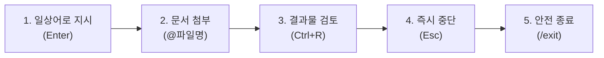
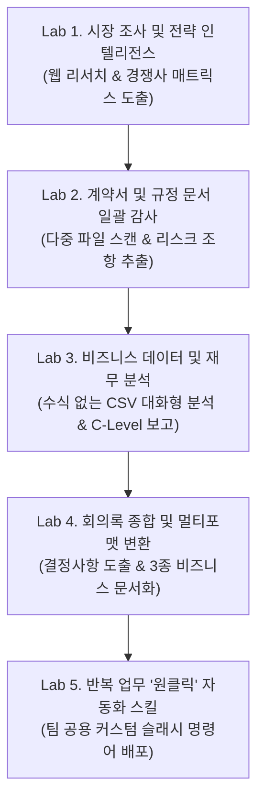
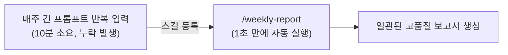

# Antigravity CLI 비즈니스 실무 활용 핸즈온 가이드 (agy_biz)

본 문서는 코딩이나 개발 지식이 없는 **비즈니스 기획자, 마케터, 운영/재무 분석가, 프로젝트 관리자(PM)** 가 **Antigravity CLI(`agy`)** 를 활용하여 복잡하고 반복적인 비즈니스 업무를 손쉽고 빠르게 자동화할 수 있도록 돕는 실습 중심 핸즈온 가이드입니다.

> [!NOTE]
> **검은 터미널 화면이 낯설어도 걱정하지 마세요.**
> Antigravity CLI는 복잡한 명령어를 외울 필요가 없습니다. 카카오톡이나 슬랙에서 비서에게 말을 걸듯 **일상적인 자연어(한국어/영어)** 로 지시하면 AI가 내 컴퓨터의 폴더와 파일들을 직접 분석하고 보고서를 작성해 줍니다.

---

## 1. 비즈니스 사용자를 위한 3분 멘탈 모델 (Zero-Anxiety Onboarding)

비즈니스 사용자가 터미널 환경을 두려워하지 않고 안심하고 사용할 수 있는 3가지 안전 가드레일과 기본 사용법을 소개합니다.

### 1-1. 안심할 수 있는 3가지 이유

1. **허락 없는 파괴적 변경은 없습니다 (안전 가드레일)**:
   - AI가 마음대로 파일을 삭제하거나 중요한 시스템 설정을 변경하지 않습니다.
   - 코드 실행이나 파일 생성이 필요할 때는 화면에 승인 요청 창(`Y/N`)이 표시됩니다.
2. **모든 산출물은 눈으로 직접 확인 후 승인합니다 (`Artifact Review`)**:
   - AI가 작성한 보고서나 결과물은 `Ctrl + R`을 눌러 원문과 변경 사항(Diff)을 한눈에 검토하고 마음에 들 때만 저장할 수 있습니다.
3. **언제든 즉시 멈출 수 있습니다 (비상 정지 버튼)**:
   - AI가 원치 않는 방향으로 답변하고 있다면 키보드의 `Esc` 키를 한 번 누르면 그 즉시 작업이 중단됩니다.
   - 작업을 끝내고 싶을 때는 `/exit`을 입력하거나 `Ctrl + D`를 누르면 안전하게 종료됩니다.

### 1-2. 비즈니스 실무자가 꼭 알아야 할 5가지 조작법



| 기능                 | 조작 방법                    | 실무 활용 예시                            |
| :------------------- | :--------------------------- | :---------------------------------------- |
| **지시 및 실행**     | 프롬프트 입력 후 `Enter`     | `경쟁사 3곳의 가격 정책을 비교해줘`       |
| **로컬 파일 첨부**   | `@` 입력 후 파일명 선택      | `@sales_q3.csv 에서 미달된 제품 찾아줘`   |
| **결과물 검토/승인** | `Ctrl + R` (Artifact Review) | 작성된 마크다운 보고서 확인 후 `y`로 승인 |
| **작업 즉시 중단**   | `Esc`                        | 엉뚱한 방향으로 조사할 때 즉시 정지       |
| **세션 종료**        | `/exit` 또는 `Ctrl + D`      | 오늘의 작업을 마치고 터미널 닫기          |

---

## 2. 실습 워크스페이스 준비

실습을 위해 깨끗한 전용 비즈니스 폴더를 만들고 Antigravity CLI 세션을 시작합니다.

> 📍 **실행 위치: 🖥️ 터미널 (일반 bash/zsh 셸)**

```bash
# 1. 비즈니스 실습용 폴더 생성 및 이동
mkdir -p ~/agy-business-lab && cd ~/agy-business-lab

# 2. Antigravity CLI 실행
agy
```

정상적으로 실행되면 아래와 같은 대화형 TUI 프롬프트가 나타납니다:

```text
? for help, / for commands, @ for files/symbols, ! for bash
>
```

> 📍 **문서 표기 안내**:
>
> - `🖥️ 터미널`: 일반 셸 명령어입니다. 터미널 창에 그대로 복사하여 붙여넣습니다.
> - `🤖 Antigravity 대화창`: `agy`가 실행 중인 상태에서 프롬프트(`> `)에 입력하는 자연어 지시문입니다.

---

## 3. 핵심 비즈니스 Use Cases 5단계 핸즈온 실습



---

### Lab 1: 시장 조사 및 전략 인텔리전스 (Market Intelligence)

**비즈니스 목표**: 신규 진입 시장의 경쟁사 3곳을 웹 검색을 통해 조사하고, 가격 정책·핵심 가치·차별점 포지셔닝 매트릭스를 작성하여 `competitor_matrix.md` 파일로 저장합니다.

#### 1단계: 시장 조사 프롬프트 입력

> 📍 **실행 위치: 🤖 Antigravity 대화창**

```text
글로벌 엔터프라이즈 생성형 AI 생산성 도구 시장의 주요 경쟁사 3곳(예: Microsoft 365 Copilot, Google Workspace with Gemini, Notion AI)을 웹에서 최신 정보로 조사해줘.
다음 항목을 반드시 포함한 비교 분석표를 작성하고, competitor_matrix.md 파일로 저장해줘:
1. 주요 타깃 고객층
2. 월/연간 라이선스 가격 정책
3. 차별화된 핵심 기능(USP)
4. 사용자들이 지적하는 주요 한계점 및 단점
5. 우리 팀이 벤치마킹할 수 있는 전략적 시사점
```

#### 2단계: AI의 자율 조사 과정 확인

- AI가 웹 검색 도구(`google_search`)를 호출하여 각 기업의 공식 요금제 및 제품 페이지를 실시간으로 탐색하는 과정이 화면에 표시됩니다.
- 복잡한 검색 키워드를 알아서 다각도로 변경하며 최신 정보를 취합합니다.

#### 3단계: 결과물 검토 및 승인

- 생성이 완료되면 `Ctrl + R`을 눌러 **Artifact Review** 창을 엽니다.
- 생성된 `competitor_matrix.md`의 내용과 표 레이아웃을 확인합니다.
- 키보드의 `y`를 눌러 생성을 승인하고, `Esc`를 눌러 다시 대화창으로 돌아옵니다.

#### 4단계: 추가 요구사항 반영 (대화형 피드백)

> 📍 **실행 위치: 🤖 Antigravity 대화창**

```text
작성된 competitor_matrix.md의 맨 위에 경영진 보고를 위한 '3줄 핵심 요약(Executive Takeaways)'을 추가해줘.
```

✅ **완료 확인**:

- 파일 브라우저나 터미널에서 `cat competitor_matrix.md`를 입력하여 깔끔한 마크다운 비교표와 요약문이 완성되었는지 확인합니다.

---

### Lab 2: 계약서 및 규정 문서 일괄 감사 (Document Auditing)

**비즈니스 목표**: 여러 건의 계약서/협약서 텍스트 파일을 한 번에 스캔하여, 법적 독소 조항(비정상적인 손해배상 한도, 불리한 관할 법원, 짧은 해지 통보 기간 등)을 탐지하고 리스크 감사 보고서를 생성합니다.

#### 1단계: 실습용 샘플 계약서 3건 생성

실습을 위해 3개의 샘플 계약서 파일을 만듭니다.

> 📍 **실행 위치: 🖥️ 터미널 (새 탭 또는 agy 세션 내 `!mkdir ...`)**
>
> _팁: `agy` 프롬프트 맨 앞에 느낌표(`!`)를 붙이면 CLI를 끄지 않고도 터미널 명령을 실행할 수 있습니다._

```bash
mkdir -p contracts

cat << 'EOF' > contracts/vendor_a_nda.txt
[상호 비밀유지계약서 - Vendor A]
제1조 (목적) 본 계약은 양사 간의 신규 클라우드 솔루션 검토를 위한 비밀정보 보호를 목적으로 한다.
제5조 (비밀유지 기간) 본 계약 체결일로부터 3년간 유효하다.
제8조 (손해배상) 일방 당사자의 고의 또는 중과실로 비밀정보가 누출된 경우, 직접적인 통상손해에 한하여 배상 책임을 진다. (배상 한도: 최근 12개월간 지급된 총 대금)
제10조 (관할 법원) 서울중앙지방법원을 전속 관할로 한다.
EOF

cat << 'EOF' > contracts/vendor_b_service.txt
[클라우드 서비스 이용약관 - Vendor B]
제3조 (서비스 제공 및 중단) 공급사는 사전 통지 없이 유지보수를 위해 언제든 서비스를 일시 중단할 수 있다.
제7조 (계약 해지) 이용자는 7일 전 서면 통지로 해지할 수 있으나, 이미 납부된 선급금은 일체 환불되지 않는다.
제12조 (책임의 제한) 공급사의 고의적 과실을 포함하여 어떠한 경우에도 공급사의 배상 책임은 총 100달러를 초과하지 않는다.
제15조 (준거법 및 분쟁) 모든 분쟁은 미국 델라웨어주 법률에 따르며 미국 관할 법원에서 해결한다.
EOF

cat << 'EOF' > contracts/vendor_c_sla.txt
[서비스 레벨 협약서(SLA) - Vendor C]
제2조 (가용성 보장) 월간 가용률 99.9%를 보장한다.
제4조 (장애 보상) 가용률 미달 시 익월 청구 금액의 10%를 크레딧으로 보상한다.
제6조 (계약 해지 통보) 계약 갱신 거절 또는 해지 시 상대방에게 최소 60일 전 서면 통보하여야 한다.
제9조 (손해배상 상한) 손해배상 청구는 어떠한 경우에도 직전 3개월 서비스 이용료 총액을 초과할 수 없다.
EOF
```

#### 2단계: 다중 문서 감사 프롬프트 지시

> 📍 **실행 위치: 🤖 Antigravity 대화창**

```text
@contracts 폴더 내의 모든 계약서 파일들을 전수 조사해줘.
우리 회사(고객사) 입장에서 불리하거나 주의해야 할 위험 요소를 분석하여 contract_audit.md 보고서로 만들어줘.

보고서에는 다음 표가 반드시 포함되어야 해:
1. 계약서명 | 위험 등급 (🔴High / 🟡Medium / 🟢Low) | 주요 위험 조항 및 내용 | 권장 수정안
2. 특히 손해배상 한도, 해지 조건, 관할 법원/준거법 조항을 집중 검토할 것.
3. 마지막에 협상 시 즉시 수정 요청해야 할 Top 3 체크리스트를 정리해줘.
```

#### 3단계: 감사 결과 확인 및 승인

- AI가 3개 파일을 차례대로 읽고(`read_file`), 각 조항을 대조 분석합니다.
- `Ctrl + R`을 눌러 `contract_audit.md`를 열고 Vendor B의 환불 불가 조항 및 극단적 책임 제한($100) 조항이 🔴High 위험으로 정확히 분류되었는지 확인한 뒤 승인(`y`)합니다.

✅ **완료 확인**:

- 수작업으로 수십 장을 읽지 않고도 10초 만에 위험 조항 식별 매트릭스가 도출되었습니다.

---

### Lab 3: 비즈니스 데이터 및 재무 분석 (Financial & Business Data Analysis)

**비즈니스 목표**: 복잡한 엑셀 수식(VLOOKUP, 피벗 테이블)이나 파이썬 코드 작성 없이, 대용량 분기 실적 CSV 파일을 자연어로 탐색하여 실적 부진의 근본 원인을 파악하고 경영진용 브리핑 메모를 작성합니다.

#### 1단계: 실습용 3분기 실적 CSV 데이터 생성

> 📍 **실행 위치: 🖥️ 터미널 (또는 agy 프롬프트에서 `!cat ...`)**

```bash
cat << 'EOF' > sales_q3.csv
Region,Product_Line,Sales_Rep,Target_USD,Actual_USD,Discount_Rate,Deals_Closed
APAC,Enterprise Suite,Alice,500000,530000,0.08,12
APAC,Cloud Storage,Bob,300000,210000,0.25,5
APAC,Security Addon,Charlie,150000,165000,0.05,18
EMEA,Enterprise Suite,David,600000,420000,0.30,7
EMEA,Cloud Storage,Emma,350000,380000,0.10,14
EMEA,Security Addon,Frank,200000,190000,0.12,11
NA,Enterprise Suite,Grace,800000,860000,0.07,20
NA,Cloud Storage,Henry,450000,310000,0.28,8
NA,Security Addon,Ivy,250000,270000,0.06,22
EOF
```

#### 2단계: 대화형 데이터 질의 및 교차 분석

> 📍 **실행 위치: 🤖 Antigravity 대화창**

```text
@sales_q3.csv 데이터를 분석해줘.
1. 목표(Target_USD) 대비 달성률(Actual/Target)이 80% 미만으로 크게 미달한 제품 라인과 담당자를 찾아줘.
2. 달성률 부진과 할인율(Discount_Rate) 또는 계약 체결 건수(Deals_Closed) 사이에 어떤 패턴이나 상관관계가 있는지 분석해줘.
3. 이를 바탕으로 4분기 매출 회복을 위해 영업본부장이 취해야 할 구체적인 조치 3가지를 도출해서 q3_sales_briefing.md 로 작성해줘.
```

#### 3단계: AI의 데이터 추론 분석 확인

- AI가 CSV 데이터를 파싱하여 지역별/제품군별 달성률을 즉각 계산합니다.
- _발견점_: Cloud Storage 제품군(Bob, Henry)과 EMEA의 Enterprise Suite(David)가 높은 할인율(25~30%)을 적용했음에도 계약 건수가 저조하여 실적이 크게 미달했다는 인사이트를 스스로 도출합니다.

#### 4단계: C-Level 보고용 원페이지 요약문 저장

- `Ctrl + R`로 `q3_sales_briefing.md` 내용을 확인하고 `y`를 눌러 저장합니다.

> [!TIP]
> **엔터프라이즈 데이터베이스(BigQuery / Cloud SQL) 연동**:
> 만약 사내 데이터가 CSV가 아니라 BigQuery나 Looker에 보관되어 있다면, Antigravity의 **MCP(Model Context Protocol)** 기능을 통해 연결할 수 있습니다. 사용자는 SQL 쿼리 문법을 몰라도 _"지난달 아시아 지역 이탈 고객 수 추이를 BigQuery에서 조회해줘"_ 라고 일상어로 지시하면 AI가 필요한 쿼리를 실행해 결과를 가져옵니다.

✅ **완료 확인**:

- 엑셀 피벗 테이블 조작 없이 자연어 질의만으로 숨겨진 비즈니스 인사이트가 담긴 보고서가 생성되었습니다.

---

### Lab 4: 회의록 종합 분석 및 멀티포맷 변환 (Meeting Productivity)

**비즈니스 목표**: 1시간 넘게 진행된 신규 프로젝트 킥오프 회의 녹취록에서 미결 안건과 액션 아이템(담당자, 기한)을 정확히 발췌하고, 이를 대상에 맞추어 3가지 비즈니스 문서(경영진 1장 보고서, 고객용 후속 메일, 전사 발표 슬라이드 개요)로 한 번에 변환합니다.

#### 1단계: 실습용 회의 녹취록 생성

> 📍 **실행 위치: 🖥️ 터미널 (또는 agy 프롬프트에서 `!cat ...`)**

```bash
cat << 'EOF' > meeting_transcript.txt
[2026-10-05 신규 결제 솔루션 킥오프 회의 녹취록]
참석자: 김철수(PM), 박지민(개발팀장), 이수진(마케팅팀장), 최영호(고객사 담당자)

김철수(PM): 오늘 안건은 11월 론칭 예정인 차세대 간편결제 시스템 연동 스케줄 및 마케팅 일정 조율입니다.
박지민(개발): PG사 연동 API 테스트는 10월 20일까지 마무리 가능합니다. 다만 보안 심사 일정이 10월 25일까지 잡혀 있어서, 실제 스테이징 배포는 10월 28일에 가능합니다.
최영호(고객사): 저희 측 가맹점 테스트를 하려면 최소 5일이 필요합니다. 10월 28일 배포라면 11월 2일까지 가맹점 검증을 끝내겠습니다. 론칭일을 11월 5일로 맞추면 무리가 없을까요?
이수진(마케팅): 11월 5일 론칭에 맞춰 얼리버드 수수료 0% 프로모션을 준비하겠습니다. 단, 홍보 배너 제작을 위해 개발팀에서 10월 15일까지 연동 화면 UI 스크린샷 3장을 전달해주셔야 합니다.
박지민(개발): 네, UI 초안 캡처는 10월 15일 퇴근 전까지 마케팅팀에 슬랙으로 전달하겠습니다.
김철수(PM): 좋습니다. 그럼 전체 론칭일을 11월 5일(목)로 최종 확정하고, 저는 다음 주 월요일까지 경영진 보고용 통합 마일스톤 문서를 작성하겠습니다.
최영호(고객사): 저희 대표님께도 오늘 회의 결과를 요약해서 메일로 공유해 주시면 감사하겠습니다.
EOF
```

#### 2단계: 액션 아이템 추출 및 다중 문서 생성 지시

> 📍 **실행 위치: 🤖 Antigravity 대화창**

```text
@meeting_transcript.txt 회의록을 분석해서 각 이해관계자별로 필요한 3가지 맞춤 문서를 한 번에 작성해줘:

1. exec_summary_1page.md:
   - 경영진 보고용 1페이지 요약 (프로젝트명, 론칭 확정일, 핵심 마일스톤 일정표, 주요 리스크)
2. client_followup_email.txt:
   - 최영호 담당자 및 고객사 대표에게 보낼 정중하고 격식 있는 후속 보고 이메일 초안
3. slide_deck_outline.md:
   - 전사 주간 공유 미팅에서 발표할 5장 분량의 슬라이드 개요 (각 슬라이드별 제목과 핵심 불릿포인트)

모든 문서에서 담당자(R&R)와 마감 기한(Due Date)이 누락되지 않도록 명확히 정리해줘.
```

#### 3단계: 결과물 일괄 검토 및 승인

- AI가 녹취록의 발언자별 대화를 파악하여 마일스톤과 액션 아이템을 추출합니다.
- `Ctrl + R`을 누른 후 대문자 `A`를 누르면 생성된 3개 파일이 한 번에 일괄 승인됩니다.

✅ **완료 확인**:

- 회의 한 번으로 파생되는 3가지 문서 작업(보고서, 이메일, 슬라이드)이 30초 만에 완벽히 분리 작성되었습니다.

---

### Lab 5: 반복 업무 '원클릭' 자동화: 비즈니스 스킬 (Custom Business Skills)

**비즈니스 목표**: 매주 또는 매월 반복되는 주간 업무 보고 작성을 매번 길게 프롬프트로 쓸 필요 없이, 슬래시 명령어 `/weekly-report` 하나만 치면 자동으로 로컬 파일들을 종합하여 표준 템플릿 보고서를 작성하는 **나만의 팀 비서 스킬**을 구축합니다.

#### 1단계: 비즈니스 스킬(Skill)이란?

Antigravity에서 **스킬(Skill)** 이란 복잡한 업무 지시서를 하나의 마크다운 파일로 저장해 두고, 채팅창에서 `/스킬이름`으로 즉시 불러내어 실행하는 템플릿 기능입니다.



#### 2단계: 스킬 디렉터리 및 스킬 파일 생성

> 📍 **실행 위치: 🖥️ 터미널 (또는 agy 프롬프트에서 `!mkdir ...`)**

```bash
# 워크스페이스 내 스킬 저장 폴더 생성
mkdir -p .agents/skills

# 주간 보고서 생성 스킬 파일 작성
cat << 'EOF' > .agents/skills/weekly-report.md
---
name: weekly-report
description: 현재 폴더의 작업 산출물과 회의록을 바탕으로 표준 주간 업무 보고서를 작성합니다.
---

당신은 전문 프로젝트 관리 사무국(PMO) 리드입니다. 현재 작업 공간의 파일들(보고서, 회의록, 데이터 등)을 분석하여 이번 주 주간 업무 보고서를 작성하십시오.

### 작성 규칙:
1. 파일명: `weekly_status_report.md` 로 저장할 것.
2. 보고서 구성:
   - **1. 주간 하이라이트 (Top 3)**: 이번 주 가장 중요한 성과 3가지
   - **2. 부서별 진행 현황**: 기획 / 개발 / 마케팅 / 영업 별 진척률
   - **3. 주요 지표(KPI) 달성 요약**: 수치 데이터 기반 성과 요약
   - **4. 차주 계획 및 리스크 요인**: 다음 주 마감 예정 작업 및 주의 사항
3. 모든 항목은 간결하고 명확한 개조식(Bullet points)으로 서술하십시오.
EOF
```

#### 3단계: 스킬 등록 확인

> 📍 **실행 위치: 🤖 Antigravity 대화창**

```text
/skills
```

- 화면에 방금 등록한 `weekly-report`가 목록에 정상적으로 로드되었는지 확인합니다.

#### 4단계: '원클릭' 슬래시 명령어 실행

> 📍 **실행 위치: 🤖 Antigravity 대화창**

```text
/weekly-report
```

- 긴 프롬프트를 일일이 작성할 필요 없이, 단 한 줄의 명령어로 AI가 앞서 실습한 `competitor_matrix.md`, `contract_audit.md`, `sales_q3.csv`, `meeting_transcript.txt`를 모두 스스로 훑어보고 종합 주간 보고서 `weekly_status_report.md`를 깔끔하게 완성합니다.
- `Ctrl + R`로 확인 후 `y`로 승인합니다.

✅ **완료 확인**:

- 반복적인 정기 보고 업무가 완벽하게 단축되었습니다. 팀원들에게 이 `.agents/skills` 폴더만 공유하면 누구나 동일한 품질의 보고서를 1초 만에 만들 수 있습니다.

---

## 4. 실습 완료 후 정리 (Clean-up)

모든 실습을 마친 후 Antigravity CLI 세션을 정상 종료합니다.

> 📍 **실행 위치: 🤖 Antigravity 대화창**

```text
/exit
```

_(또는 키보드에서 `Ctrl + D`를 누릅니다)_

생성된 산출물들을 확인해 봅니다:

> 📍 **실행 위치: 🖥️ 터미널**

```bash
ls -lh *.md *.csv *.txt
```

---

## 5. 비즈니스 사용자를 위한 1페이지 치트시트 & FAQ

### 5-1. 필수 단축키 치트시트

| 단축키                  | 이름                    | 사용 목적                                     |
| :---------------------- | :---------------------- | :-------------------------------------------- |
| `Enter`                 | 제출 (Submit)           | 작성한 프롬프트 지시 전달                     |
| `Shift + Enter`         | 줄바꿈 (Newline)        | 프롬프트를 여러 줄로 나누어 보기 좋게 작성    |
| `@`                     | 파일 멘션 (Attach)      | 분석할 로컬 파일이나 폴더를 직접 지정         |
| `Ctrl + R`              | 아티팩트 리뷰 (Review)  | AI가 생성/수정한 파일 확인 창 열기            |
| `y` / `n`               | 승인 / 거절             | 검토 창에서 변경 사항 승인 또는 취소          |
| `A`                     | 전체 승인 (Approve All) | 생성된 여러 파일을 한꺼번에 승인              |
| `Esc`                   | 비상 정지 (Stop)        | AI가 엉뚱한 답변을 하거나 길어질 때 즉시 중단 |
| `Ctrl + D` 또는 `/exit` | 안전 종료 (Exit)        | Antigravity CLI 세션 종료                     |

### 5-2. 비즈니스 사용자가 자주 묻는 질문 (FAQ)

**Q1. AI가 작성한 결과물이 마음에 들지 않으면 어떻게 하나요?**

> AI에게 추가 지시를 내리면 됩니다. 예를 들어 `“표 형식 대신 3줄 요약 불릿 포인트로 다시 정리해줘”` 또는 `“용어가 너무 어려워. 고등학생도 이해할 수 있는 비즈니스 쉬운 말로 바꿔줘”`라고 후속 지시를 하면 즉시 수정본을 작성합니다.

**Q2. 회사 기밀 문서나 고객 개인정보가 외부에 유출되지 않나요?**

> Antigravity CLI는 기본적으로 엔터프라이즈 보안 및 샌드박스 격리 정책을 따릅니다. 사용자의 로컬 환경 내에서 안전하게 구동되며, 공개 웹에 복사/붙여넣기하는 방식보다 훨씬 안전합니다. 또한 중요한 시스템 파일 수정이나 외부 명령 실행 시 반드시 사용자 승인을 거치므로 안심하고 사용할 수 있습니다.

**Q3. 엑셀 파일(.xlsx)이나 파워포인트 파일(.pptx)도 분석할 수 있나요?**

> 네, 텍스트 기반 데이터(CSV, Markdown, TXT, JSON)는 물론, 문서 변환 스크립트나 MCP 도구를 통해 PDF, Excel 데이터 시트를 직접 읽고 분석할 수 있습니다. 가장 빠르고 정확한 분석을 원하신다면 엑셀 문서를 `CSV` 형식으로 다른 이름으로 저장한 뒤 `@파일명.csv`로 지정하는 것을 추천합니다.

**Q4. 팀원들과 이 자동화 설정을 함께 쓰고 싶어요.**

> 프로젝트 폴더 내의 `.agents/skills/` 디렉터리에 팀 공용 마크다운 스킬 파일들을 넣어두고, 해당 폴더를 공유(Git 저장소, 공유 드라이브 등)하면 팀원 모두가 동일한 슬래시 명령어(`/weekly-report`, `/contract-audit` 등)를 즉시 사용할 수 있습니다.
